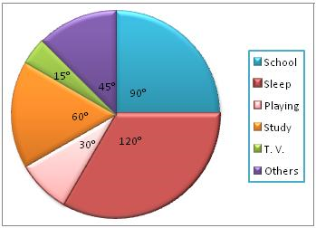

## Pie Charts

* ### Definition - 

  Sectors represent data, and these sectors form a circle.

<!-- end list -->

- ### Angle of a sector:

$$\theta = \ \frac{\text{Number of an item}}{\text{Total number of items}}\  \times 360^{{^\circ}}$$

- Sum of angles in a pie chart is $360^{{^\circ}}$
- Calculate the angle for each sector representing a category, then use a protractor to draw the sectors within a circle