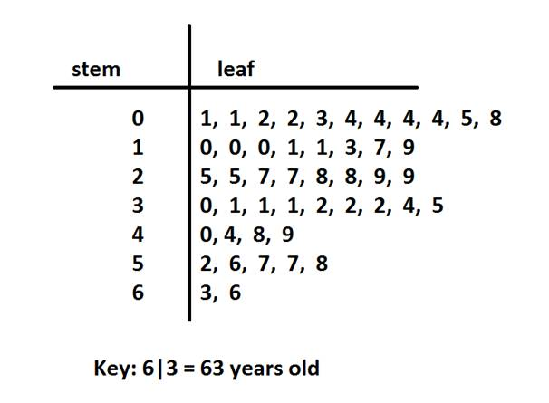

## Stem and Leaf diagrams

### Definition

- Stem-and-Leaf diagram is a quick way of summarizing a range of data.

- There is a column known as the stem, which contains unique
  elements of data formed by removing last digits of the data.

- Keys are used in this diagram

### Structure

* A key or legend is always included to show how to read the diagram.

**How to find the median of a Stem leaf diagram**

* First ensure the data is ordered from smallest to largest .

* Locate the middle value.

* If there's an odd number of data points, the median is the single middle value.

* If there's an even number of data points, the median is the average of the two middle values