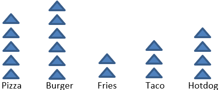

## Pictograms

- Data is represented in pictures

- A key is given to represent the value of a picture.

- There are no axes

- Frequency is represented by symbols

- A key shows value of 1 symbol

E.g. 
= 5 people

Favorite Fast Food of 100 Children