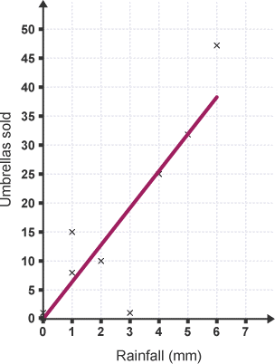

## Scatter Diagrams

- Displays the correlation between two sets of data

- May have positive, negative or no correlation

- Scatter graphs are used to plot pairs of data

- The vertical and horizontal axes represent the two quantities being measured

- Points are plotted as crosses, ×

- The general shape formed by the points shows the type of correlation

  

- ### Correlation 

- **Positive**: Indicates a relationship between two variables where they tend to move in the same direction

- **Negative**:  An inverse relationship between two variables, meaning as one variable increases, the other decreases

- **No Correlation:** No derivable relationship between the two sets of data being plotted

- ### Line of Best Fit 

- Use a transparent ruler to visually estimate the trend of the data points

- Draw a straight line that represents that trend. 

- Aim for roughly the same number of data points above and below the line

