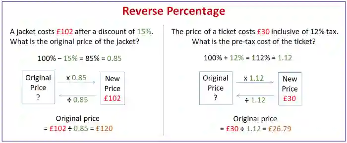

## Percentages

* Percentages are a method of showing the ratio between the number and the max out of 100
* To express one quantity as a percentage of another, divide the first quantity by the second, then multiply by 100.

$$
\frac{50}{200} \times 100 = 0.25 \times 100 = 25%
$$

* To find a percentage of a quantity, multiply the quantity by the percentage (as a decimal).

$$
15% \times 200 = \frac{15}{100} \times 200 = 0.15 \times 200 = 30
$$

* To calculate the percentage increase or decrease in a value, you can simply do:

  $$
  \text{Percentage Change} = \frac{\text{New Value} - \text{Original Value}}{\text{Original Value}} \times 100
  $$

  * If the result is positive, it’s a **percentage increase**.

  * If the result is negative, it’s a **percentage decrease.**

* **How to Increase/Decrease a number by a Percentage**

  $(\frac{100 \pm \text{percentage change}}{100}) \times \text{Original value}$

  * This formula is also used for Exponential growth (increase)  and decay (decrease)

### Simple Interest

* This is when a value is increased based on the initial start amount (Principal Amount)
* You can use this formula to calculate the interest amount (You need to add the principal amount again to find the final amount)

$$
\text{Simple Interest} = \frac{P \times R \times T}{100}
$$

$P = \text{Principal}, \quad R = \text{Rate}, \quad T = \text{Time}$

### Compound Interest

* Compound interest is when the interest is based on the latest value
* You can use this formula to calculate the interest amount

$\text{Compound Interest} = \text{Principal} \times (1 + \frac{\text{Rate}}{100})^{\text{Time}}$

### Reverse Percentage

$A = P(1 + \frac{r}{100})^t$

• $A$: final amount after time $t$

• $P$: initial principal or starting value

• $r$: percentage rate of change per period

• $t$: number of time periods

**Exponential Growth**

$A = P(1 + \frac{r}{100})^t$

• Used when the value increases each period (e.g., investments, population growth).

**Exponential Decay**

$A = P(1 - \frac{r}{100})^t$

• Used when the value decreases each period (e.g., depreciation, cooling, radioactive decay).

**In summary:**

• Growth → plus sign $(1 + \frac{r}{100})$

• Decay → minus sign $(1 - \frac{r}{100})$

**Example**

(a) The value of one car is 21000 USD. The value of this car decreases exponentially by 18% each year. Calculate the value of this car after 5 years. Give your answer correct to the nearest hundred dollars.

**Working:**

The formula for exponential decay is derived from the compound interest formula:

$A = P(1 - \frac{r}{100})^t$

Substitute values:

$A = 21000 \times (1 - \frac{18}{100})^5$

$A = 21000 \times (0.82)^5$

$A = 7785.54$

$A = 7785.54 \approx 7800$

Answer: The value of the car after 5 years is 7800 USD (nearest hundred dollars).

(b) The value, today, of the other car is 15000 USD. The value of this car increases exponentially by $x$% each year. After 12 years the value of the car will be 42190 USD. Calculate the value of $x$.

Working:

The formula for exponential growth is:

$A = P(1 + \frac{r}{100})^t$

Substitute values:

$42190 = 15000(1 + \frac{x}{100})^{12}$

Divide both sides by 15000:

$\frac{42190}{15000} = (1 + \frac{x}{100})^{12}$

$2.8127 = (1 + \frac{x}{100})^{12}$

Take the 12th root:

$\sqrt[12]{2.8127} = 1 + \frac{x}{100}$

$1.09 = 1 + \frac{x}{100}$

$0.09 = \frac{x}{100}$

$x = 9$

Answer: The annual growth rate is approximately 9%.