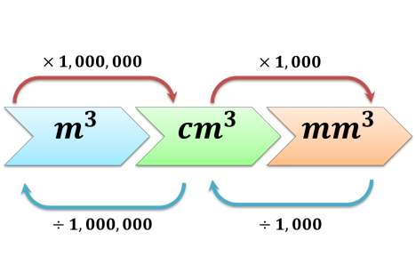
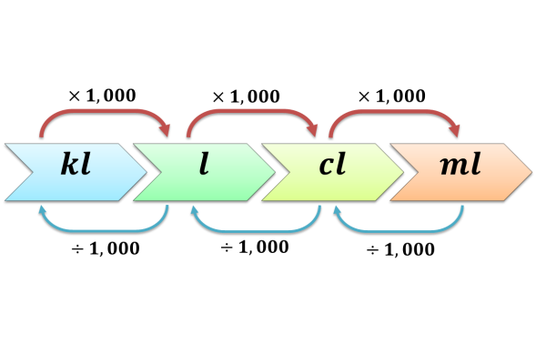
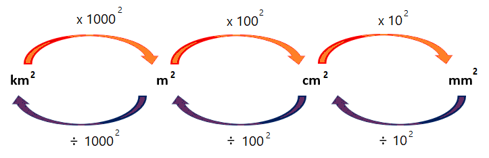
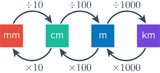

## Units

### **Volume**

### **Mass**

### **Capacity**

### Area

### Length

- **Connecting Volume and Capacity:**

  - $1ml = 1cm^{3}$

    Students should understand that:

  - $1 m^{3}$ = 1 m × 1 m × 1 m = 100 cm × 100 cm × 100 cm = $1 000 000 cm^{3}$

  - Thus, 1 cubic metre = 1,000,000 cubic centimetres.

- **Density** $= \frac{\text{Mass}}{\text{Volume}}$