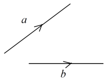

# Vectors & Transformations

## Vectors

* **Vector quantities** have both magnitude and direction

* Vectors a and b represented by the line segments can be added using the ‘parallelogram rule’ or ‘nose-to-tail method’

  

* Vectors are also written like $\overrightarrow{AB}$

### Scalar Quantities

* **Scalar Quantity:** has a magnitude but no direction

### Multiplication by a Scalar

* The negative sign reverses the direction of the vector

* For Eg, 3$ \begin{pmatrix} a \\\ b \end{pmatrix} = \begin{pmatrix} 3a \\\ 3b \end{pmatrix}$

### Column Vector

$$
\begin{pmatrix} x \\\ y \end{pmatrix}
$$

* Top number = Horizontal component
* Bottom number = Vertical component

### Parallel Vectors

* Vectors are parallel if they have the same direction
* In general, the vector $k \begin{pmatrix} a \\\ b \end{pmatrix}$ is
  parallel to $\begin{pmatrix} a \\\ b \end{pmatrix}$

### Magnitude of a Vector

* In general, if $\vec{x} = \begin{pmatrix} m \\\ n \end{pmatrix}$,
  \|$\vec{x}$\| $= \sqrt{(m^2 + n^2)}$

### Addition and Subtraction of Vectors

**Addition of Vectors**

* Add vectors using the tip-to-tail rule.
* The **resultant vector** goes from the start of the first to the end of the last.
* Can also add using the parallelogram method.
* $\vec{AB} + \vec{BC} = \vec{AC}$
* In component form:
  * $\begin{pmatrix} a_x \\\ a_y \end{pmatrix} + \begin{pmatrix} b_x \\\ b_y \end{pmatrix} = \begin{pmatrix} a_x + b_x \\\ a_y + b_y \end{pmatrix}$

**Subtraction of Vectors**

* To subtract, reverse the vector:

  $ \vec{A} - \vec{B} = \vec{A} + (-\vec{B})$

* $\vec{-B}$ has same length as $\vec{B}$ but opposite direction

* In component form:

  * $\begin{pmatrix} a_x \\\ a_y \end{pmatrix} - \begin{pmatrix} b_x \\\ b_y \end{pmatrix} = \begin{pmatrix} a_x - b_x \\\ a_y - b_y \end{pmatrix}$

### Position Vectors

* A position vector locates a point relative to an origin $O$.
* The position vector of $A$ is written as $\vec{OA}$
* In coordinates:
  * $\vec{OA} = \begin{pmatrix} x \\\ y \end{pmatrix}$
* To find a vector between two points:
  * $\vec{AB} = \vec{OB} - \vec{OA}$
* Position vectors can be added or subtracted like regular vectors

### Equal Vectors

* Two vectors are equal if they have the same magnitude and direction

### Parallel Vectors

* Two vectors are parallel if they have the same/opposite direction, but different magnitudes, and the same ratio of magnitude

### Collinear Vectors

* Vectors that lie along the same line or parallel lines. They can be parallel (pointing in the same direction) or anti-parallel (pointing in opposite directions)

### Gradient of a Vector

The gradient $m$ of a vector
$\vec{v} = \begin{pmatrix} x \\\ y \end{pmatrix}$
is given by
$m = \frac{y}{x}$.

If the vector represents a line joining two points $A(x_1, y_1)$ and $B(x_2, y_2)$, then
$\vec{AB} = \begin{pmatrix} x_2 - x_1 \\\ y_2 - y_1 \end{pmatrix}$ and
$m = \frac{y_2 - y_1}{x_2 - x_1}$.

### Negative Vectors

* Vectors that have the same magnitude (length) as its corresponding positive vector but points in the opposite direction