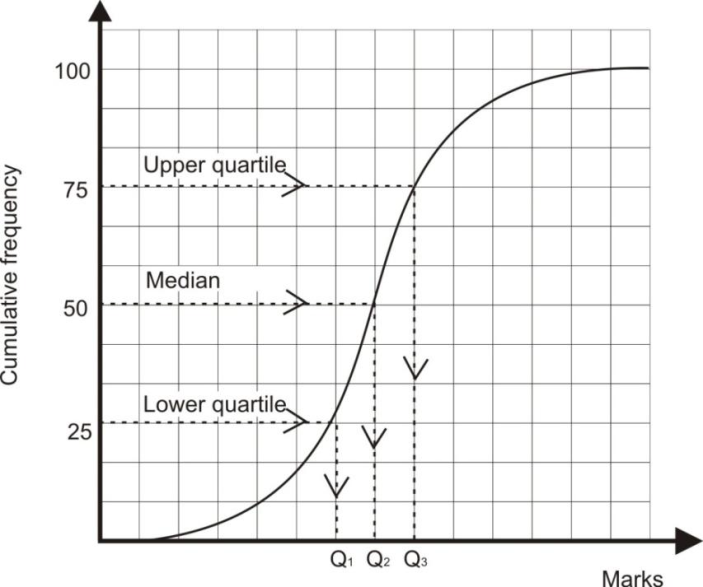
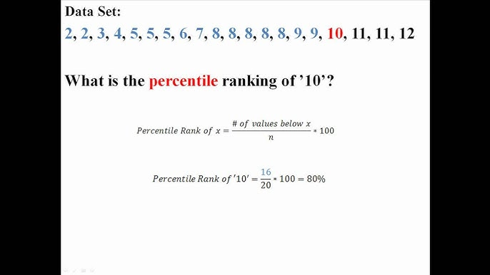

## Understanding Cumulative Frequency

- Cumulative frequency is the total frequency up to a given point

- Inter-quartile range $= upper\ quartile - lower\ quartile$

- Interpreting Cumulative Frequency Diagrams

* The cumulative frequency graph must always follow a sigmoid curve shape

* **Percentiles**

