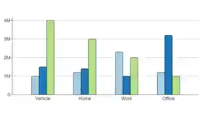

## Bar Charts

* Used to represent discrete data (data in separate categories).

* Each bar represents a category and its frequency (or value).

* Bars must be of equal width and equally spaced

**Key Features**

* Horizontal Axis shows categories

* Vertical axis shows frequency or measured value

* Height of Bar = Frequency

* Used when data is categorical and discrete

**Reading a Bar Chart**

* Look at the height of each bar

* Match it with the scale on the y-axis

* Compare bars to see the highest, lowest, or differences