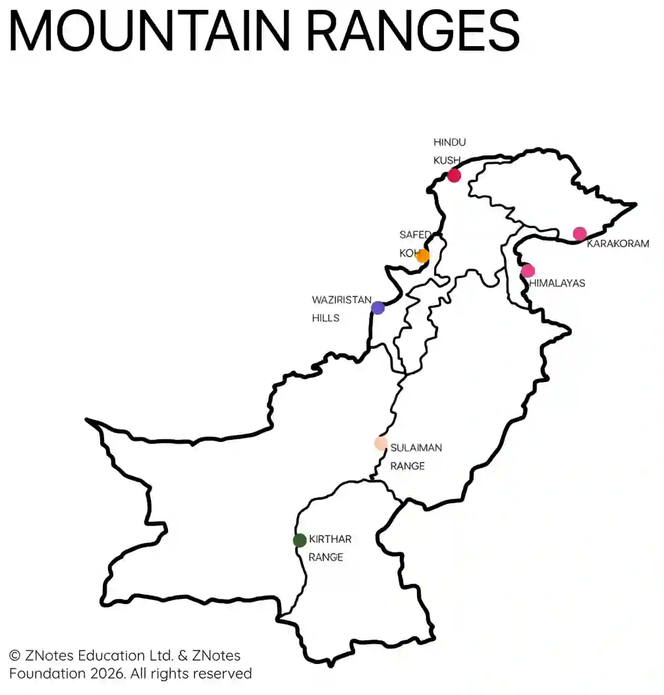
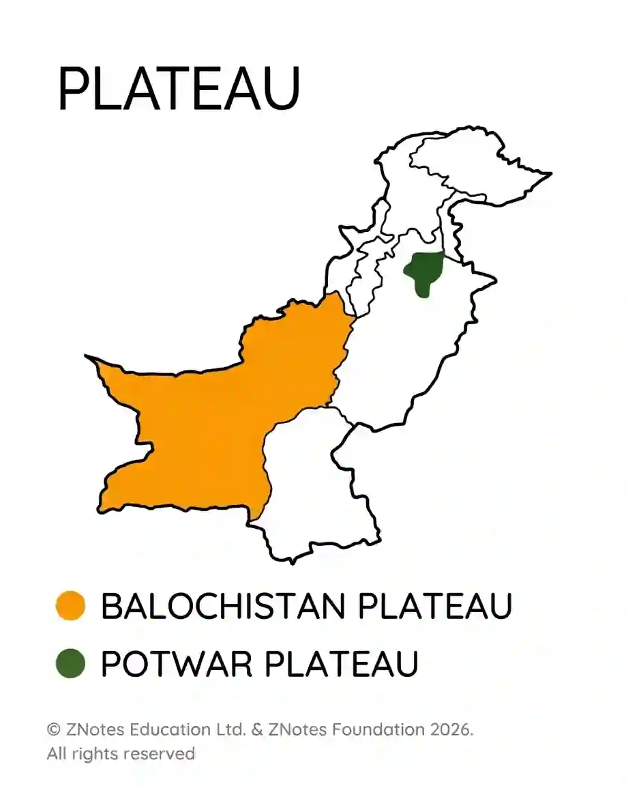
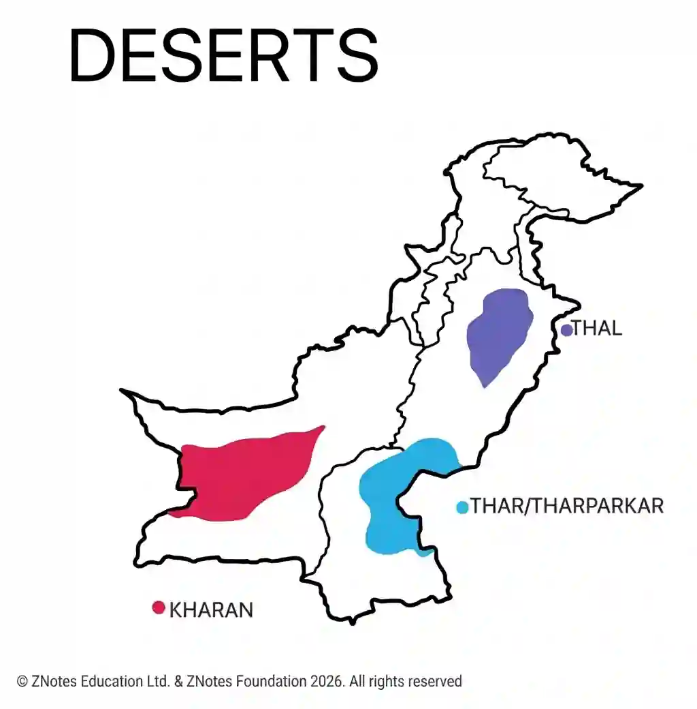
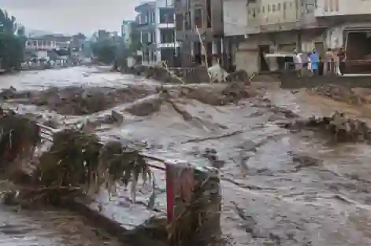
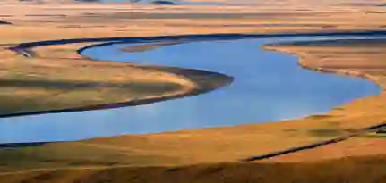

## The Natural Topography - Including drainage

* The Northern and North-Western Mountains.
* The Western Mountains.
* Balochistan Plateau.
* Potwar Plateau and Salt Range.
* The Indus plain.
* Deserts.

**Definitions**

* **Mountains:** High, rugged landmasses towering steeply above surrounding areas with narrow peaks and deep valleys (formed due to tectonic plate collisions, like the Himalayas and Karakoram).

* **Plateau:** Elevated, relatively flat tablelands that stand significantly higher than sea level, often bounded by steep slopes or cliffs (e.g., Potwar and Balochistan plateau).

* **Floodplains:** Low-lying, flat areas adjacent to rivers formed by the deposition of fertile silt (alluvium) during annual river floods (e.g., the Indus Plain).

* **Deserts:** Arid regions receiving extremely low annual precipitation, featuring sand dunes, rocky surfaces, and sparse vegetation due to high evaporation rates.

### Northern Mountains:

* Consists of 3 main mountain ranges:

  * Karakoram
  * Himalayas
  * Hindu Kush

* Harsh living conditions for people (forced into nomadic/semi-nomadic lifestyles.

* Low economic growth rate, high population growth and low level of per capita income.

* Cottage/small scale industries common sources of income during winter (embroidery, rugs, carpets and other handicraft productions).

* Presence of a few major industries such as vegetable oil production and sugar refineries.

  * Economic and human impact:

    * Steep mountain slopes force people into terraced farming.

    * Livestock rearing also took place because large-scale farming is impossible.

    * Building roads and railways through these rugged rocks is very expensive, which isolates the local economy from big city markets.

* **Karakoram**:

  * Average height of peaks is $6000$ m.
  * Ranges run in east-to-west direction.
  * Highest peak is K2 ($8610$ m).
  * Presence of glaciers common in peaks.
  * Nomadic/semi-nomadic way of life followed.
  * Agriculture prevalent in valleys with water (major products are apple, barley and millet).

* **Himalayas**:

  * The Himalayas consists of:
    * The Siwaliks ($600$m to$1200$m) located near Attock.
    * The Lesser or lower Himalayas ($1800$m to $4500$m) covering the area of Murree, Nathia Gali & Ghora Gali.
    * Central Himalayas ($5000$m to $8126$m) are located between Pir Panjal Range and Karakoram range. Nanga Parbat ($8126$m)  is the highest peak of this region.
  * Average height of peaks is $4000$ meters.
  * Ranges run in east-to-west direction.
  * Highest peak is Nanga Parbat ($8126$m).
  * Presence of popular hill stations (Murree, Ghora Gali, Nathia Gali).
  * Presence of glaciers common in the range.

* **Hindu Kush**:

  * Average height of peaks is $5000$m.
  * Ranges run north-south.
  * Highest peak is Tirich Mir ($7690$m).
  * Presence of glaciers in peaks.
  * Little to no vegetation, save for presence of a few green forests.
  * Rice cultivated on terraced fields in valleys.

* Drainage:

  * Drained by the River Indus and its tributaries.

  * Result in waterfalls, streams, springs and gorges (hard rocks left behind after erosion due to river’s flow).

  * Rivers run north-east to south-west.

### Western Mountains:

* Consist of ranges such as:

  * Safed Koh
  * Waziristan
  * Sulaiman and Kirthar

* Hard to provide infrastructure here due to location and rugged landscape.

* Little to no industrial development or projects.

* Nomadic lifestyle is followed.

  **Safed Koh Range:**

  * Present south of Kabul river.
  * Snow-covered peaks (hence the name, directly translating to ‘White Mountain’).
  * River Kurram flows through range (in south).
  * Kohat Valley present (wheat, rice, sugar cultivated there).

* **Waziristan** **Hills:**

  * Located between Kurram and Gomal rivers.
  * Area is rich in mineral.
  * Contains Bannu Valley (important towns and military centers present in Bannu).
  * Kurram Dam provides most irrigation water in these areas.

* **Sulaiman and Kirthar Range:**

  * Abundance of limestone and sandstone.
  * Two ranges meet in the south.
  * Average height of range is $1500$m.

### Balochistan Plateau:

* Located at the south west of Pakistan ranging altitudes from $600$m to around $3000$m.

* Consists of some irregular depressions (basins), mountain ranges and coastal areas.

* Scarcity of water due to lack of resources.

* Limited transportation systems.

* Crop farming/livestock main means of income for people.

* Presence of many mineral resources yet untapped.

### Karez:

* A traditional, underground tunnel irrigation system used in Balochistan.

* Its used because Because Balochistan has an arid climate with extreme heat.

* Open water channels would evaporate instantly.

* Underground tunnels protect the water from the sun.

* It flows from mountain springs down to the valley farms.

### Potwar Plateau:

* Located between River Indus and Jhelum.

* Consists of mainly flat land.

* Height about 300 m to 600 m.

* Rich in minerals (gypsum, limestone, coal).

* Presences of ridges, ravines, troughs and dissected/faulted land (due to erosion).

* Many oil and gas fields present here (Attock Oil Refinery being a prominent oil refinery).

* Rugged landscape leads to minimal farming but Wheat, Maize and Barley cultivated where possible.

* Accessible by road, rail and transport.

### Badland topography:

* Its Land that is heavily broken, fractured, and full of steep ridges, deep ravines, and gullies.

* It is caused by water and wind erosion on soft rocks over thousands of years.

* It makes the landscape look "dissected" or broken up.

* This is exactly why it is so difficult to farm or build roads there

### Salt Range:

* Presence of salt mines (e.g Khewra).

* Average height of ranges $750$ m to $900$ m.

* Rich in minerals (rocksalt, gypsum, limestone).

* Presence of lakes (Kallar Kahar, Khabeki).

### The Indus Plain:

* Consists of Upper Indus Plain, Lower Indus Plain and the Deltaic plain.

* River Indus and tributaries drain the Indus Plain.

* Extensive and well-developed canal irrigation present.

* Human settlements in uplands as they are safe from potential floods.

* Dense network of roads/rail allows for transport.

* Most areas supplied with electricity.

* Industries such as sugar mills, cotton textile and chemical also present.

* Very productive region due to relief and drainage patterns encouraging growth (such as through more agricultural production opportunities).

* Doabs (area between two rivers) are located between the rivers.

* Each doab comprises of:

  * Active Flood Plain
  * Old Flood Plain
  * Alluvial terraces (bars)
  * Scarps
  * Levees

|Doabs|Location|
|:---|:---|
|Sindh Sagar|Between Indus and Jehlum|
|Chaj|Between Jhelum and Chenab|
|Rachna|Between Chenab and Ravi|
|Bari|Between Ravi and Sutlej|

* **Active Flood Plain:**

  * It is the strip of land on both sides of rivers.

  * Results in alluvium deposition in channel due to the fast flowing rivers.

  * Oxbow Lakes and levees present in active flood plains.

  * Flooded almost all year hence ideal land for water-reliant crops to be grown (rice, sugar-cane, etc).

* **Old Flood Plains:**

  * Covered with old alluvium.

  * Flooded less frequently (after every $7$ to $8$ years due to heavy monsoon rainfall).

  * Ox-bow channel remains, meander scars and abandoned channels present in Old Flood Plains.

* **Scarps:**

  * These are steep slopes.

  * They separate the low Old Flood Plain from the higher Alluvial Terrace (Bar).

* **Levees:**

  * These are natural embankments/ridges.

  * They are built up along riverbanks by flood silt.

* **Alluvial terraces:**

  * Alluvial terraces are the areas higher than the ground between rivers, formed due to the deposition of old alluvium.
    * Sandal Bar on Rechna Doab.
    * Ganji Bar on Bari Doab.
    * Nili Bar on Bari & Kirana Doab.
    * There’s no bar on Sindh Sagar Doab.

### Transport, infrastructure and industrial impact

* **Influence of mountains and deserts on road and rail networks:**

  * Building transport links through rugged mountain topography (such as the Western Mountains or Salt Range) or shifting desert sands (such as Thal and Kharan) is exceptionally difficult and expensive.

  * Steep mountain gradients require costly engineering marvels like tunnels and switchbacks (e.g., the Karakoram Highway), while flash floods and landslides frequently wash away roads, bridges, and railway lines, cutting off industrial supply chains.

* **Worked Example (examining industry and transport links):** Suppose a severe monsoon rainstorm triggers a flash flood that washes away a bridge along the main railway line connecting up-country cotton farms to textile mills in Faisalabad. Because the transport link is broken, raw cotton cannot reach the factories on time. Consequently, industrial processing stalls, machinery sits idle, and finished textile exports are delayed at Karachi port, demonstrating how physical weather events directly damage the national economy.

  

* **How to identify rainstorms/damage:**

  * Washed out roads/collapsed bridges.

  * Could be seen near Indus Plain.

  * Caused usually by Monsoon rains (July-September) or glacial melts.

  * Stuff like Bridge destruction and crop loss can be seen.

* **Impact of Rainstorms and Floods on Industry:**

  * Heavy rainstorms and severe river floods cause widespread urban and industrial flooding, short-circuiting power grids and halting factory machinery.

  * Transport blockages prevent raw materials (such as cotton for textile mills or sugarcane for sugar refineries) from reaching factories, while finished goods cannot reach ports like Karachi or domestic markets, resulting in massive economic losses.

### The Desert Areas:

* Consist of Thal, Thar and Kharan deserts.

  * Thal located between River Indus and River Jhelum.
  * Thar is located in South-east Pakistan and comprises of:
    * Tharparkar
    * Nara
    * Cholistan
  * Kharan is located in Balochistan.

* Winds cause change in landscape.

* Contain rolling sand dunes, bare rocks, minimal vegetation and weathering (of the rocks).

* Lifestyle depends on current environment in the desert.

* Shortage of water prevents farming and other human activities or production.

* Most of Thar is now farmland thanks to canal irrigation from Sukkur Barrage.

* Presence of oil and gas fields in some areas (like Thar).

### Worked example

* Worked Example (identifying Topographical features):

  * If an exam photograph shows a flat, low-lying area next to a meandering river with intense farming of sugarcane and rice, you should identify it as a **floodplain** (specifically part of the Indus Plain), **not** a **plateau**.

  * This is because a plateau is an elevated tablelands with steep cliff-like edges, whereas floodplains are low, depositional flatlands formed by river silt.

    