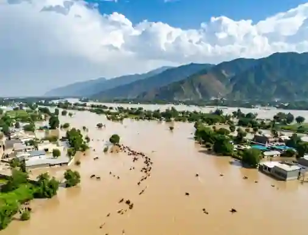
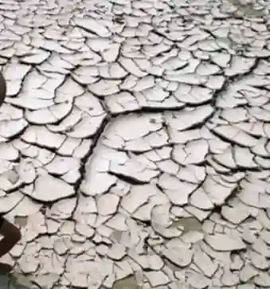
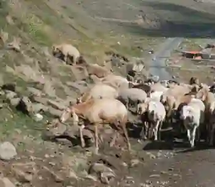

## Climate of Pakistan

### Climatic Zones:

* Pakistan experiences a continental type of climate characterized by extreme seasonal and daily temperature variations because it is far away from the moderating maritime influence of the ocean (except for the coastal strip).

  * **Highland climate**

  * **Lowland climate**

  * **Coastal climate**

  * **Arid climate**

* **Highland climate:**

  * Comprises the Northern, North-western and Western highlands.
  * Summers are short and moderate, whereas winters are lengthy, chilly, and snowy.
  * Rainfall varies with altitude, with the northern mountains having the highest amounts.
  * While in western mountains, rainfall is inadequate.
  * The altitude also affects temperature.
  * In the northern mountains, summers are brief, moderate, and rainy; in the western mountains, they are dry and warm.
  * Wintertime is not ideal for farming.
  * People engage in indoor handicrafts like pottery and carpet-making.
  * Herdsmen tend to keep goats and sheep.
  * Transhumance (the moving from highland to lowland regions in the winter and back again in the summer) is a common practice.
    * In **winter** Temperatures drop below freezing.

    * Heavy snow blankets the mountain pastures, making outdoor work and animal grazing impossible.

    * Herdsmen take their livestock and migrate downward into warmer valleys or lowlands.

    * During this time, they live in temporary shelters.

    * They earn money through indoor cottage industries (like weaving carpets or making handicrafts).

    * In **summer** The snow melts and temperatures rise.

    * Fresh grass begins to grow back on the mountain slopes (alpine pastures).

    * The herdsmen migrate back up the mountains with their animals to let them graze on the fresh vegetation.

    * They also practice small-scale terraced farming in the valleys.

* **Lowland Climate:**

  * Includes the whole Indus plain except coastal areas.
  * Controlled by distance from the sea and flat relief.
  * Scorching summers occur because heat gets trapped in the plains, while winters are chilly due to cold continental winds blowing down from the north
  * Arid and harsh climate, scorching summers, chilly winters.
  * The amount of rain varies from north to west.
  * The west experiences greater temperatures and less rainfall than the north.
  * It is well-known for agriculture because of the fertile plains and the Indus River and its tributaries.
  * Possess sophisticated canal systems.

* **Coastal Climate:**

  * Experienced in the southern coastal strip including Indus Delta, Karachi and the entire Makran coast.
  * Pakistan has about $1000$ km long coastal line of which about $750$ km are long with Baluchistan, while $250$ km long with Sindh.
  * The climate is dominated by sea breezes.
  * Most of the coastal areas experience the climate called **maritime** or moderate climate.
  * Summers are hot humid and long while winters are mild, humid and short.
  * Relative humidity is always higher due to the presence of sea.
  * It rains very low quantity in the coastal areas as the relative humidity in coastal areas is very high.
  * Fishery is main profession.
  * Mangroves are found here, they are the shelters, breeding ground, and supply food to fish and also provide wood to people.
  * Gwadar is in a rapid pace of development.

* **Arid Climate:**

  * Consists of the south-western Balochistan and the west-eastern desert.

  * The climate remains dry and hot with dusty winds prevailing during summer.

  * Lack of rainfall, hence aridity prevails there.

  * Thal, Kharan and Tharparkar experience arid climate.

  * Temperature goes into $40°$C to $50°$C during summers.

  * It comes down to $20°$C to $30°$C in winters.

  * Rate of evaporation is much higher than the rate of precipitation.

  * Days are very hot while nights are very cold.

  * Dust storms and wind storms are common.

  * Nomadic lifestyle is common, animal rearing is the main profession.

  * People wear thick course to protect themselves from extreme heat during day and very low temperature during night.

  * Agriculture is practiced on very small scale.

  * Only cactus types of plants are found here.

### Climatic Elements:

* **Temperature**:

  * Temperature is a degree of hotness or coldness that can be measured using a thermometer. Temperature is generally measured in degrees on Celsius scale.

* **Atmospheric Pressure**:

  * AP is the force per unit area exerted on a surface by the weight of air above that surface in the atmosphere of earth.

* **Humidity**

  * Humidity is the amount of water vapor in the air.

* **Precipitation**:

  * Precipitation is any liquid or frozen water that forms in the atmosphere and falls back to the earth. It comes in many forms, like rain, or snow.

* **Winds**:

  * Wind is air in motion.

  * It is produced by the uneven heating of the earth’s surface by the sun.

  * Since the earth’s surface is made of various land and water formations, it absorbs the sun’s radiation unevenly.

  * Two factors are necessary to specify wind:

    * Speed (how fast it travels)

    * Direction (the compass point it comes from)

### Causes of Rainfall & Seasonality:

* **Summer Monsoon Cause:**

  * In summer (June to September), the sun heats the landmass of Central Asia and Pakistan intensely. This extreme heat causes air to rise, creating a deep low-pressure zone over the land.

  * Meanwhile, the Indian Ocean and Arabian Sea are relatively cooler, creating a high-pressure zone. Winds naturally blow from high pressure to low pressure, sucking moisture-laden sea winds across Pakistan.

  * As these winds hit mountain barriers (like the Himalayas), they are forced to rise, cool down, condense, and drop heavy relief rainfall across the country.

* **Winter Monsoon Cause:**

  * In winter (December to March), the land cools down rapidly, becoming much colder than the surrounding seas.

  * This creates a high-pressure zone over the land, causing cold, dry winds to blow outward toward the warmer sea (offshore winds).

  * Because these winds originate over land and contain very little moisture, winter monsoon results in dry weather across most of the country.

* **The 4 Sources of Rain:**

  1. **Monsoons.**

  2. **Western Depressions**

     These are weather systems originating from the Mediterranean Sea that travel eastward across Iran and Afghanistan before entering western and northern Pakistan during winter. They bring crucial winter rain to the plains and heavy snowfall to the northern and western mountains, which feeds rivers and supports winter crops like wheat.

  3. **Convectional Currents**

     Occur in the pre-monsoon months (May and June) when intense land heating causes warm air to rise rapidly, forming towering cumulonimbus clouds. This results in sudden, localized thunderstorms, heavy downpours, and squalls, particularly in the northern and upper plain areas.

  4. **Tropical Cyclones**

     Form over the warm waters of the Arabian Sea during the transition periods between monsoons (May-June or October-November). When they hit Pakistan's southern coastal strip (Makran and Sindh coast), they bring destructive winds, torrential storm surges, and rare heavy coastal rainfall.

* **Day Length:**

  * **Influence of Latitude on Day Length**: Pakistan lies entirely in the Northern Hemisphere, spanning from approximately $23.5°$C to $36°$N.

    * Because of the Earth's tilted axis ($23.5°$C), locations further north experience greater variations in day length between seasons.

    * During summer, the Northern Hemisphere tilts toward the sun, causing the sun's rays to strike at a steeper angle for longer hours, resulting in extended daylight hours (longer days and intense sunshine).

    * Conversely, in winter, the hemisphere tilts away, causing shorter daylight hours and weaker solar radiation.

    * Overall when there is a lower latitude, there is more direct sun so it gets hotter. When there is a higher latitude there are longer summer days and shorter winter days. As per the climate, the Southern Pakistan is hotter than the Northern.

  * **Longitude**, on the other hand, determines local time zones rather than seasonal day length, though minor variations in sunrise and sunset times occur across Pakistan from east $76°$E to west $64°$E.

    * The Earth rotates $360$° in $24$ hours which is equals to $15$° per hour. Each $15$° of longitude is equal to $1$ hour time difference.

    * Everything is placed at different longitudes so everything has different local times.

  * **Examples**

    * Gilgit ($35$°N) has approximately $14.5$ hours of daylight in June.

    * Karachi ($24$°N) has approximately $13.5$ hours of daylight in June.

    * **Reason**: Higher latitude has more daylight variation.

### **Floods**:

* **Identify:**

  * Standing water over land and submerged houses can be seen.

  * Takes place in Punjab or Sindh plains.

  * Caused by river overflow mostly (after heavy monsoon).

  * Causes waterlogging, salinity risk and disease outbreak.

**Causes of Floods:**

* Melting of snow during winter.

* Heavy monsoon rainfall.

* Cutting of trees on the foothills increase surface run-off.

* Failure to strengthen or heighten embankments alongside rivers.

**Advantages:**

* Lots of alluvium flow boosts soil fertility.

* Increases hydroelectric power potential.

* Enhances irrigation for agriculture.

* Supports fish migration and breeding.

* Replenishes groundwater.

* Enriches land with nutrients.

* Promotes wetland health and expansion.

**Economic and human impact:**

* Heavy floods wash away transport networks (roads/railways).

* They destroy crucial cash crops like cotton and rice in the plains.

* They force textile mills and factories to halt operations (due to supply chain breaks).

### Drought:

* **Identify:**

  * Cracked dry earth and dead vegetation is usually seen.

  * Takes place in Thar, Cholistan or Balochistan.

  * Caused by low rainfall and high evaporation.

  * Causes Crop failure and livestock death.

* Prolonged period of abnormally low rainfall leading to a shortage of water.

* **Some ways of categorizing drought:**

  * Permanent Drought: Exists where crops can’t cultivate.

  * Seasonal Drought: It occurs in climates that have well-defined annual rainy and dry seasons.

  * Invisible Drought: It is result of a borderline water deficiency that diminishes crop yields
    Unpredictable Drought: It is an abnormal rainfall failure.

**Causes of Droughts:**

* Unreliability of monsoon winds.

* Global climate.

* Deforestation.

* Mismanagement of water resources.

* Disputed and unfair distribution of water.

**Economic & Human Impact:**

* Severe droughts dry up water reservoirs. This heavily reduces hydel power generation at the dams.

* The lack of electricity due to this triggers:

  * Massive industrial blackouts.

  * It shuts down machinery.

  * It also stalls the country's economic growth.

* **Impact of Low Temperatures, Ice, and Snow:**

  

* **Identify:**

  * Heavy snowfall and collapsed vehicles can be seen.

  * Happens in Murree or other northern areas.

  * Caused by winter snowfall.

  * Causes road closures and structural damage.

    * In winter, extreme sub-zero temperatures and heavy snow blankets block mountain passes (such as Lowari and Babusar), completely isolating remote mountain communities from urban centers.

    * Frozen ground halts all outdoor agricultural work, forcing villagers to rely entirely on stored food and indoor cottage industries like carpet-weaving.

    * Meltwater from glaciers in spring causes sudden flash floods that can wash away terraced fields and primitive infrastructure, adding constant seasonal risk to local livelihoods.

### Worked Example

* **Worked Example (understanding climate impacts):** Consider a livestock farmer living in the northern mountains of Pakistan (such as Chitral).

* Because winter temperatures drop well below freezing and heavy snow blankets the alpine pastures, the farmer cannot keep sheep and goats outside.

* Instead, they practice **transhumance** by migrating down to warmer river valleys in winter, living in temporary shelters, and weaving carpets indoors to earn money until the summer snow melts.

* **Identify:**

  * Herd grazing on vegetation can be seen.

  * Happens in Balochistan or northern areas.

  * Caused by transhumance.

  * Causes overgrazing and soil erosion.