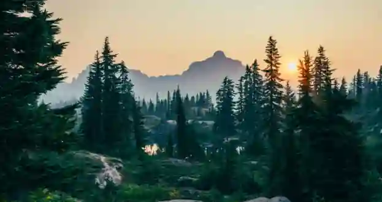
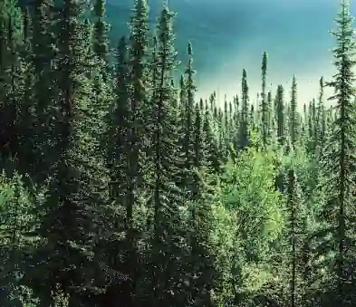
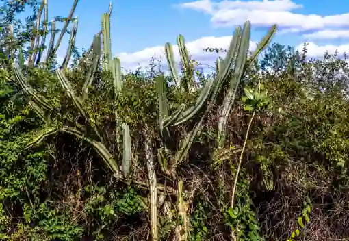
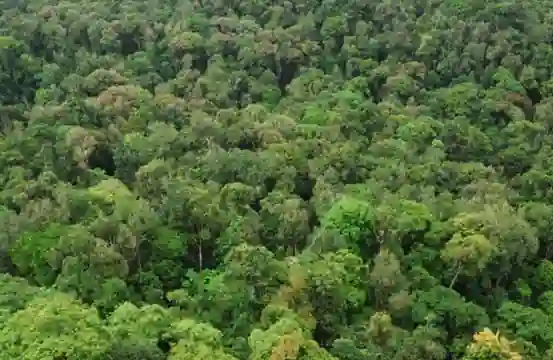
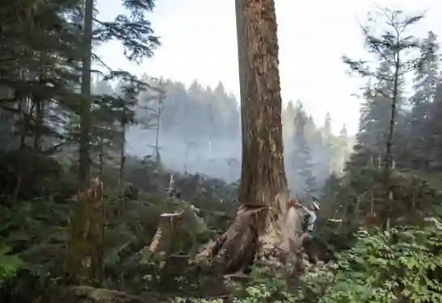

## Forest

### Forests and their importance

* Forests are continuous areas of land dominated by trees that provide vital environmental and economic benefits.

* **Environmental benefits** include producing oxygen, absorbing carbon dioxide, supporting nearly half of all known land biodiversity, preventing soil erosion and reducing flooding.

* **Economic benefits** include contributing to GDP and GNP, providing employment in forestry and wood-based industries, attracting tourism and supplying raw materials for timber, furniture, sports goods, transport, agriculture and paper industries.

* **Minor Forest Products:** Products include Mazri (used for baskets and packing material), resin (for varnishes), and ephedra (used in the pharmaceutical industry).

* **Determinants of forest growth:** Forest distribution is controlled by soil type (alluvial soil promotes better growth, while thin mountain soil leads to stunted growth), rainfall (high rainfall supports denser forests like conifers, while low rainfall limits vegetation to bushes), temperature and extreme weather and altitude.

### Altitudinal zones

* Above $4000$ meters: Alpine forests found only in northern Pakistan

* Between $1000$ and $4000$ meters: Coniferous forests found in northern and western mountains.

* Less than $1000$ meters: Sub-tropical, thorn and scrub forests, alongside coastal mangroves.

#|
||

**Forest Type**

|

**Main Locations**

|

**Map Label**

||
||

Alpine

|

Chitral, Dir, Kohistan, Gilgit-Baltistan

|

Above $4000$m - northern Pakistan

||
||

Coniferous

|

Murree, KPK hills, Balochistan mountains, northern areas

|

$1000$ and $4000$m -northern/western mountains

||
||

Tropical Thorn

|

Punjab plains, Sindh plains, southern/western Balochistan

|

Below $1000$m - arid plains

||
||

Sub-Tropical Scrub

|

Lower Himalayas, Suleiman Range, Kirthar Range, Makran coast

|

Lower hills - watershed protection

||
||

Riverain/Bela

|

Along Indus and tributaries (linear plantations)

|

Riverbanks - Punjab/Sindh

||
||

Mangrove

|

Coastal Sindh (Indus Delta) and Balochistan (Sonmiani, Miani Hor)

|

Tidal mud flats -coastal

||
|#

### Types of forests

* Alpine Forests: Northern areas (Chitral, Dir, Kohistan); trees exhibit stunted growth due to low temperatures and weak sunlight.

* Coniferous Forests: Northern areas, KPK and hill stations like Murree and Balochistan mountains; evergreen trees with conical shapes, sloping branches to shed snow and needle-like leaves.

* Tropical Thorn Forests: Punjab plains, southern and western Balochistan and Sindh plains; low-height ($6$ to $10$ meters) thorny hardwoods with deep roots.

* Sub-Tropical Scrub Forests: Lower Himalayas, Suleiman and Kirther ranges, western mountains and Makran coast; broad-leaved and thorny species serving as watershed protection and grazing areas.

* Riverain or Bela Forests: Linear plantations along the River Indus and its tributaries yielding valuable commercial hardwoods like Shishum and Babul.

* Mangrove Forests: Coastal areas of Sindh and Balochistan on tidal mud flats; trees survive in saline water with broad leathery leaves, acting as crucial breeding grounds for fish and shrimp and protecting coastlines from erosion.

### Deforestation (causes, effects, solutions)

* **Causes of Deforestation**:

  * Clearing land for agriculture to feed growing populations, mineral exploration, infrastructure construction (motorways, dams), urbanization, overgrazing by sheep and goats, fuelwood gathering and timber demand in wood-based industries.

* **Effects of Deforestation:**

  * Soil erosion, reservoir siltation reducing hydroelectric power and irrigation capacity, increased flooding severity, reduced local rainfall from lower transpiration rates, loss of wildlife habitats, landslides and negative impacts on the balance of trade due to timber imports.

* **Solutions and Sustainable Forestry:**

  * Implementing selective cutting, reforestation, afforestation projects - such as those by the Agha Khan Rural Support Program in Balochistan which planted over $80,000$ plants.

  * Also establishing fuelwood alternatives like LPG cylinders and small-scale hydel projects, and strictly enforcing forest laws.

### Afforestation on Mountain Slopes and Plateaus

* **Why it's needed:**

  * Northern and western mountains (Himalayas, Karakoram, Hindu Kush, Suleiman, Kirthar) suffer from severe deforestation due to overgrazing, fuelwood cutting, and shifting cultivation.

  * Bare slopes increase landslide risk, flash flooding, and reservoir siltation (e.g. Tarbela loses over $40,000$ acre-feet of storage annually due to sediment).

* **Afforestation methods used**:

  * Contour trenching: digging V-shaped ditches along slope contours to trap rainwater and support sapling growth.

  * Terracing: creating flat steps on steep slopes to prevent runoff and allow tree planting.

  * Mixed-species planting: using native species like Pine (Pinus roxburghii), Deodar (Cedrus deodara), and Oak (Quercus) which are adapted to high altitudes.

* **Key projects**

  * **Aga Khan Rural Support Programme (AKRSP)** in Gilgit-Baltistan and Chitral, planted over $80,000$ saplings using community-based nurseries.

  * **Billion Tree Afforestation Project (KPK)**, restored over $350,000$ hectares of degraded forest land using participatory management where local communities earn $40$% of final timber revenue.

* **Challenges on plateaus (e.g Balochistan)**

  * Sparse rainfall (\<$200$mm/year) makes natural regeneration impossible, requires irrigated plantations using drip systems or karez water.

  * Slow growth rates due to thin, rocky soils and extreme temperatures.

* ### Human Factors Reducing Forest Extent

  * **Overgrazing:** Goats and sheep eat saplings before they can grow, preventing natural regeneration. Most severe in Balochistan and KPK.

  * **Fuelwood Gathering:** Rural households depend heavily on wood for cooking and heating (approximately $80$% of the rural population). Consumes roughly $1$ to $2$ trees per household per month.

  * **Timber Demand:** Driven by furniture, construction, sports goods, and paper industries. Illegal logging and timber mafias operate with impunity in northern forests.

  * **Clearance for Agriculture:** Forests are cleared to create new farming land, including shifting cultivation in the hills.

  * **Infrastructure & Urbanization:** Roads, dams, motorways, and CPEC projects cut through forest land, while expanding cities and housing schemes replace woodlands.

  * **Deforestation Status**

    **Current Forest Cover:**  approximately $4$% to $5$% (the target is $25$%)

    **Deforestation Rate:** approximately $2$% per year (one of the highest in the world)