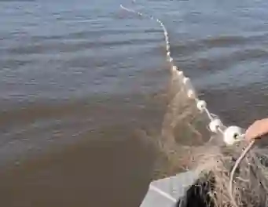
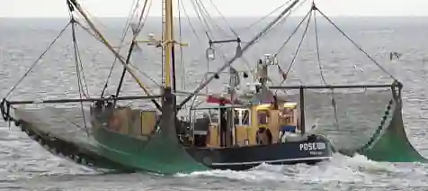
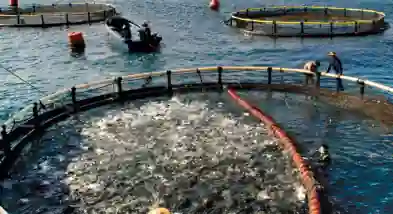
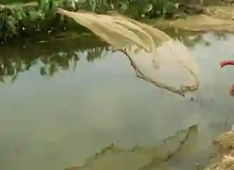
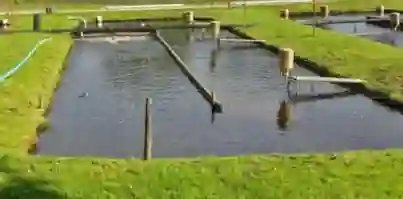

## Fishing industry

### Importance

* It contributes to national income by generating export revenue, creating jobs, supplying raw materials to other markets and paying taxes to the government.

* Earns foreign exchange by exporting high-value marine and aquaculture products, such as fish, shrimp and seafood to international markets, receiving payments in foreign currencies that boost national trade

* Improves the balance of trade by generating foreign exchange through the export of high-value fish and seafood products.

* Inland fishing initiatives help reduce rural-to-urban migration because most fish farms are located in rural villages, while commercial coastal projects contribute to the development of remote areas like the Balochistan coast by bringing in roads, electricity and telecommunication infrastructure.

* Provides employment opportunities for many people.

### Types of fishing operations

* **Subsistence fishing:** Practiced primarily for home or family consumption with low capital investment. It is strictly coastal in marine environments yielding lower catches and relies entirely on traditional methods such as wooden sailing boats, ice baskets, family labor, inherited knowledge and handmade nets.

* **Commercial fishing:** Undertaken for market sale and profit with large capital investment. Commercial vessels can travel $50$ to $60$ km offshore to secure high catches using modern equipment such as marine engines, gill netters, skilled labor, chillers and nylon nets.

* **Marine fishing:** Conducted in sea waters along the Makran and Sindh coasts for both local and international markets. It requires relatively less labor than inland fishing but yields much larger catches. Common marine species caught include sharks, drum fish, catfish, rays, croakers, herrings, skates, crabs, lobsters, prawns and sardines.

* **Inland fishing:** Practiced in rivers, lakes, ponds and dam reservoirs (such as Mangla, Tarbela and Haleji Lake) as well as dedicated fish farms. It supplies local markets and supports subsistence needs, though overall output is smaller due to traditional methods. Prominent inland species include Mahseer, Palla, Thala, Rohu and Trout.

### Regional comparision

#|
||

**Sindh coast**

|

**Balochistan coast**

||
||

* Centered around Karachi Port, this area has a shorter coastline but yields a significantly higher catch.

* Advantages include a natural deep-water harbor, a wide shallow sea with an extensive continental shelf, abundant nutrient availability in the Indus Delta, well-developed infrastructure (roads and railways for rapid transport) and superior processing and refrigeration facilities powered by steady electricity.

* Major species found here include crabs, lobsters, prawns, sardines and sharks

|

* Spanning locations like Jiwani, Ormara, Pasni, and Gwadar, this region accounts for about $70$% of Pakistan's coastal area.

* However, it suffers from low output due to severe developmental hurdles, including poor infrastructure, a lack of paved roads, low education and skill levels among local communities, shortages of fresh drinking water, unreliable electricity, inadequate telecommunication links and heavy reliance on outdated traditional methods.

* Key species harvested include herrings, Indian mackerel, sardines, sharks and sea catfish.

||
|#

### Some fishing port names:

* **Sindh Coast Fishing Ports:**

  * **Karachi Port:** Largest fishing harbour

  * **Korangi:** Major fish landing site

  * **Keti Bandar:** Indus Delta fishing port

* **Balochistan Coast Fishing Ports:**

  * **Jiwani:** Near the Iranian border

  * **Ormara:** Mid-Makran coast

  * **Pasni:** Major fish harbour (ADB funded)

  * **Gwadar:** Deep-water port and fishing hub

### Inland fish farms and breeding practices

* **Definition**: Inland fish farms are man-made ponds dug to keep and breed fish, alongside natural lakes utilized as farms primarily in Sindh.

* **Geographical distribution:** The majority of fish farms are located in Punjab along rivers and doabs, with many found along the River Indus in Sindh, some in KPK (near the Kabul River and Warsak Dam) and none in Balochistan.

* **Farming methods:**

  * Fish eggs are cultivated in specialized hatcheries and hatched under controlled conditions.

  * Once hatched, small fish are transferred to long, thin rectangular ponds arranged in grid patterns to separate different species.

  

  * These ponds feature raised mud embankments, are often lined with bricks or cement to minimize water seepage, and are surrounded by trees to reduce evaporation.

  * Fish are systematically fed, vaccinated, and maintained until they reach optimal age and weight for commercial transport and sale.

  * Fish breeding peaks during the monsoon months of June and July.

### Problems, threats and solutions

* **Key challenges:** The industry struggles with a lack of capital to purchase modern vessels like gill netters, a lack of formal education among fishermen regarding modern techniques, unhygienic conditions in fish markets that deter buyers and a shortage of cold storage facilities leading to massive post-harvest fish waste.

* **Marine pollution and ecosystem threats:**

  * Heavy industrial waste and plastic pollution originating from Karachi's industrial sectors discharge straight into coastal waters, poisoning marine breeding grounds and drastically depleting fish and shrimp populations.

  * Oil seepage further damages aquatic life. Furthermore, mangrove destruction threatens marine stocks because mangroves serve as vital fish breeding grounds, supply organic nutrition (plankton) and protect young marine life from predators.

* ### Uses of fish:

  * **Local Market:** Fresh fish sold in city markets; shrimp and prawns supplied to hotels and restaurants.

  * **Home Consumption:** Subsistence fishermen retain a portion of their catch for their families.

  * **Export:** Shrimp, lobster, and crab exported to Japan, USA, and EU; fish exported to the Middle East and China, generating approximately $300$-$400$ million/year in foreign exchange.

  * **Processing:** Frozen, canned, and dried fish, alongside fish meal utilized for poultry feed.

  * **By-products:** Fish oil (omega-$3$), shark fins (exported to China), and fish skin (leather).

* **Regulatory solutions and developments:**

  * The government enforces strict legal bans on extra-fine mesh nets with microscopic holes that accidentally scoop up baby fish and destroy future stocks.

  * Strict legal bans on commercial maritime trawling are enforced during the peak breeding season in June and July to allow marine life to reproduce peacefully.

  * Infrastructure projects like the development of the Gwadar Port and the Pasni Fish Harbor (assisted by the Asian Development Bank) have expanded storage facilities, ice factories and modern fish processing capabilities.

  * Institutional support includes providing financial loans for modern equipment, weather and safety guidance via the meteorological department and educational pamphlets distributed by provincial fisheries departments.