## Mineral resources

### Mineral classification and mining methods

* Mineral resources form part of the primary sector of industry, focusing on extracting non-renewable raw materials from beneath the earth that took millions of years to form.

* **Key industry terms**: Mineral exploration refers to discovering metallic or non-metallic minerals; mineral extraction involves taking them out using specific techniques; mineral exploitation means utilizing these available resources for national development.

### Mining methods:

* **Open-Cast Mining**: Applied when a mineral layer or seam is located close to the earth's surface. The upper layer of soil and rock is removed and minerals are excavated directly using power shovels.

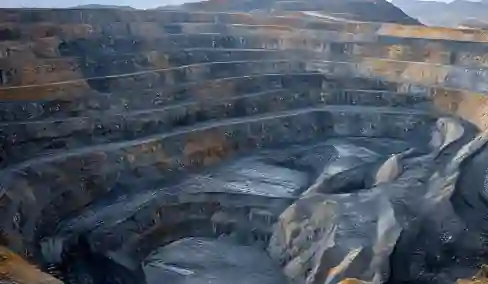

* **Adit Mining:** Applied when a mineral seam runs along the slope or hillside of a mountain. Access is established by cutting a horizontal tunnel directly into the slope.

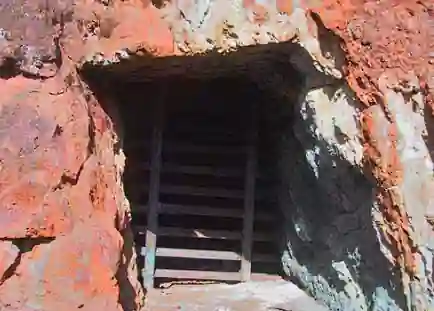

* **Shaft Mining**: Applied when a mineral seam is located deep underground. Access is achieved by digging a vertical shaft downward and elevators are used to transport workers and minerals.

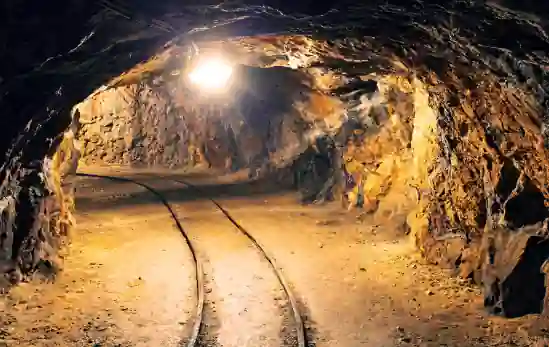

### Metallic minerals

Metallic minerals resemble metals, exhibiting shiny, hard, and smooth surfaces, high electrical conductivity, and malleability.

* Chromite: Imparts hardness and electrical resistance to steel, making it essential for manufacturing bridges, railway carriages, metallurgical furnace linings, engineering tools and stainless steel. It is found in large quantities in the Zhob Valley and Muslim Bagh in Balochistan, with extraction reaching $134$ million tons during $2011$-$2012$.

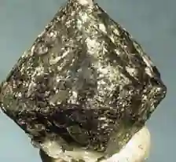

* Iron ore: A foundational raw material used in steelmaking, construction and the transport industry. Pakistan's iron ore reserves total approximately $430$ million tons with an extraction output of $274,211$ tons in $2011$-$2012$. It is mined at Kalabagh, Chaghi, Langrial and Domal Nisar

  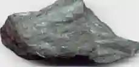

  * It is categorized into four grades..

    * Magnetite.

    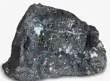

    * Limonite.

    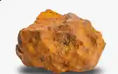

    * Hematite.

    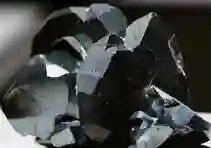

    * Siderite.

    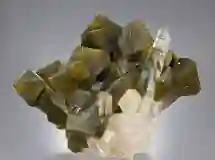

* Copper: Utilized for manufacturing electrical copper wire, switches, alloys, water pipes, and storage tanks. Major deposits are located at Saindak near Chaghi. The Saindak Copper and Gold Mining Project involves foreign exploration of proven deposits containing copper, gold and silver.

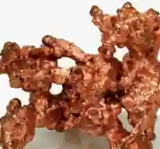

* Manganese: Used in the production of dry cell batteries and industrial paints. Found in Zhob, Lasbela, and Galdanian in Balochistan, with extraction recorded at $2378$ million tons in $2011$ - $2012$.

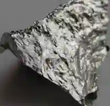

* Bauxite: The primary ore used to obtain aluminum for household utensils, metal tins and cans. Found in Muzaffarabad, it possesses reserves exceeding $74$ million tons and an extraction rate of $166,565$ tons in $2011$ - $2012$.

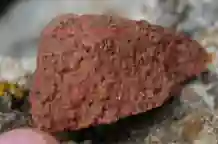

* Celestine: Used in tracer bullets, fireworks, ceramics, paints and plastics. Mined in Dandot, it has moderate deposits and an extraction volume of $1855$ million tons in $2011$-$2012$.

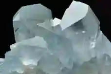

### Non metallic minerals

* Non-metallic minerals are generally softer, rougher, fracture easily when shaped, cannot be stretched or compressed, and act as poor electrical conductors.

* Rock salt: White and pink in color, utilized in the manufacture of soda ash, sodium bicarbonate, caustic soda, and laundry, textile, food processing and tanning chemicals. Important mines are located at Khewra, Warcha, and Kalabagh, boasting over $100$ million tons in reserves and an extraction of $1445$ million tons in $2011$-$2012$.

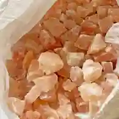

* Gypsum: Serves as a raw material for paints, rubber, plaster of Paris, cement and chemical fertilizers. In agriculture, it is spread over saline soils to aid land reclamation. Mined from Khewra, Dandot and Daudkhel, reserves stand at $350$ million tons with $552$ million tons extracted in $2011$-$2012$.

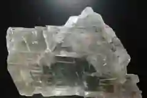

* Limestone: The principal raw material for the cement industry (vital for construction and factory building) and chemical manufacturing, including lime, bleaching powder, glass, soap, paper, paints and steel industry flux. Widespread across Pakistan (Daudkhel, Zinda Pir, Kot Digi, Harnai, Mangopir, and Murli Hills), limestone has massive deposits with $25,014$  million tons extracted in $2011$-$2012$. In agriculture, lime reduces soil acidity and salinity and is painted on fruit tree trunks to prevent termite attacks.

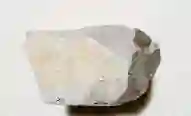

* Marble: Found in striking bands of white, grey, yellow, and brown, utilized for building decoration, flooring chips, and ornamental pieces. Extracted in Chaghi, Thano Bula Khan, and Mullagori (where high-grade white marble is heavily exported). Deposits are very large, with $758$ million tons extracted in $2011$-$2012$.

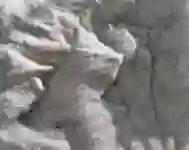

* Sulphur: Used to manufacture sulphuric acid, explosives, paints, dyes, pulp, and fertilizers, as well as in petroleum refining. Found in Sanni and Koh-e-Sultan, with deposits of $0.8$ million tons and extraction of $19,919$ tons in $2011$-$2012$.

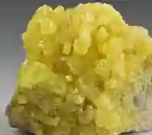

* Clays: Comprising China clay, fire clay, and Fuller's earth, utilized in the ceramic industry. Found in Shah Deri, reserves total $4.9$ million tons with $38$ million tons extracted in $2011$-$2012$.

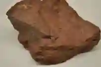

* Soapstone and Barite: Soapstone is crushed into powder as a filler for soap, ceramics, and face powder (mined in Sherwan, Abbottabad), while barite is utilized in the oil-drilling industry, paints, glass and insecticides (mined in Kundi).

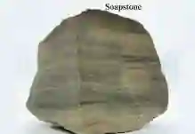 

### Importance, problems, environmental impacts and solutions

* **Economic importance:** The mining sector contributes directly to GDP and GNP, supplies essential industrial raw materials, earns foreign exchange through exports (such as marble and rock salt), fulfills domestic requirements to prevent costly imports, improves the balance of trade, creates local employment and curbs rural-to-urban migration by providing jobs in remote regions.

* **Problems of the industry:** Challenges include a lack of capital preventing the purchase of modern machinery, a shortage of technical experts requiring expensive foreign assistance, low government priority, inaccessible mineral deposits and security risks or terrorism that deter foreign investors.

* **Environmental and human impacts:**

  * Air and noise pollution: Blasting rock formations creates intense noise pollution and massive, choking dust clouds that degrade local air quality.

  * Land degradation: Open-cast mining and quarrying leave behind massive scars, deep craters and destroyed natural vegetation.

  * Water contamination: Toxic chemical waste and mine tailings wash into nearby streams and leach into groundwater systems.

  * Health hazards: Underground miners face severe occupational hazards, including chronic respiratory illnesses like black lung disease from inhaling fine dust, alongside risks from sudden mine collapses.

* **Solutions:**

  * Institutional bodies like the **Geological Survey of Pakistan** conduct systematic geological mapping and investigation.

  * The government offers financial incentives and tax holidays to attract foreign and local investors, engages multinational corporations through production-sharing agreements and expands educational programs to train skilled local labor.

### Extent to which mineral resources can be exploited

**Current exploitation status**

#|
||

**Minerals**

|

**Reserves**

|

**Annual** extraction

|

**Exploitation rate**

||
||

**Chromite**

|

Approximately $134$ million tons (Balochistan)

|

Approximately $200,000$ tons/year

|

Low (mostly exported raw so minimal local professing)

||
||

**Iron ore**

|

Approximately $430$ million tons

|

Approximately $274,000$ tons/year

|

Very low - greater than $0.1$% reserves extracted annually

||
||

**Copper**

|

Approximately $400$ million tons (Saindak and Reko Diq)

|

$15,000$ tons/year

|

Moderate - Saindak is operational but Reko Diq is stalled

||
||

**Rock Salt**

|

Less than $100$ million tons (Khewara)

|

$1.4$ million tons/year

|

High - it’s well exploited but mostly as crude salt

||
||

**Gypsum**

|

Approximately $350$ million tons

|

$552,000$ tons/year

|

Low - it’s vastly underutilised given cement demand

||
||

**Limestone**

|

massive (widespread)

|

Approximately $25$ million tons/year

|

Moderate - adequate for cement but the export is limited

||
|#

### Constraints limiting exploitation:

* Energy shortages: mining and processing require reliable electricity; load-shedding disrupts operations.

* Lack of beneficiation: Pakistan exports raw ores and imports processed metals (e.g., steel), losing \~$70$% of potential value-added revenue.

* Inaccessible deposits: many reserves (e.g., Reko Diq copper, Chaghi iron) are in remote, mountainous, or desert regions with no rail or all-weather roads.

* Security risks: Balochistan's mineral belt faces insurgency and sectarian violence, deterring foreign companies (Reko Diq project was stalled for years over legal disputes).

* Exploration gap: only \~$20$% of Pakistan's mineral potential has been systematically explored using modern geophysical methods.

**Evaluation**: Pakistan exploits less than $5$% of its total mineral wealth. At current rates, even known reserves would last over $100$ years, but without investment in processing infrastructure, the sector will remain a low-value raw-material exporter, contributing only \~$2.5$% to GDP (compared to \~$10$-$15$% in comparable mining economies like Chile or South Africa).

### Sustainability of mineral extraction

**Why it’s not sustainable currently?**

* **Open-cast mining** leaves permanent scars, destroys topsoil, and renders land unusable for agriculture or grazing.

* **Tailings (toxic waste)** from copper and chromite processing contain heavy metals (lead, arsenic, cadmium) that leach into groundwater, e.g., Saindak's waste ponds have been linked to contaminated wells in nearby villages.

* **No reclamation laws:** Pakistan has no legal requirement for mining companies to restore land after extraction, unlike the US or Australia.

* **Groundwater depletion**: mining operations pump large volumes of water, lowering the water table in already arid regions (Balochistan).

**What would make it sustainable?**

* **Mandatory environmental impact assessments (EIAs)** with strict penalties for non-compliance.

* **Rehabilitation funds:** mining companies should deposit bonds that are refunded only after site restoration (e.g., backfilling pits, replanting vegetation).

* **Processing localisation**: instead of exporting chromite ore, build ferrochrome smelters in Pakistan to add value and reduce waste transported overseas.

* **Circular economy**: recovering metals from electronic waste (e-waste) could reduce the need for virgin mining.

**Evaluation**: Currently, mineral extraction is environmentally destructive and economically inefficient. Without legislative reform, Pakistan will exhaust its high-grade deposits within $50$-$70$ years, leaving behind contaminated wastelands. The Reko Diq agreement ($2022$) includes some sustainability clauses (e.g., $25$% local equity, water recycling), but enforcement remains weak.

### Main imported minerals

**Pakistan is mineral poor in high grade ores for modern industry, so it imports:**

#|
||

**Imported mineral**

|

**Main origin**

|

**Annual quantity (approximately)**

|

**Purpose**

||
||

**Crude oil & petroleum products**

|

Saudi Arabia, UAE, Iraq, Kuwait

|

Approximately $10$-$12$ million tons

|

Energy, petrochemicals, transport fuel

||
||

**Natural gas (LNG)**

|

Qatar, USA, Australia

|

Approximately $4$-$5$ million tons/year

|

Electricity generation, fertiliser production

||
||

**Phosphate** **rock**

|

Morocco, China, Jordan

|

Approximately $1$-$2$ million tons/year

|

Fertiliser manufacturing (Pakistan’s domestic reserves are low grade)

||
||

**Iron ore (high grade)**

|

Australia, Brazil, South Africa

|

Approximately $2$-$3$ million tons/year

|

Steel mills (Pakistan’s own iron ore is low grade)

||
||

**Copper concentrate**

|

Chile, Peru, Australia

|

Approximately $50,000$-$100,000$ tons

|

Supplement domestic copper (Saindak output insufficient)

||
||

**Sulphur**

|

Russia, Saudia Arabia, Canada

|

Approximately $200,000$-$300,000$ tons

|

Fertiliser (superphosphate) and sulphuric acid production

||
||

**Coal (high grade coking)**

|

Australia, South Africa, Indonesia

|

Approximately $3$-$4$ million tons/year

|

Steel making (Pakistan’s Thar coal is low grade lignite for power, not coking coal)

||
|#

**Economic impact**: These imports cost Pakistan \~$15$-$20$ billion annually, about $60$-$70$% of total export earnings, creating a persistent current account deficit. Import dependence also makes Pakistan vulnerable to global price shocks (e.g. Ukraine war caused fertiliser prices to triple in $2022$).