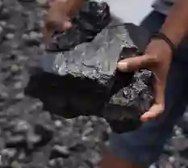
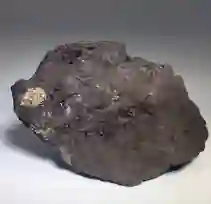
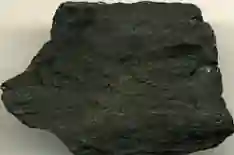
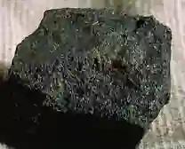
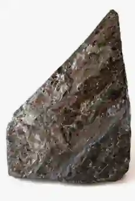
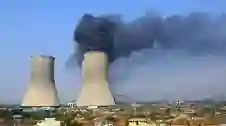
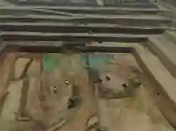

# Power

## Coal

### Classification of Coal Quality

* Lignite: Also referred to as brown coal, is the lowest rank of coal and is used almost exclusively as fuel for electric power generation.

* Sub-bituminous Coal: Properties range from those of lignite to those of bituminous coal; used primarily as fuel for steam-electric power generation.

* Bituminous Coal: Dense mineral, black but sometimes dark brown; used primarily as fuel in steam-electric power generation, with substantial quantities also used for heat and power applications in manufacturing and to make coke.

* Anthracite: The highest rank; a harder, glossy, black coal used primarily for residential and commercial space heating.

### Usage and Importance of Coal

Around $80$% of the coal found in Pakistan is used to make bricks.

The rest is used by the cement industry, which blends it with imported coal to reduce costs.

* The coal used for power generation is first washed to reduce its sulfur and ash content.

* Coal can also be turned into a gas and then used as a fuel.

* Pakistan Steel industry has to import higher graded coal from countries like South Africa, Australia, and Indonesia to meet its current demands.

* Coal found in Pakistan is of poor quality; it is unsuitable for use in steel production.

* The production of coal in Pakistan is too low, as coal seams are thin and mineral layers have a lot of faults.

* It is very difficult to operate machines, and Pakistan does not have the finances to explore and utilize new mines.

The local coal is carried out of the mine by donkeys or sometimes by humans on their backs.

### **Why donkeys/llamas are used:**

* Coal seams in Balochistan and the Salt Range are extremely thin, low, and faulted.

* Modern machinery cannot physically fit into these narrow tunnels, forcing miners to rely on manual labor and animals to transport the coal out.

* The coal is loaded onto trucks and taken to the nearest market.

* In more mechanized mines, the coal is carried by rail.

* Imported coal is unloaded at the port and checked by customs.

* After the import duty has been paid, it is allowed to leave the port area. seams in Balochistan and the Salt Range are extremely thin, low, and faulted.

* Modern machinery cannot physically fit into these narrow tunnels, forcing miners to rely on manual labor and animals to transport the coal out.

* The coal is loaded onto trucks and taken to the nearest market.

* In more mechanized mines, the coal is carried by rail.

* Imported coal is unloaded at the port and checked by customs.

* After the import duty has been paid, it is allowed to leave the port area.

### Coal Extraction Methods

**Open-Cast Mining (Surface Mining)**

**Method**:

* Clear the surface vegetation and trees.

* Remove the topsoil using bulldozers and scrapers.

* Store the topsoil for future land reclamation.

* Excavate the waste rock and subsoil layers.

* Drill holes into the exposed hard rock.

* Fill the drilled holes with explosive materials.

* Detonate the explosives to fracture the rock.

* Load the broken ore into large haul trucks.

* Transport the ore to processing plants or stockpiles.

* Extract the valuable minerals from the mined rock.

* Backfill the open pit with accumulated waste rock.

* Replace the stored topsoil over the filled area.

* Replant native vegetation to restore the ecosystem.

Used when: Coal seam is close to Earth's surface (less than 50m deep, e.g., some Thar deposits).

**Adit Mining (Horizontal tunnel.)**

**Method**:

* Survey and select a stable hillside location above the valley floor to place the portal entrance.

* Excavate and stabilize the surface portal using concrete, steel, or timber supports to prevent surface rock collapse.

* Drill blast holes into the rock face using a planned pattern, such as a wedge cut.

* Charge the holes with explosives and detonate the rock face to fragment the material.

* Clear away the broken rock, known as muck, using loaders and haulage cars.

* Install structural roof and wall supports like shotcrete, rock bolts, or steel arches as the horizontal tunnel advances.

* Set up temporary or permanent ventilation tubing and fans to push fresh air in and remove harmful blasting fumes.

* Establish natural gravity drainage by maintaining a slight upward slope inward so water flows safely out of the entrance.

* Drive crosscuts or intersecting drifts off the main adit passage once you reach the target ore body to begin extraction.

Used when: Coal seam runs along mountain slope (e.g., Balochistan).

**Shaft Mining (Vertical Tunnel):**

**Method**:

* Locate mineral deposits using geological surveys.

* Drill core samples to determine depth.

* Design the vertical shaft layout carefully.

* Clear vegetation and level the surface.

* Construct a headframe over the site.

* Install hoists and winding mechanical gear.

* Sink the shaft downwards using explosives.

* Excavate broken rock using heavy machinery.

* Install concrete lining to prevent collapse.

* Fix steel guides for the cages.

* Excavate horizontal tunnels at various depths.

* Install ventilation fans and air ducts.

* Set up water pumps at bottom.

* Drill blast holes into working faces.

* Load holes with specialized mining explosives.

* Detonate explosives safely from the surface.

* Load broken ore into mine cars.

* Transport ore to the main shaft.

* Hoist ore to surface using skips.

* Crush the raw material for processing.

* Refine ore to extract valuable minerals.

* Store waste rock in designated dumps.

* Seal the shaft after resource depletion.

* Restore topsoil to rehabilitate local environment.

  

Used when: Coal seam is located deep underground (more than 100m, e.g., Salt Range mines).

### **Coal Reserve Duration**

#|
||

Coal type

|

Location

|

Total reserves

|

Annual extraction

|

How long will reserves last

||
||

Lignite (brown)

|

Thar desert, Sindh

|

approximately $175$ billion tons

|

Currently minimal (under development)

|

$500$\+ years

||
||

Sub-bituminous

|

Salt range, Balochistan

|

approximately $3$ billion tons

|

approximately $3$ million tons

|

approximately $1,000$ years

||
||

Bituminous

|

Makerwal, Sor-Range

|

approximately $500$ million tons

|

approximately $1.5$ million tons

|

approximately $333$ years

||
||

Anthracite

|

Small deposits (Rashid Khel)

|

approximately $20$ million tons

|

approximately $0.1$ million tons

|

approximately $200$ years

||
|#

**Key Point:** Pakistan's total coal reserves are estimated at approximately $186$ billion tons (mostly lignite from Thar). At current extraction rates, they would last well over $500$ years. However, Thar coal is low-grade lignite and currently underutilized at scale.

### The Thar Coalfield Project

* Located in the Thar Desert (Sindh), this is one of the world's largest untapped deposits of lignite coal.

* The government is actively developing it to run massive, local thermal power plants to reduce dependency on expensive, imported coal.

