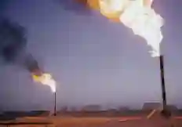

## Natural Gas

### Usage and Transport

* Natural gas is used as a fuel for cars; about 2.5 million of them in Pakistan.

* It is also used for making fertilizers, for cooking, making hydrogen, and other organic compounds like methanol.

* Natural gas is transported on land by two means: pipelines and cylinders.

* The use of cylinders means that only a small amount of gas can be carried at once.

* Refilling takes time, and the risk of explosion due to faulty cylinders is an added concern.

* The cylinders are heavy and difficult to move.

**The demand for natural gas is increasing due to:**

* Use of CNG to run cars.

* Making fertilizers (more demand).

* Generating power as it is cheaper than oil and coal.

* Cooking in homes (as it burns cleanly and is easy to transport).

### Natural Gas Reserves and Locations

* Sui.

* Mari.

* Pirkoh.

* Meyal.

* Dhurnal.

* ### **Sui Discovery:**

  * Natural gas was first discovered at Sui (Balochistan) in 1952.

  * This discovery revolutionized Pakistan's industrial sector by providing a cheap, local source of fuel and raw material for fertilizers.

* **Why Natural Gas is an Important Fuel**

  - It can reach remote areas in cylinders
  - Cheaper compared to other fuels
  - It is cleaner than oil or coal
  - Alternative to oil in vehicles
  - Reduces dependence on imported fuel

### Natural gas reserve duration

#|
||

Category

|

figure

||
||

Total proven reserves

|

$20$-$25$ trillion cubic feet (TCF)

||
||

Annual production

|

$1.3$-$1.5$ TCF per year

||
||

Reserve duration at current rate

|

$15$-$20$ years (if no new discoveries)

||
||

Peak production year

|

$2010$-$2011$ (declining since then)

||
|#

