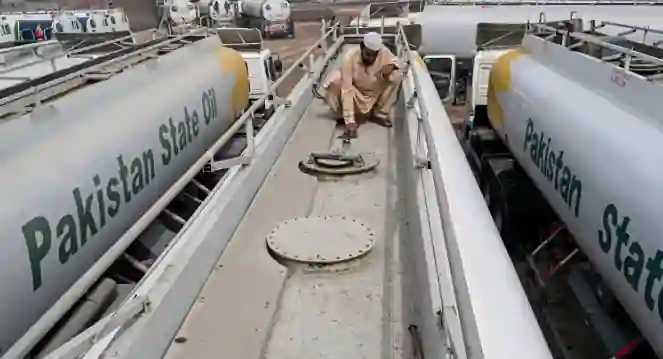
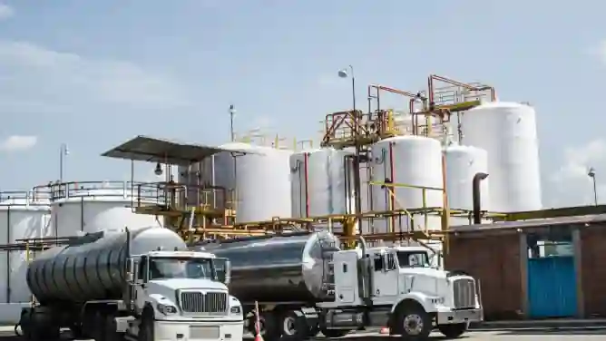

## Oil

* Oil is extracted from the ground at oilfields, and it is separated into its constituent fractions (kerosene, petrol, diesel, wax, etc.) at Oil Refineries.

### **Oil Extraction Method**

Exploration and drilling process:

* Geologists analyze seismic waves and satellite data to locate potential underground oil reserves.

* Engineers drill an initial exploratory well, called a wildcat well, to confirm oil presence.

* Crews lower a heavy drill bit attached to long steel pipes into the ground.

* Special drilling mud pumps down the pipe to cool the bit and lift rock cuttings.

* Workers insert steel casing pipes into the hole to prevent the well from collapsing.

* Engineers pump cement outside the casing to seal the well and protect groundwater.

* A specialized blowout preventer valve assembly is installed at the surface to control pressure.

* Testing teams measure rock porosity and fluid flow to determine if extraction is profitable.

* Production casing is lowered and perforated with small explosive charges to let oil enter.

* Crews install a collection of surface valves, called a Christmas tree, to regulate oil flow.

### **Reasons for the increase in oil imports**

* Increased electricity demand due to the growing rural and urban population (homes). Most of the electricity produced in Pakistan comes from thermal power stations.

* Growth of industries (wax, lubricants, solvents, fertilizers, etc., are manufactured locally to reduce import costs).

* Mechanization of farms (use of harvesters, tractors, etc.) requires fuel.

* Use of diesel tube wells in villages to provide water for irrigation.

* Use of new diesel locomotives in trains (modernization).

* Old oil wells have become less productive (they are inefficient; the maintenance cost is higher than the value of oil they produce). These wells do not produce profit and thus have been closed. Local production has not really increased.

* There has been a lack of foreign investments in the oil fields of Pakistan because of institutional mismanagement.

### **Oil Transport**

* Oil is transported by pipelines and tankers.

* Tankers are used to transport oil where pipelines cannot go (due to topography or low demand, which means the project is not feasible) or where pipelines do not exist.

* This is expensive in the long run as pipelines may require a lot of capital to build but are cheap to maintain.

* Tankers, on the other hand, require fuel and maintenance.

* Heavy tankers also cause damage to roads.

**Oil Production and Reserve Duration (Added)**

#|
||

**Category**

|

**Figure**

||
||

Total proven oil reserves

|

approximately $500$-$600$ million barrels

||
||

Annual production

|

approximately $30$-$35$ million barrels per year

||
||

Annual consumption

|

approximately $100$-$120$ million barrels per year

||
||

Reserve duration at current production

|

$15$-$18$ years

||
||

Import requirement

|

Pakistan imports approximately $70$-$80$% of its oil needs

||
||

Annual import quantity

|

approximately $70$-$80$ million barrels (costs approximately $10$-$12$ billion annually)

||
|#

### **The Oil Network in Pakistan**

**the White Oil Pipeline:**

* An $870$ km pipeline running from Port Qasim (Karachi) to Qasba Gujrat (Mehmood Kot near Multan).

* It is used to transport refined petroleum (mainly diesel) safely, cheaply, and quickly inland.

* **Benefits**:

  * Vastly reduces reliance on heavy oil tankers, saving money on road maintenance.

  * Reduces traffic accidents and carbon emissions on highways.

### **Key Oil Refineries in Pakistan**

* **Attock Oil Refinery (ARL):**

  * Located at Rawalpindi.

  * Processes local crude oil from the Potwar Plateau.

* **Pak-Arab Refinery (PARCO):**

  * Located at Mehmood Kot near Multan.

  * The largest refinery, connected directly to Karachi via pipeline.

* **National Refinery / Pakistan Refinery (NRL/PRL):**

  * Located in Karachi.

  * Processes imported crude oil directly from the coast.

* ### Crude oil extraction process 

  * Exploration

    **Seismic Surveys:** Sends shock waves into the ground to map underground rock layers and identify potential traps.

  * Drilling

    **Exploration Well:** Drilled deep into the earth to test for the physical presence of oil and natural gas.

  * Testing

    **Flow & Pressure:** Measures pressure and flow rates to determine if the deposit is commercially viable.

  * Production

    **Extraction:** A pump jack (or production well system) is installed to lift crude oil to the surface.

  * Transport

    **Distribution:** Transported via pipelines or tankers directly to a refinery for processing.