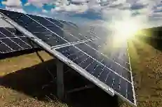
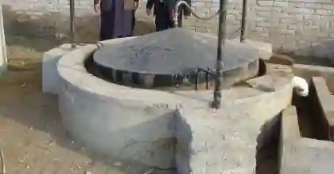
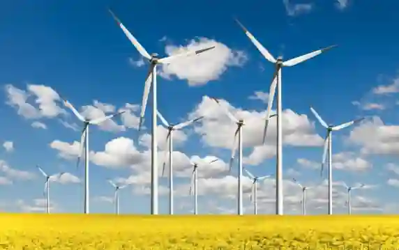
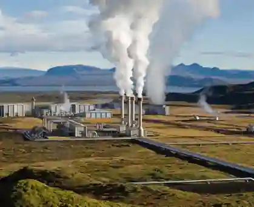
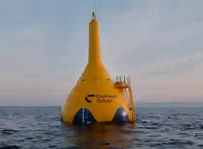
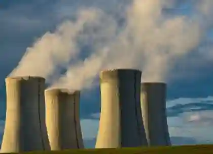

## Renewable and Non-Renewable Energy

* Renewable energy comes from natural resources such as sunlight, wind, rain, tides, and geothermal heat, which are naturally replenished.

* A non-renewable resource is a natural resource which cannot be produced, grown, generated, or used on a scale which can sustain its consumption rate.

* These resources often exist in a fixed amount, or are consumed much faster than nature can create them.

* Fossil fuels (such as coal, petroleum, and natural gas) and nuclear power (uranium) are examples.

### **The role of IPPs (Independent Power Producers)**

* **What they are:**

  * Private companies that build, own, and operate power plants to generate electricity, which they then sell to the national grid.

* **Why they are important:**

  * They bring in massive private and foreign investment to build new power stations, reducing the financial burden on the government.

* **The issue:**

  * Because they charge the government in US dollars for the electricity they produce, any devaluation of the Pakistani Rupee makes IPP electricity incredibly expensive, contributing heavily to the country's circular debt.

### **Solar power**

**Advantages**

* Safe

* Less space required

* Efficient

* Low running cost

**Disadvantages**

* Construction is expensive

* Skilled labor is required

* Cannot be used on cloudy or rainy days

**Physical and climatic feasibility in Pakistan**

* Requires high insolation (long, intense daily hours of clear, cloudless sky).

* Requires flat, open land to install massive arrays of solar panels.

* Best locations: The arid plains of Southern Punjab (e.g., Cholistan Desert), Sindh, and Balochistan.

**How solar power is generated:**

* Solar panels (photovoltaic cells) absorb sunlight.

* Sunlight knocks electrons loose from atoms, generating direct current (DC) electricity.

* An inverter converts DC to alternating current (AC) for household/industrial use.

* Excess electricity can be stored in batteries or fed back into the national grid.

**Major solar project**

* Quaid-e-Azam Solar Park (located in Bahawalpur, Punjab) - Pakistan's flagship utility-scale solar plant.

### **Biogas**

**Advantages**

* Safe

* Less space required

* Efficient

* No skilled labor required

* Less deforestation

**Disadvantages**

* Causes pollution

* Limited amount of gas is produced

* Cannot be used in city areas

**How biogas is generated**

* Organic waste (animal manure, crop residue, food waste) is placed in an airtight digester tank.

* Bacteria break down the organic matter through anaerobic digestion (no oxygen).

* This produces methane gas, which rises and is captured in a gas holder.

* The biogas is piped directly to stoves for cooking or to generators for small-scale electricity production.

### Wind energy

**Advantages**

* Environmentally friendly

* No running cost

* Consistent in the medium and long term

* Occupies little land

* Maintenance is simple

**Disadvantages**

* Difficult to maintain

* Birds and bats may be killed

* Not always reliable

**Physical and climatic feasibility in Pakistan**

* Requires a continuous, high, and reliable wind speed (typically above $5$ m/s).

* Requires wide, flat, unobstructed corridors to catch the wind.

* Best locations: The coastal wind corridors of Sindh, specifically Jhimpir and Gharo.

**How wind energy is generated**

* Wind blows against turbine blades, causing them to rotate.

* Blades spin a shaft connected to a generator inside the nacelle (housing).

* The generator converts mechanical (rotational) energy into electrical energy.

* Electricity is sent through cables to a transformer, then fed into the national grid.

**Major wind project corridor**

* Jhimpir Wind Corridor (located in Thatta, Sindh) - a highly windy, flat area hosting dozens of commercial wind turbines.

### Geothermal

**Advantages**

* Reliable source

* Large amount of energy is produced

* More jobs for locals

**Disadvantages**

* High installation cost

* May release harmful gases

* Can destroy plants due to heat

**How geothermal energy is generated**

* The Earth's core contains hot magma which heats underground water reservoirs.

* Wells are drilled down to these hot water/steam reservoirs (typically $1$-$3$ km deep).

* High-pressure steam rises and spins a turbine connected to a generator.

* After generating electricity, the cooled water is reinjected into the reservoir to maintain pressure.

### Wave energy

**Advantages**

* Large amount of energy is produced

* Does not produce greenhouse gases

* Safe

**Disadvantages**

* High installation cost

* Difficult to maintain

* Qualified people required

* Requires coastal conditions

**How wave energy is generated**

* Wave energy converters (oscillating water columns or buoys) are placed offshore.

* Wave motion forces air into a chamber or moves a float mechanism.

* The forced air or mechanical movement spins a turbine connected to a generator.

* Underwater cables transmit the electricity back to the shore.

### **Nuclear power**

**Advantages**

* Requires less space than a dam

* Provides a continuous supply of energy

* Environmentally friendly

**Disadvantages**

* Very high initial cost

* Parts are not available easily

* Nuclear rods remain radioactive and can harm humans

* Skilled workers are required

**How nuclear power is generated**

* Uranium atoms are split through nuclear fission (neutrons strike uranium-$235$ nuclei).

* Splitting releases massive heat energy and more neutrons (chain reaction controlled by control rods).

* Heat turns water into high-pressure steam.

* Steam spins a turbine connected to a generator, producing electricity.

* Spent fuel rods remain highly radioactive and require secure, long-term storage.

### **Difference between thermal and hydroelectric power**

#|
||

**Thermal power station**

|

**Hydroelectric power station**

||
||

Fossil fuels will be exhausted.

|

will not be exhausted.

||
||

Not environmentally friendly.

|

environmentally friendly.

||
||

Can develop anywhere fossil fuels are available.

|

have certain physical and climatic conditions.

||
||

Less expensive to build than HEP, but running costs are high.

|

running costs are low.

||
|#

### **Dams and hydroelectric power**

**Major dams**

* Tarbela (on the Indus River)

* Mangla (on the Jhelum River)

* Warsak (on the Kabul River, near Peshawar)

**Physical and climatic feasibility of hydroelectric power (HEP)**

* Requires a steep, narrow valley or gorge to build a strong dam wall.

* Requires strong, impermeable bedrock to support the massive weight of the reservoir.

* Requires a reliable, permanent water supply from high rainfall or glacial/snow melt.

* Best locations: The rugged, high-altitude northern mountain ranges (Himalayas, Karakoram, Hindu Kush).

**How hydroelectric power is generated**

* Water from the reservoir is released through penstocks (large pipes).

* Gravity forces the water down at high pressure.

* The fast-flowing water strikes turbine blades, causing them to spin.

* Turbines spin a generator, converting mechanical energy into electricity.

* Water exits the dam and continues downstream.

### **Multi-Purpose Hydel Schemes**

#|
||

**Purpose**

|

**Explanation**

|

**Example**

||
||

**Irrigation**

|

Stores water - released via canals for crops

|

Tarbela feeds Punjab/Sindh canals

||
||

**Flood Control**

|

Reservoir absorbs excess monsoon flow

|

Mangla protects Jhelum valley

||
||

**Hydroelectric Power**

|

Water released at pressure - spins turbines

|

Tarbela ($4,888$ MW), Mangla ($1,310$ MW)

||
||

**Recreation**

|

Reservoirs attract tourists - boating, fishing

|

Mangla Lake, Tarbela Lake

||
||

**Fisheries**

|

Reservoirs stocked with fish -commercial fishing

|

Tarbela, Mangla, Haleji Lake

||
||

**Domestic/Industrial Supply**

|

Water for drinking and factories

|

Rawalpindi/Islamabad from Mangla

||
|#

### **Human and physical conditions favouring multi-purpose hydel schemes**

**Physical conditions:**

* High annual rainfall and/or glacial melt ensures year-round water supply.

* Steep gradient (narrow gorges) allows for high water pressure with minimal dam height.

* Strong bedrock geology can support massive concrete structures.

**Human conditions:**

* Sufficient government funding or foreign aid (dams cost billions of dollars).

* Political stability and provincial consensus on water distribution.

* Availability of skilled engineering and construction workforce.

* Secured resettlement of displaced communities.

* Adequate transport infrastructure to bring in heavy equipment.

### **Rivers**

* Indus

* Jhelum

* Kabul

### **Major power plants to locate on a map**

**Thermal power plants**

* Karachi (Korangi & Bin Qasim) - Sindh (dependent on gas/oil).

* Kot Addu & Muzaffargarh - Punjab (oil/gas thermal plants).

* Jamshoro - Sindh (major oil/coal plant).

**Nuclear power plants**

* KANUPP (Karachi Nuclear Power Plant) - located on the Karachi coast.

* CHASNUPP (Chashma Nuclear Power Plant) - located near Chashma (Punjab) along the Indus River.

**Hydroelectric power (HEP) plants**

* Tarbela Dam (on the Indus River).

* Mangla Dam (on the Jhelum River).

* Warsak Dam (on the Kabul River).

* Ghazi-Barotha (on the Indus River - a major run-of-the-river project)