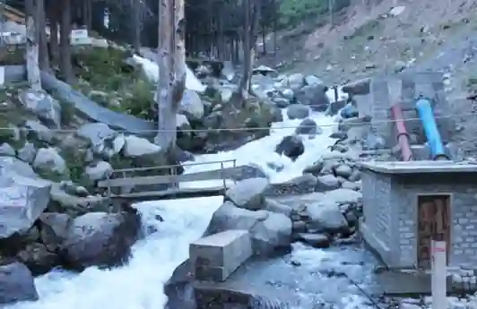

## **Feasibility of small-scale renewable generation**

### Small-scale solar

* Feasible: Pakistan has $300$\+ sunny days per year. Rooftop solar panels for individual homes and businesses are highly viable.

* Promoting factors: Falling solar panel costs, net-metering policies allowing households to sell excess electricity.

* Hindering factors: High upfront cost, lack of financing options, limited local manufacturing, and lack of skilled installers in rural areas.

### **Small-scale wind**

* Feasible only in specific areas: Coastal Sindh (Jhimpir, Gharo) and some mountain passes (Balochistan) where wind speeds consistently exceed $5$ m/s.

* Hindering factors: Turbines require large open spaces, are noisy, and maintenance is expensive for individual owners.

### Small-scale biogas

* Highly feasible in rural areas: Abundant animal manure (cattle, buffalo) makes this ideal for villages.

* Promoting factors: Low cost, simple technology, reduces deforestation and dependence on cylinder gas.

* Hindering factors: Limited gas production (enough only for cooking, not electricity), requires regular organic waste input, and does not work in large cities due to space constraints.

### Small-scale hydel (micro-hydel)

* Feasible in northern areas: Small rivers and streams in KPK, Gilgit-Baltistan, and Azad Kashmir can power micro-turbines for villages.

* Hindering factors: Seasonal flow variability (low output in winter), high initial setup cost, and difficult access to remote mountainous locations.