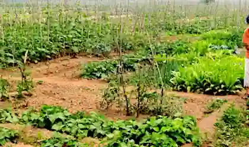
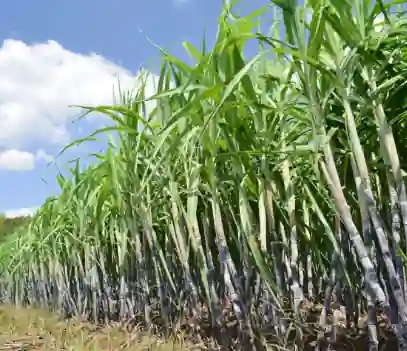
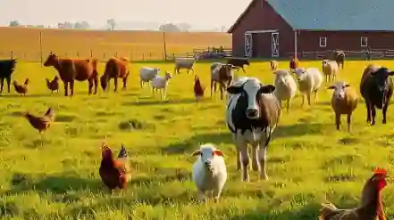

# Agricultural Development

## Farming Systems

### Small-scale subsistence farming

* Natural inputs: Small plot of land, rainfall/river water, natural soil fertility.

* Human inputs: Family labour, draught animals (oxen/bullocks), saved seeds, basic hand tools (hoe, sickle), animal manure.

* Processes: Hand ploughing, manual sowing, weeding, manual harvesting, threshing using animals.

* Outputs: Food crops for family consumption (wheat, pulses), crop stalks for fodder, animal dung.

### Cash crop farming (commercial)

* Natural inputs: Flat alluvial plains, reliable climate/temperature.

* Human inputs: High capital, tractors/combine harvesters, high-yielding varieties (HYVs), chemical fertilizers, pesticides, canal/tube well irrigation, hired labour.

* Processes: Mechanical tilling, canal flooding/sprinkling, chemical spraying, machine harvesting, factory processing.

* Outputs: Cash crops for local sale/export (cotton lint, raw sugar, high-grade rice), crop waste.

### Livestock farming system

* Inputs: Grazing land, crop residue/fodder, water, veterinary medicines, animal breeds.

* Processes: Grazing, milking, breeding, feeding, shearing wool.

* Outputs: Milk, meat, hides/skins, wool, dung (fertilizer/fuel), draught power.

