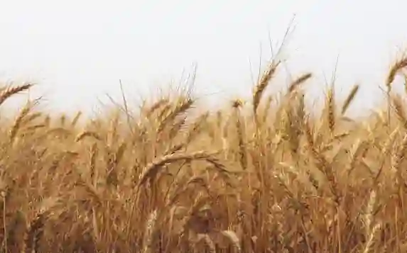
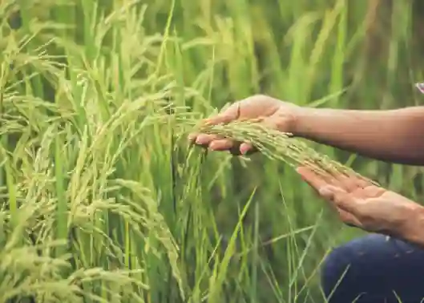
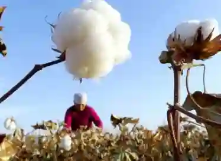
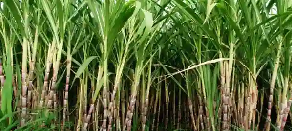

## The Big Four Major Crops

### Pakistan crop distribution

### Wheat (staple food crop - rabi)

* **Seasons**: Sown in October-December; harvested in April-May.

* **Physical factors**:

  * Temperature: Cool initial growth ($10$°C-$20$°C), warm sunny harvest ($25$°C-$30$°C).

  * Water: Moderate ($250$mm-$500$mm), needs $3$-$4$ timely irrigations.

  * Soil and relief: Well-drained loamy/alluvial soil; flat plains for machinery.

* **Main areas**: Canal-irrigated plains of Punjab (Faisalabad, Multan, Sargodha); Sindh (Sukkur, Hyderabad).

* **Uses**: Staple diet (flour for roti/bread); animal fodder (straw/bhusa).

* **Photograph recognition tip**: Stiff, upright golden-yellow stalks with compact spiked heads (grain ears) in flat, open dry fields.

### Rice (food and export crop - kharif)

* **Seasons**: Sown in April-June; harvested in October-November.

* **Physical** **factors**:

  * Temperature: High sustained warmth ($25$°C-$30$°C).

  * Water: Heavy ($1270$ mm equivalent); requires fields flooded with $30$cm of standing water during early growth.

  * Soil and relief: Impermeable clay soil to hold water; flat land with embankments (bunds).

* **Main areas**:

  * Basmati (aromatic): Gujranwala, Sialkot, Sheikhupura (Punjab's "Kalar Bowl").

  * Irri (coarse): Badin, Thatta (lower Sindh).

* **Uses**: Direct human consumption, major export commodity, husk used for fuel/industrial boards.

* **Photograph recognition tip**: Bright green shoots emerging from flooded fields.

### Cotton (primary cash crop - kharif)

* **Seasons**: Sown in May-June; picked in September-November.

* **Physical** **factors**:

  * Temperature: Warm growth ($25$°C-$35$°C).

  * Water: $500$mm-$1000$mm (via canal/tube well).

  * Weather: Must have completely dry, sunny harvest weather; rain damages the open cotton bolls.

  * Threats: Leaf curl virus, bollworms, whiteflies.

* **Main** **areas**: Southern Punjab (Bahawalpur, Rahim Yar Khan, Multan) and central Sindh (Sanghar).

* **Uses**: Raw lint exported or used in textile mills (yarn, cloth); seeds crushed for cooking oil and oilcake (animal feed).

* **Photograph recognition tip**: Medium-height bushes with white cotton bolls, usually with workers hand-picking into bags.

### Sugarcane (industrial crop - kharif)

* **Seasons**: Planted in February-April; harvested in November-March (it takes almost a full year to mature).

* **Physical** **factors**:

  * Temperature: High ($25$°C-$35$°C); frost destroys sucrose.

  * Water: Extremely high ($1500$mm - via frequent irrigation).

  * Soil: Deep, fertile silt loam.

* **Crucial industrial rule**: Must be processed at sugar mills within $24$ hours of harvesting; delay causes rapid sucrose evaporation and loss of crop value.

* **Main areas:** Central Punjab, central Sindh, and KPK (Peshawar).

* **Uses**: White sugar, gur (jaggery), bagasse (cane residue used for paper and fuel), molasses (chemical manufacturing).

* **Photograph recognition tip**: Very tall ($2$-$4$ meters), thick green fields resembling giant bamboo with broad leaves.

