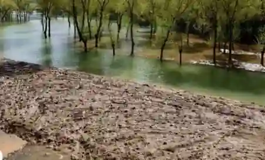

## Irrigation Infrastructure and Systems

### Key water infrastructure terms

* Dam: Massive artificial barrier across a river creating a deep storage reservoir (e.g., Tarbela, Mangla). Multi-purpose use (HEP generation, flood control, seasonal irrigation storage).

* Barrage: Low-gated structure built across a river to raise the water level slightly and divert river flow into canals (e.g., Sukkur Barrage, Kotri Barrage).

* Link canal: Massive wide canal connecting western rivers (Indus, Jhelum, Chenab) to eastern rivers (Ravi, Sutlej) to transfer water under the Indus Water Treaty.

* Distribution canal/field channel: Smaller unlined channels that branch off main canals to deliver water directly to farmland.

* Bund: Raised mud wall around a field to contain irrigation water.

### Comparison of Irrigation Methods

#|
||

**Method**

|

**Type**

|

**Description**

|

**Advantages**

|

**Disadvantages**

||
||

**Perennial** **Canals**

|

Modern canals

|

Permanent channels fed by dams and barrages operating all year.

|

Reliable, high volume: supports massive cash crop production.

|

Unlined channels cause heavy water seepage, leading to waterlogging and salinity.

||
||

**Inundation** **Canals**

|

Conventional canal

|

Channels filling only when river levels rise during summer flood season.

|

Provides free seasonal water so it requires no complex dams.

|

Unreliable; dry during winter (Rabi season).

||
||

**Karez** **System**

|

Conventional underground

|

Underground tunnels intercepting mountain aquifers in Balochistan.

|

No evaporation loss; operates purely on gravity without fuel.

|

Labor intensive to excavate so it cannot be expanded easily.

||
||

**Persian** **Wheel**

|

Conventional lift

|

Wheel with buckets driven by bullocks camels walking in circles.

|

Low cost; built with local materials; eco friendly.

|

slow, low capacity; limited to shallow groundwater tables.

||
||

**Tube** **Well**

|

Modern lift

|

Electric/diesel motor pumping water from deep underground wells.

|

Provides on demand water; lowers water table to combat waterlogging.

|

Expensive installation so it requires electricity diesel; can over extract aquifers.

||
|#

* **Perennial** **Canals**

* **Inundation** **Canals**

* **Karez** **System**

* **Persian** **Wheel**

* **Tube** **Well**

### Karez irrigation - dates and vegetables

* **Context:** Practiced in arid, mountain-rimmed basins of Balochistan (e.g., Turbat, Panjgur, Quetta valley).

* **How Karez Works:** Underground horizontal tunnels tap water tables at the foot of mountains. Water flows to the surface naturally via gravity. Zero evaporation loss occurs while underground.

* **Crops Grown:**

  * **Dates:** Deep-rooted palms; tolerate extreme heat; harvested in August - September.

  * **Vegetables:** Onions, tomatoes, and melons grown in small plots near outlets.

  * **Orchards:** Apples, apricots, and pomegranates in cooler highland areas.

* **Processes:** Water is distributed via small channels to fields using traditional flood irrigation on fragmented plots due to limited supply.

* **Outputs:** High-energy date staples, fresh local vegetables, and dried fruit exports.

* **Challenges:** Labor-intensive tunnel excavation/maintenance, limited expansion capacity, and declining water tables driven by nearby tube wells.

### **Irrigation Methods - Advantages & Disadvantages**

#|
||

**Irrigation Method**

|

**Advantages for Small-Scale**

|

**Disadvantages for Small-Scale**

|

**Advantages for Cash Crops**

|

**Disadvantages for Cash Crops**

||
||

**Perennial Canals**

|

Reliable water supply

|

Cannot afford canal fees; land far from canals

|

High volume supports cotton, rice, and sugarcane

|

Waterlogging and salinity risks from seepage

||
||

**Inundation Canals**

|

Free seasonal water supply

|

Unreliable; dry up during the winter (Rabi season)

|

Cheap water for Kharif season crops

|

Zero water supply for Rabi wheat

||
||

**Karez**

|

No fuel cost; gravity-driven flow

|

Cannot expand easily; highly labor-intensive

|

Supports high-value dates and vegetables in deserts

|

Limited volume; cannot support large-scale cash crops

||
||

**Persian Wheel**

|

Low setup cost; built with local materials

|

Slow output; low capacity

|

Traditional irrigation option for small plots

|

Cannot meet the heavy water demands of sugarcane

||
||

**Tube Well**

|

On-demand water availability

|

Expensive installation and high electricity/diesel costs

|

Provides reliable water security for all crop types

|

Heavy over-extraction lowers the local water table

||
|#

