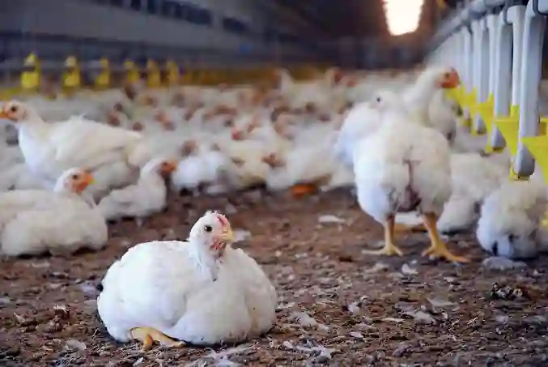
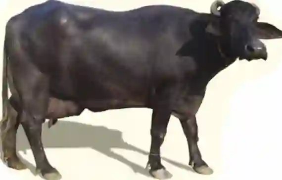
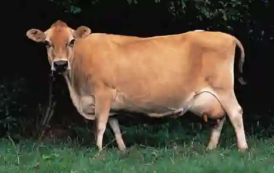
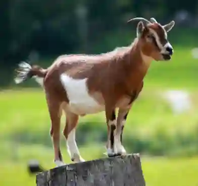
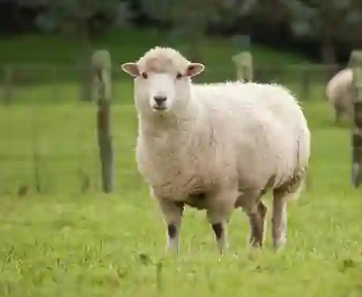

## Livestock farming

### Livestock products and uses

* Buffaloes: Primary milk producers (Nili Ravi, Kundi breeds); meat. Located in canal plains near water.

* Cattle: Draught power (ploughing, transport); milk (Sahiwal, Red Sindhi).

* Goats and sheep: Meat (mutton), wool (carpets/textiles), leather. Adapted to dry, rugged landscapes (Balochistan, KPK).

* Poultry: Meat and eggs. Fast growth near big cities (Lahore, Karachi).

**Factors affecting livestock farming**

* Natural factors: Climate stress on buffaloes in extreme heat; pasture overgrazing in Balochistan/Thar; disease outbreaks (foot-and-mouth, tick-borne infections, avian flu).

* Human factors: Capital requirements for commercial dairy; urban market access versus remote spoilage risks; breed improvement (artificial insemination); winter fodder shortages; insufficient veterinary support.

**Farming practices**

* Nomadic pastoralism: Herders move continuously with sheep and goats in dry deserts (Thar, Kharan) seeking pasture and water.

* Transhumance: Seasonal movement of livestock between mountain pastures in summer and lower valleys in winter (northern high mountain regions).

* Commercial dairy and poultry farming: Modern farms using scientific feeding, automated milking, and veterinary care near urban markets.

**Small-scale subsistence livestock keeping vs nomadic practices**

* Small-scale subsistence: $1$-$5$ animals kept near homestead on crop residues/waste for family milk, fuel/fertilizer dung, and draught. Challenges include inbreeding, limited veterinary care, and water competition during droughts.

* Nomadic/semi-nomadic: Herds of $50$-$200$ goats/sheep moving seasonally following rainfall for meat, wool, and hides. Challenges include land conflicts with settled farmers, lack of vaccination access, water scarcity, and climate shifts.

**Poultry farming factors**

* Natural factors: Temperature control is critical to prevent heat stress and disease outbreaks (avian influenza).

* Human factors: Proximity to urban markets (Lahore, Karachi, Faisalabad), soybean/feed price volatility, biosecurity needs, and competition from cheap imported frozen chicken.

### **Small-Scale Subsistence vs Nomadic/Semi-Nomadic Livestock**

#|
||

**Feature**

|

**Small-Scale Subsistence**

|

**Nomadic/Semi-Nomadic**

||
||

**Herd Size**

|

$1$ - $5$ animals

|

$50$ - $200$ animals

||
||

**Location**

|

Near homestead (village)

|

Move seasonally across deserts and mountains

||
||

**Purpose**

|

Milk for family; dung for fuel; draught power

|

Meat, wool, and hides for sale or trade

||
||

**Feed**

|

Crop residues; kitchen waste; limited grazing

|

Natural pasture; mobile search for water

||
||

**Labour**

|

Family members (unpaid)

|

Herders (hired or family members)

||
||

**Veterinary Care**

|

Limited

|

Very limited (due to mobile herds)

||
||

**Challenges**

|

Inbreeding; limited vet care; water competition

|

Land conflicts; lack of vaccination; climate change altering routes

||
||

**Examples**

|

Buffalo kept by a small farmer in Punjab

|

Goat/sheep herders in Balochistan or the Thar Desert

||
|#

### Animal photo recognition tips

* **Poultry:**

  * Small body with white, brown, or mixed feathers.

  * Red fleshy comb on the head.

  * Kept in intensive sheds, cages, or free-range systems near cities.

  * Divided broadly into broilers (raised for meat) and layers (raised for eggs).

  

* **Buffalo**:

  * Large, dark gray/black skin.

  * Curved horns.

  * Often submerged in mud or rivers.

* **Cattle**:

  * Distinct hump over shoulders.

  * Large dewlap (loose skin under throat).

  * Varied light colors.

* **Goats**:

  * Thin body.

  * Short tail pointing upward.

  * Long ears.

  * Sharp horns.

* **Sheep**:

  * Thick woolly fleece coat.

  * Heavy rounded body.

  * Downward pointing tail.

