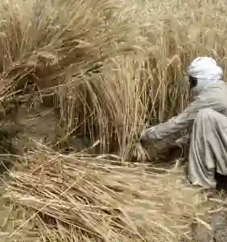
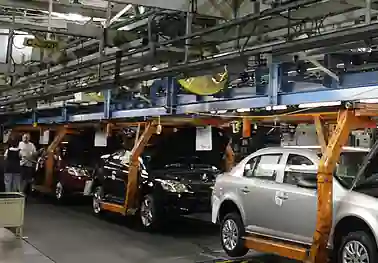

# Industrial Development

## Essential Terminology and Economic Sectors

* Raw Materials: Unprocessed basic materials in their natural state before being converted into products (e.g., raw cotton, sugarcane, iron ore).

* Refined: Purified or freed from impurities through industrial processing (e.g., crude oil refined into petrol or crude sugar refined into white sugar).

* Processed: Altered or prepared through a series of mechanical or chemical operations to make it usable (e.g., wheat processed into flour).

* Manufactured: Products made from raw or processed materials using machinery and labour in factories (e.g., cotton yarn woven and sewn into garments).

* Value-Added: The extra financial value added to a product at each stage of manufacturing (e.g., raw cotton (low value) to cotton yarn to woven cloth to finished designer garments (highest value added)).

* Infrastructure: The basic physical systems and facilities needed for an industry to operate efficiently (electricity grids, gas pipelines, metalled roads, railways, seaports).

* Services: Non-physical utilities or activities provided to support people and businesses (banking, insurance, transport, telecommunications).

### Refined and processed

* **Refined:** Purification through the removal of impurities from a substance that is already usable.

  * Examples: Crude oil refined into petrol; crude sugar refined into white sugar.

  * Key Idea: The substance is purified, not fundamentally changed.

* **Processed:** Mechanical or chemical alteration that changes the physical form or nature of a raw material.

  * Examples: Wheat ground into flour; sugarcane crushed into juice; cotton spun into yarn.

  * Key Idea: The substance is altered into something entirely new.

    * **Worked Example: Stages of Production**

      #|
      ||
      
      **Stage**

      |
      
      **Term**

      |
      
      **What Happens**

      ||
      ||
      
      **Crude oil extracted**

      |
      
      Raw material

      |
      
      Unprocessed, natural state

      ||
      ||
      
      **Crude oil heated and separated**

      |
      
      Refined

      |
      
      Impurities removed; fractions separated

      ||
      ||
      
      **Petrol blended with additives**

      |
      
      Processed

      |
      
      Chemical alteration to make usable fuel

      ||
      ||
      
      **Petrol sold at pump**

      |
      
      Manufactured

      |
      
      Final product ready for consumer

      ||
      |#
      

### Economic Sectors

* Primary Industry: Extractive activities involving direct collection or harvesting of natural resources from the earth or sea (e.g., agriculture, mining, fishing, forestry).

* Secondary Industry: Processing and manufacturing activities that transform raw primary materials into finished or semi-finished goods (e.g., textile mills, steel mills).

* Tertiary Industry: Service-based activities that provide expertise, transport, commercial services, or care to consumers and industries (e.g., tourism, education, call centres, healthcare).

