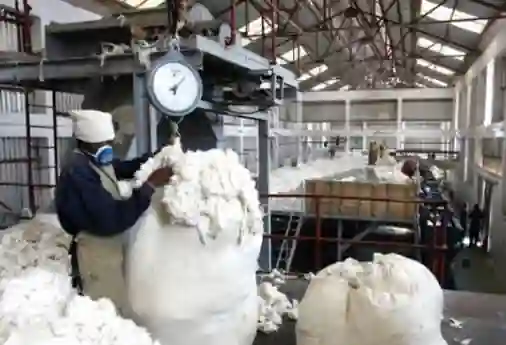
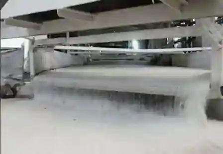
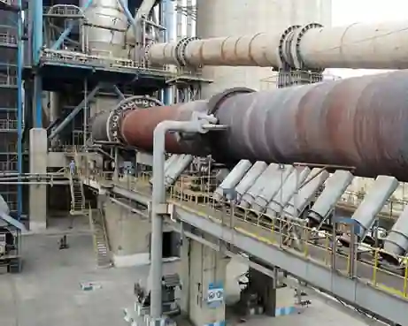
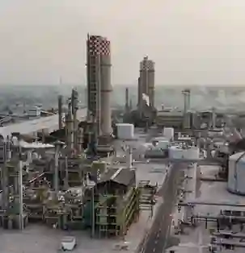
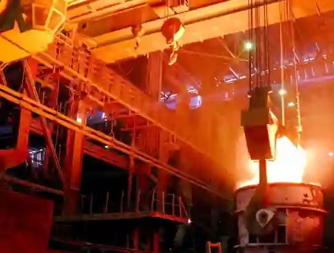
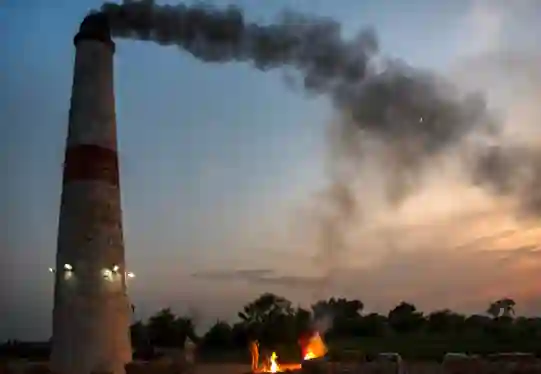
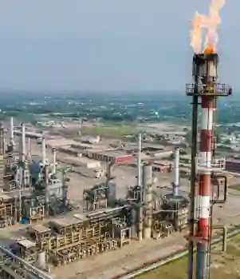
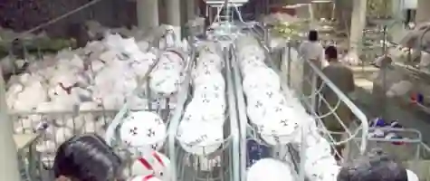
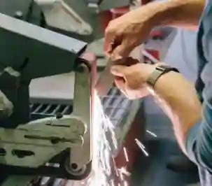
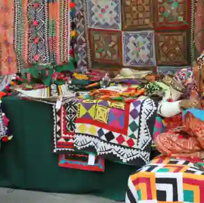

## 10 Specified Industries

### Cotton Industry (Ginning to Clothing)

* **Production Stages:**

  * Ginning (separates fibres from seeds).

  * Spinning (raw lint into yarn).

  * Weaving (yarn into grey cloth).

  * Processing/dyeing (bleaches and colours fabric).

  * Garments (ready-made clothing, towels, bedwear).

* **Locational Factors**: Proximity to the cotton belt of Punjab (Faisalabad, Multan) and Sindh (Hyderabad) to minimize transport costs; coastal port access in Karachi for export; abundant soft water for dyeing and reliable electricity.

* **Challenges**: Cotton Leaf Curl Virus, electricity tariffs, and outdated spinning machinery.

### Sugar Refining Industry

* **Main Products:** White refined sugar, gur, bagasse, and molasses.

* **Locational Factors**: Built directly inside sugarcane-growing regions (Faisalabad, Sargodha) due to the 24-Hour Rule (sucrose rapidly evaporates and sours if cane is not crushed within $24$ hours of harvesting).

* **Challenges**: Highly seasonal operation ($4$-$5$ months during winter) and price disputes between farmers and mill owners.

### Cement Industry

* **Main Products**: Portland cement, clinker, water-resistant cement.

* **Inputs**: Limestone ($75$%), clay ($20$%), gypsum ($5$%), and coal/gas.

* **Locational Factors:** Located right at the foot of limestone hills (Salt Range at Dandot/Wah, Hattar, D.G. Khan, Hyderabad) because moving bulky stone over long distances is uneconomical.

* **Challenges**: Heavy carbon footprint, dust pollution, and sensitivity to global coal price swings.

### Fertilizer Industry

* **Main Products:** Urea, DAP, and NPK compound fertilizers.

* **Locational Factors:** Situated along major natural gas pipelines and fields (Daharki, Rahim Yar Khan, Sheikhupura) because natural gas serves as both the fuel source and the main chemical feedstock for urea.

* **Challenges**: Gas shortages and load shedding during winter, alongside reliance on expensive imported rock phosphate.

### Iron and Steel Industry

* **Main Products:** Steel billets, rolled sheets, galvanized pipes, and structural steel.

* **Locational Factors:** Established as Pakistan Steel Mills at a deep-water coastal site at Port Qasim (Karachi) to receive imported raw iron ore and coking coal directly from heavy cargo ships.

* **Challenges**: Heavy reliance on foreign raw materials, high capital maintenance, and operational disruptions.

### Brick Industry (Brick Kilns)

* **Main Products:** Burnt clay bricks, roof tiles, paving blocks.

* **Locational Factors**: Situated across the alluvial plains of Punjab and Sindh where fine clay and water are abundant, positioned on peri-urban fringes just outside major cities to supply expanding construction markets.

* **Challenges**: Severe air pollution contributing to winter smog, destruction of fertile agricultural topsoil, and seasonal monsoon shutdowns.

### Oil Refining Industry

* **Main Products:** Petrol, diesel, kerosene, jet fuel, furnace oil, LPG, and asphalt.

* **Locational Factors**: Coastal terminals in Karachi (National Refinery, Pakistan Refinery) receive imported crude; Attock Refinery (Rawalpindi) sits at the Potwar oilfields; PARCO (Mahmood Kot) sits along a mid-country pipeline.

* **Challenges**: Heavy import bill burden, fluctuating international oil prices, and refining technology upgrades.

### Sports Goods Industry

* **Main Products**: Hand-stitched inflatable footballs, cricket bats, hockey sticks, tennis rackets, and sportswear.

* **Locational Factors:** Heavily concentrated in Sialkot due to a century-old heritage of specialized craftsmanship, skilled hand-stitching labour, a local dry port, and an international airport.

* **Challenges**: Competition from automated thermo-bonded balls made in China and strict international labour standard compliance.

### Surgical Instruments Industry

* **Main Products:** Scissors, scalpels, forceps, dental tools, and veterinary tools.

* **Locational Factors**: Located in Sialkot alongside the sports industry, utilizing centuries of inherited metalworking and die-casting expertise and air freight access for high-value shipments.

* **Challenges**: Rising costs of imported stainless steel alloys and stringent international medical quality certifications.

### Crafts Industry (Cottage/Handicrafts)

* **Main Products:** Onyx products, blue pottery (Multan), hand-knotted wool carpets, carved furniture (Chiniot), glazed tiles.

* **Locational Factors:** Operates primarily as a home-based cottage industry using family labour and generational skills in cultural hubs.

* **Challenges**: Exploitation by middlemen who take profits, lack of formal bank credit, and competition from cheap plastic mass-manufactured goods.

### Key numerical facts

* **Cotton Exports:** $50$ percent to $60$ percent of all export earnings.

* **Sugarcane Processing Rule:** Must be processed within $24$ hours of harvest to prevent sugar content loss.

* **Pakistan Forest Cover:** Currently $4$% to $5$% (against a target of $25$%).

* **Call Centre Employment:** Employs $50,000$ to $70,000$ people.

* **Tourism GDP Contribution:** \<$1$% currently; with a long-term potential of $5$% to $10$%.

### Domestic vs export market dynamics 

* **Cotton & Textiles:** Primarily serve a strong domestic market for clothing and garments, while also acting as Pakistan's largest export earner ($50$% to $60$% of total exports).

* **Cement & Fertilizer:** Cement fulfills domestic housing and construction demands while exporting surpluses to Afghanistan and Gulf nations. Fertilizer is almost entirely consumed domestically by farmers, with only occasional urea exports.

* **Iron & Steel & Oil Refining:** Catering mainly to domestic construction, engineering, and national energy/transport needs, with minimal exports (such as steel pipes to Afghanistan).

* **Niche Export Industries (Sports Goods & Surgical Instruments):** Have minimal domestic footprints and are overwhelmingly export-oriented, supplying international brands, global sports events, and overseas hospitals.

* **Sugar, Bricks & Crafts:** Sugar and bricks are almost entirely consumed domestically due to high weight or local demand, whereas traditional crafts serve domestic retail alongside niche international markets (like carpets and onyx).