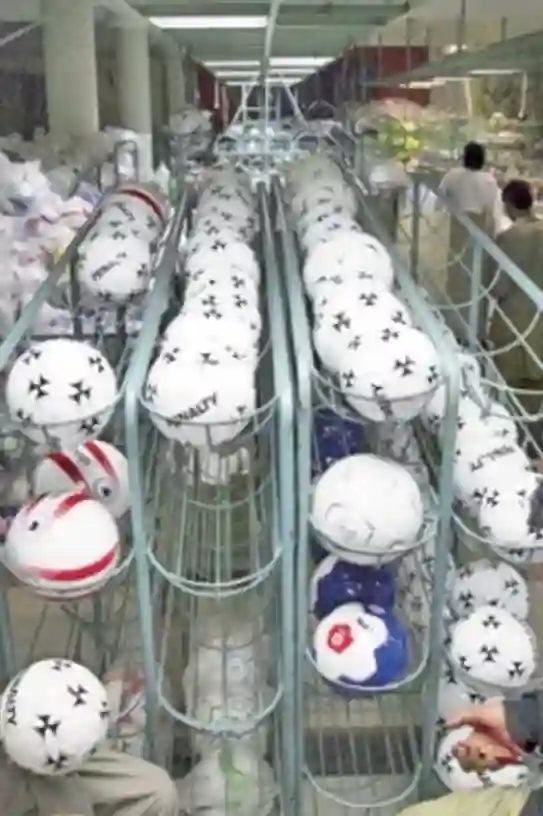
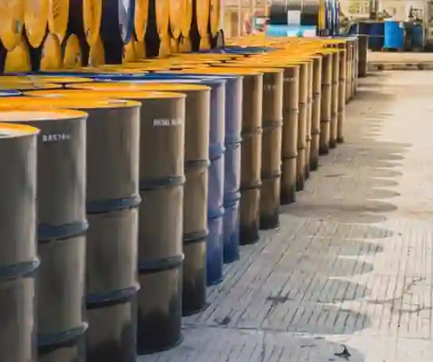

## What Pakistan Exports and Imports

### Exports (What Pakistan Sells)

* Textiles and clothing ($50$% to $60$% of all export earnings): Raw cotton, cotton yarn, woven cloth, ready-made clothes, bedsheets, towels, and knitwear. Serves as the primary source of foreign currency.

* Farming and food Items: High-quality Basmati rice (Middle East/Europe) and non-Basmati rice (Africa/East Asia); Kinno citrus, mangoes, dates, onions, and seafood (shrimp, fish, crabs).

* Specialised manufactured items: Hand-stitched footballs, cricket gear, surgical instruments (Sialkot), tanned leather, carpets, cement, marble, and basic medicines.

### Imports (What Pakistan Buys)

* Petroleum and energy ($18$ billion\+): Crude oil, petrol, diesel, furnace oil, and LNG to run power plants and fuel transport.

  

* Machinery and industrial equipment: Textile machines, electric generators, telecom gear, and turbines ($5$–$8$ billion annually).

* Chemicals and raw materials: Industrial chemicals, plastic materials, fertilizers, pesticides, and scrap iron/steel.

* Food and cooking goods: Edible palm oil (Malaysia/Indonesia), tea, lentils, and wheat during domestic shortages.

* Transport vehicles: Cars, heavy trucks, airplanes, ships, and spare parts.

### **Export and Import Composition**

#|
||

**Category**

|

**% of Total Exports**

|

**Category**

|

**% of Total Imports**

||
||

**Textiles**

|

$60$%

|

**Oil and energy**

|

$25$%

||
||

**Rice**

|

$8$%

|

**Machinery**

|

$15$%

||
||

**Leather**

|

$4$%

|

**Chemicals**

|

$10$%

||
||

**Sports goods**

|

3$%

|

**Food**

|

$10$%

||
||

**Other**

|

$25$%

|

**Other**

|

$40$%

||
|#

### **Trade Deficit Impacts**

#|
||

**Impact**

|

**Explanation**

||
||

**Drains reserves**

|

Foreign currency reserves are depleted to pay for imports

||
||

**Weakens rupee**

|

Higher demand for USD means more PKR is needed per dollar

||
||

**Increases debt**

|

The government is forced to borrow internationally to bridge the gap

||
||

**Causes inflation**

|

Imported raw materials and fuel become costlier, driving up domestic prices

||
|#

