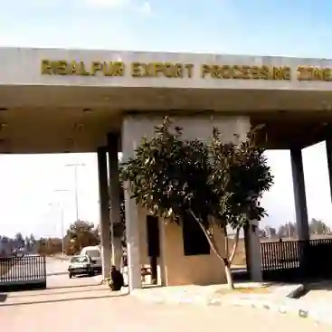

## EPZs, Infrastructure and Government Barriers

* ### Export Processing Zones (EPZs):

  

  * Specialized enclaves (Karachi, Risalpur, Saindak) offering tax holidays, $100$% foreign ownership, zero import duties on machinery, and reliable infrastructure to attract FDI and boost manufactured exports.

  * **Table for EPZs**

    #|
    ||
    
    **EPZ Location**

    |
    
    **Key Incentive**

    ||
    ||
    
    **Karachi EPZ (Sindh)**

    |
    
    Tax-free operations, $100$% foreign ownership permitted

    ||
    ||
    
    **Risalpur EPZ (KPK)**

    |
    
    Duty-free imports of machinery and raw materials

    ||
    ||
    
    **Saindak EPZ (Balochistan)**

    |
    
    Heavy tax incentives tailored for mineral extraction and mining

    ||
    |#
    

* ### Infrastructure & Ports:

  * Inland dry ports reduce coastal congestion; Gwadar Port offers deep-sea transit for western China and Central Asia. However, Afghan transit trade faces smuggling issues, while coastal ports suffer from heavy silt accumulation, dredging costs, and peak-season delays.

* ### Government Trade Barriers:

  * Implementing tariffs (taxes on imports), quotas (strict physical limits), and embargoes (complete bans) to protect domestic industries and manage the trade deficit.

* ### Transport Modes:

  * Sea routes handle over $90$% of trade volume due to cost-efficiency for bulk goods, while land routes (Karakoram Highway) enable regional land trade despite mountain terrain and seasonal weather closures.

  * **Table of Transport Routes for Trade**

    #|
    ||
    
    **Route Type**

    |
    
    **Examples**

    |
    
    **Key Goods Transported**

    ||
    ||
    
    **Sea routes**

    |
    
    Karachi Port, Port Qasim, Gwadar

    |
    
    Crude oil, industrial machinery, textiles

    ||
    ||
    
    **Land routes**

    |
    
    Karakoram Highway (China), Khyber Pass (Afghanistan)

    |
    
    Cement, food items, consumer machinery

    ||
    |#
    

