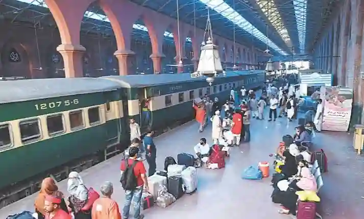
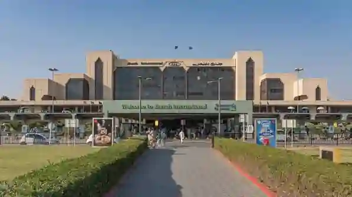
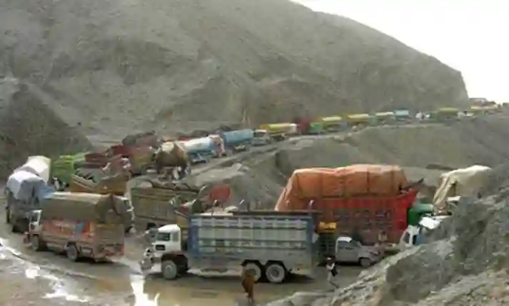
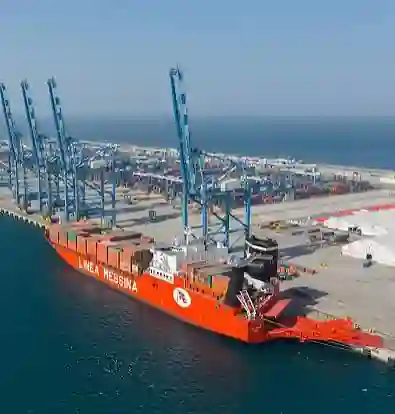

## Comparison of transport modes (goods and people)

#|
||

**Transport** **mode**

|

**Advantages**

|

**Disadvantages**

||
||

**Road** **transport**

|

* Door-to-door service without reloading; high flexibility ($24/7$ on demand); cost-effective for short/medium hauls; minimal paperwork.

|

* Low payload capacity compared to trains; vulnerable to traffic congestion, accidents, and severe weather; high long-distance wear and tear.

||
||

**Rail transport**

|

* High capacity for bulk goods (coal, oil, steel, cement); cheaper per ton-kilometre for long hauls; safer with fewer accidents and weather resistance.

|

* Inflexible fixed routes and strict timetables require feeder transport; massive capital costs for tracks/locomotives; bureaucratic delays.

||
||

**Air transport**

|

* Unmatched speed for people and high-value/perishable cargo; reaches remote mountain regions cut off by land; high security against theft/damage.

|

* Prohibitively expensive for everyday travel or heavy bulk freight; very low volume capacity; highly weather-dependent (fog, snow cancellations).

||
|#

### **Factors Affecting Location and Development**

**Cross-Border Roads and Railways**

* **Terrain:** Must strictly follow valleys and mountain passes (such as the Khyber or Khunjerab Pass) because high mountains cannot be crossed directly.

* **Political Relations:** Trade routes function only when neighboring countries permit cross-border transit (e.g., the India border is closed periodically).

* **Security:** Border areas in Balochistan and KPK present security risks, requiring continuous route protection.

* **Existing Infrastructure:** Upgrading established routes like the Karakoram Highway is significantly cheaper than engineering new ones through mountains.

**Airports**

* **Flat land:** Must be free from surrounding high-rise buildings and hills.

* **Clear weather:** Low occurrence of fog (Islamabad and Karachi enjoy better winter weather than Lahore).

* **Proximity to cities:** Close to major economic, commercial, and population centers.

* **Large area:** Runways and passenger terminals require substantial acreage.

**Dry Ports**

* **Proximity to export industries:** Located close to manufacturing hubs (e.g., Sialkot for sports goods, Faisalabad for textiles).

* **Transport links:** Strong road and rail connections linking the facility to both coastal ports and inland markets.

* **Land availability:** Large, flat areas are required for container handling yards at affordable land prices.

* **Government support:** Efficient customs facilities, security, and streamlined regulations.

**Seaports**

* **Deep water close to shore:** Essential to accommodate large container ships (found in Karachi, Port Qasim, and Gwadar).

* **Natural shelter:** Bays and natural barriers protect vessels from monsoons and rough waves (e.g., Manora Island shelters Karachi Port).

* **Flat backing land:** Adequate space is needed for storage yards and container stacking.

* **Road and rail links:** Must connect seamlessly to interior consumer markets.

