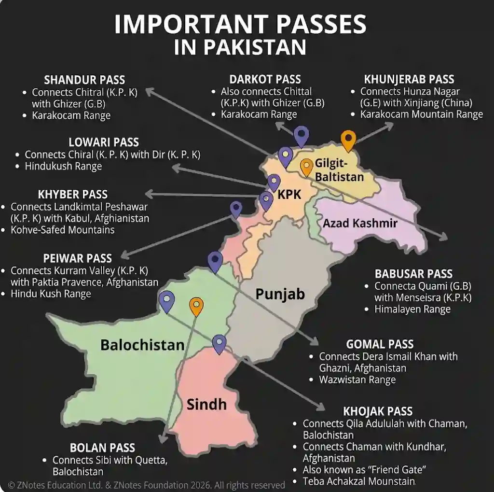

## International Transport

### International Transport and Cross-Border Routes

* **To Afghanistan:** Khyber Pass (Peshawar to Kabul road), Khojak Pass (Quetta-Chaman rail/road tunnel to Kandahar), and Bolan Pass (connecting Balochistan to Afghanistan).

* **To China:** Khunjerab Pass (highest paved international border crossing, carrying the KKH through the Karakoram mountains to Xinjiang).

* **To Iran:** Quetta-Taftan Railway Line and N-40 Road connecting western Balochistan to Taftan.

* **To India:** Wagah Border (Lahore to Amritsar/Delhi road/rail link) and Khokrapar-Munabao Route (Sindh to western India rail link).

### Seaports of Pakistan

* **Port Keamari (Karachi Port):** Historic, primary deep-water port in a sheltered bay protected by Manora Island. Handles a massive share of imports and exports (machinery, oil, textiles, chemicals).

* **Port Qasim:** Located about $50$ km southeast of Karachi to relieve port congestion. Handles bulk cargo (iron ore, coal, furnace oil, wheat) and serves adjacent industrial zones (Pakistan Steel Mills).

* **Gwadar Port:** Strategic deep-water seaport on the southwestern Balochistan coast on the Arabian Sea. Developed with Chinese assistance under CPEC to link landlocked Central Asia and western China to global shipping lanes.

* **Location Requirements:** Deep water close to shore for modern container vessels, natural protection from monsoons, flat backing land for storage yards, and strong road/rail connections.

**Pakistan border map**

