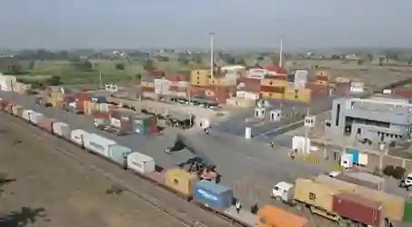

## Dry ports

* **Definition:** An inland intermodal terminal directly connected by road or rail to a seaport, allowing regional cargo to be processed, stored, and cleared by customs away from the coast. Examples include Lahore, Sialkot, Multan, Faisalabad, Rawalpindi, Peshawar, Quetta, Hyderabad, and Larkana.

* ### **Why They Have Been Developed:**

  * Relieve Port Congestion: Divert \~$20$-$30$% of cargo traffic away from overloaded coastal ports like Karachi Port (which handles \~$60$% of national cargo).

  * Inland Customs Clearance: Importers/exporters complete documentation locally, reducing clearance time from $7$-$10$ days down to $2$-$3$ days.

  * Boosting Inland Exports: Supports regional manufacturing hubs (e.g., Sialkot dry port handles \~$70$% of the city's \~$2$ billion annual exports).

  * Reducing Transport Costs: Saves fuel and road wear by reducing truck trips to the coast.

  * Job Creation: Employs thousands directly and indirectly in customs brokerage, freight forwarding, and warehousing.

* **Location Factors:** Proximity to export manufacturing hubs, robust road/rail connections, affordable flat land for container yards, government customs support, and sufficient cargo volume.