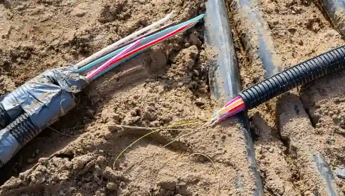

## **Problems Associated with Provision**

* Geographical Obstacles: Mountainous northern and western terrain blocks wireless signals and makes laying underground fibre-optic cables treacherous and expensive.

* Power Shortages: Frequent blackouts and unreliable rural grids disrupt cell towers, exchanges, and internet routers.

* High Cost and Affordability: Importing hardware burdens the balance of payments; low-income rural households struggle to afford devices and broadband bills.

* Digital and Literacy Divide: Widespread illiteracy and digital illiteracy slow technology adoption in remote areas.

* Disasters and Security: Natural disasters snap fibre lines and knock down masts, while cyber threats and vandalism present ongoing security challenges.

