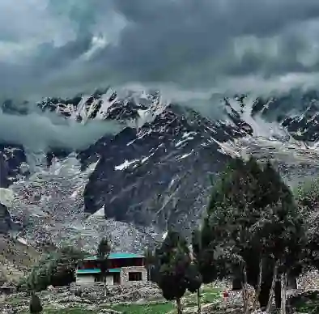

## Distribution & Density of Population

### **Core Definitions**

* **Population distribution:** The spatial pattern of where people live across a country.

* **Population density:** The average number of people living in a specific unit of area.

**Regional Variations Across Provinces**

#|
||

**Province/Region**

|

**Population (approx.)**

|

**% of Total**

|

**Density (\\text\{persons/km\}\^2)**

|

**Key Features**

||
||

**Punjab**

|

approximately $110$ million

|

approximately $53$ %

|

approximately $600$

|

Highest population; fertile Indus Plain

||
||

**Sindh**

|

approximately $55$ million

|

approximately $22$ %

|

approximately $350$

|

Karachi mega-city; Indus corridor

||
||

**KPK**

|

approximately $40$ million

|

approximately $16$ %

|

approximately $250$

|

Peshawar valley; mountainous north

||
||

**Balochistan**

|

approximately $15$ million

|

approximately $6$ %

|

approximately $20$

|

Largest area; sparse desert population

||
||

**Gilgit-Baltistan**

|

approximately $2$ million

|

approximately $1$ %

|

approximately $10$

|

High mountains; valley settlements

||
||

**AJK**

|

approximately $4$ million

|

approximately $2$ %

|

approximately $300$

|

Hilly terrain; some dense valleys

||
|#

**Regional Variations Across and Within Provinces**

* **High Density Areas:** The fertile plains of Punjab and central Sindh, particularly along the Indus River basin and major urban industrial corridors (e.g., Lahore, Faisalabad, Islamabad-Rawalpindi, Karachi).

* **Low Density Areas:** Rugged northern mountain regions (e.g., Gilgit-Baltistan, parts of Khyber Pakhtunkhwa's highlands) and hyper-arid desert tracts like the Kharan and Cholistan deserts.

### Overall

* **Punjab:** High density in Lahore, Faisalabad, and Multan; low density in the Cholistan and Thal deserts.

* **Sindh:** High density in Karachi (approximately $20$ million) and Hyderabad; low density in the Thar Desert and Kirthar Range.

* **KPK:** High density in the Peshawar Valley, Mardan, and Swat; low density in Chitral and Kohistan.

* **Balochistan:** High density in Quetta; low density in Kharan, Chaghi, and Makran.

* **Gilgit-Baltistan:** High density on valley floors (Gilgit, Skardu); low density in high mountain pastures.

### **Factors Influencing Variations**

* **Physical Factors:**

  * **Relief and Climate:** Flat, low-lying alluvial plains with moderate climates and fertile soils support high densities, whereas steep mountain slopes, freezing winters, and water-scarce deserts make settlement sparse.

  * **Water Availability:** Proximity to perennial rivers, extensive canal networks, and reliable rainfall dictates human settlement viability.

* **Economic Factors:** The concentration of jobs, trade routes, commercial markets, and manufacturing industries in cities pulls large volumes of people into specific geographic corridors.

* **Social and Political Factors:** Historical migration patterns, tribal boundaries, administrative headquarters, and security considerations also shape local population distributions.