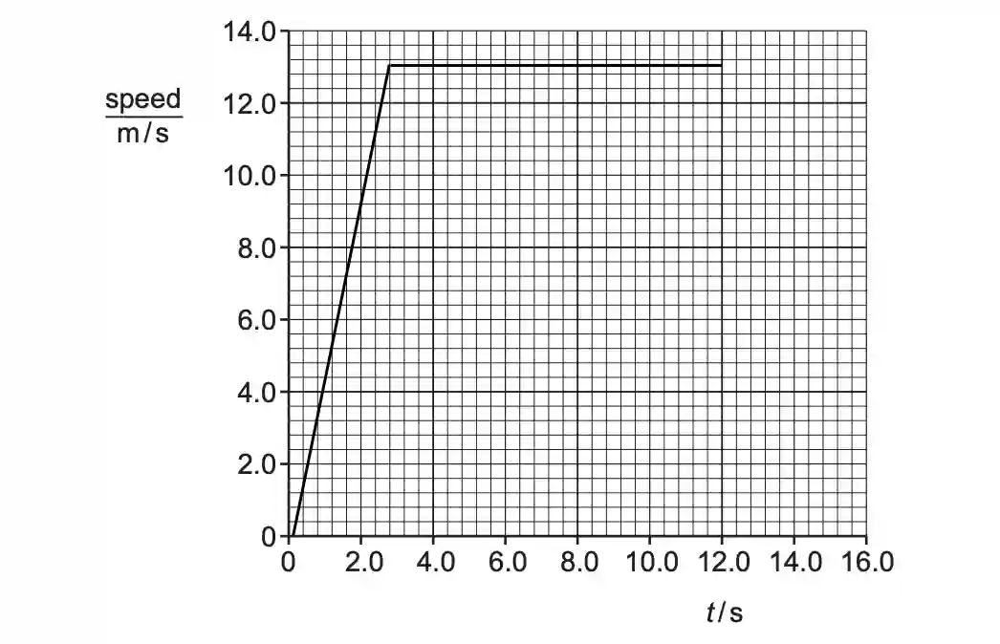

# 0625/42/O/N/23

## Question 1

**a)**

**i)**

   $$ a = \frac{ \Delta v}{ \Delta t}$$

   $$ a = \frac{ 13}{ 3.2}$$

   $$ a = 4.1 m/s^2 $$

**ii)**

* The change or increase in velocity per unit time OR rate of change of velocity

**b)**

**i)** 

**ii)**

$$ \frac{1}{2} \times 3.2 \times 13 = 21m $$

**c)**

$$ W = F \times d $$

$$ F = m \times a$$

$$ F = 1350 \times 13 = 8775 N $$

$$ W = 8775 \times 13 = 1.1 \times 10^5 $$

**d)**

Suggestion : Rainy day

Explanation: Due to slippery roads, there is a decrease in frictional force between the tires and the road