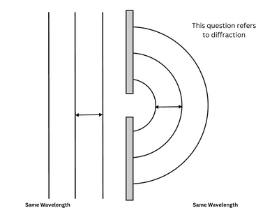

## Question 5

**a)**

**i)** T

#|
||

application

|

region of electromagnetic spectrum

||
||

cancer treatment

|

gamma rays

||
||

Bluetooth data connection

|

**radio waves**

||
||

optical fibres

|

**infrared**

||
||

security marking

|

**ultraviolet**

||
||

sterilising food

|

**gamma rays**

||
||

wireless internet

|

**microwaves**

||
|#

**ii)**

$$3.0 \times 10^8 m/s$$

**b)**

**i)**

**ii)**

