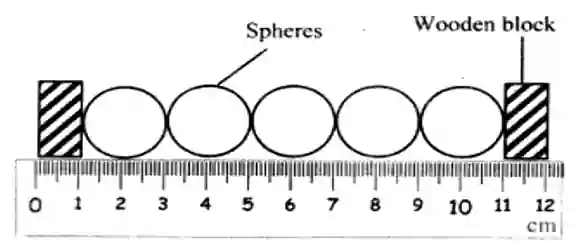

# **Motion, Forces and Energy**

## Physical quantities and measurement techniques

### Base units and conversions

#|
||

Physical quantity

|

SI unit

|

Symbol

||
||

Distance

|

Meter

|

m

||
||

Time

|

Second

|

s

||
||

Mass

|

Kilogram

|

kg

||
||

Temperature

|

Kelvin

|

K

||
||

Current

|

Ampere

|

A

||
|#

#|
||

**Meter (m)**

|

**Other units**

||
||

$10^6$m

|

1 Megameter (Mm)

||
||

$10^3$m

|

1 Kilometer (km)

||
||

1m

|

1 Meter (m)

||
||

$10^{-1}$m

|

1 Decimeter (dm)

||
||

$10^{-2}$m

|

1 Centimeter (cm)

||
||

$10^{-3}$m

|

1 Millimeter (mm)

||
||

$10^{-6}$m

|

1 Micrometer (µm)

||
||

$10^{-9}$m

|

1 Nanometer (nm)

||
|#

### Measuring length, volume and time intervals

* Rulers and measuring cylinders are used to find the length or volume respectively

* Measuring time intervals can be done using clocks and digital timers

**To measure the thickness of a single sheet of paper:**

1. Use a ruler to measure the thickness of a set amount of sheets

2. Divide the value by the total number of sheets

3. Repeat with different positions of reading and find the average

**To find the diameter of a single ball:**

1. Line up 5 identical balls next to each other and place a wooden block on each side

2. Measure the total diameter of the balls

3. Divide the number by 5

**To measure a variety of time intervals (Pendulum):**

1. Use a stopwatch to time oscillations and determine a complete cycle when the ball reaches its original place

2. Perform multiple oscillations

3. Divide the total time by the number of oscillations

### Scalar and vector quantities

#|
||

Scalar

|

Vector

||
||

Scalar quantity has magnitude (size) only

|

Vector quantity has both magnitude and direction

||
||

Examples:  Distance, speed, time, mass, energy and temperature

|

Examples: force, weight, velocity, acceleration, momentum , electric field strength, magnetic field strength, gravitational field strength and displacement

||
|#

### Resultant of 2 vectors at right angles

++By calculation:++

(Use the Pythagoras theorem)

Resultant vector

$\boxed{c=\sqrt{a^2+b^2}}$

$=\sqrt{15^2+15^2}$

$=21.2N$

Angle to the horizontal surface/X

$\boxed{Tan(x) = opposite/adjacent}$

$Tan(x)= 15/15$

$x=Tan^{-1} (1)$

$x=45°$

++Graphically:++

* Choose an appropriate scale. Eg: 5N = 1cm

* Convert the value of forces into centimetres

* Construct a right angled triangle using the head and tails method.

* Connect the ends of the 2 line segments and draw the arrow in the correct direction.

* Measure the hypotenuse and convert it back to force.

* Use a protractor to measure the angle to the horizontal

