## Motion

### Speed

* The distance travelled per unit time

* Speed = $v=\frac{d}{t}$

* $\text{Average speed} = \frac{\text{Total distance}}{\text{Total time}}$

* Average speed is used when the speed isn’t uniform, but rather keeps changing

* Unit: m/s

### Velocity

* Speed with direction
* velocity = $v=\frac{s}{t}$

### Acceleration

* Is the change in velocity per unit time

* $a=\frac{{\Delta}v}{{\Delta}t}$

* Unit: m/$s^2$

* Deceleration is a negative acceleration

* Acceleration of free fall g for an object near to the surface of the Earth is approximately constant and is approximately $9.8 m/s^2$

Distance-time graphs

The y-axis is distance and the x-axis is time)

#|
||

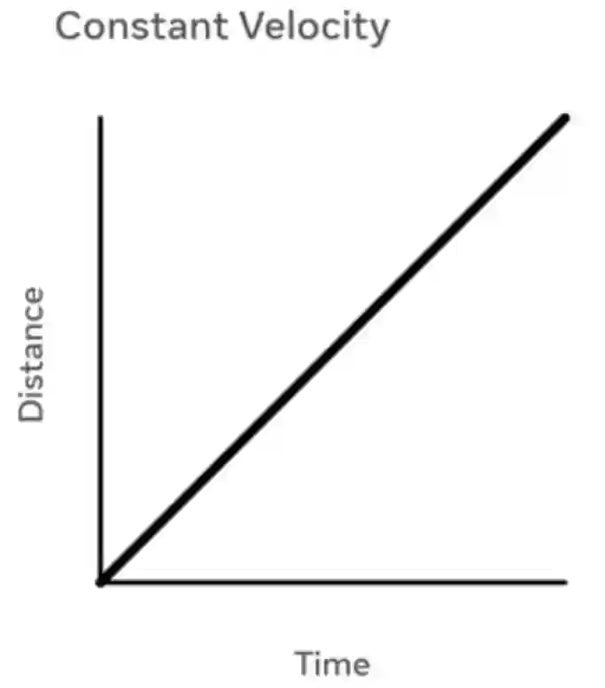

|

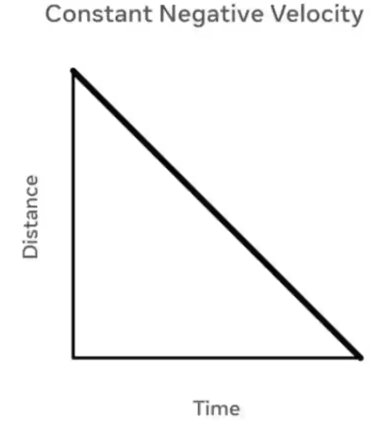

|

|

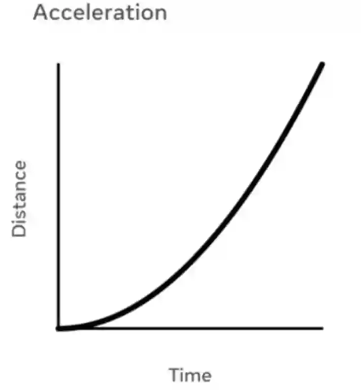

|

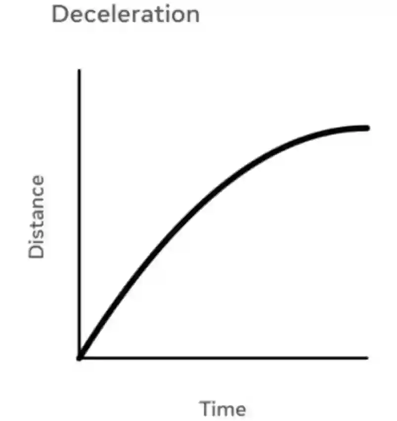

||
||

**Constant velocity**

|

**Constant negative velocity**

|

**At rest/stationery**

|

**Acceleration**

|

**Deceleration**

||
||

The value of velocity obtained is the same on any point of the slope.

V= constant

|

Object is moving backwards

(-V)=constant

|

No movement of the object.

V= 0

|

V= increases

|

Acceleration is negative, hence

V= decreases

||
|#

Speed-time graphs

The y-axis is speed and the x-axis is time

#|
||

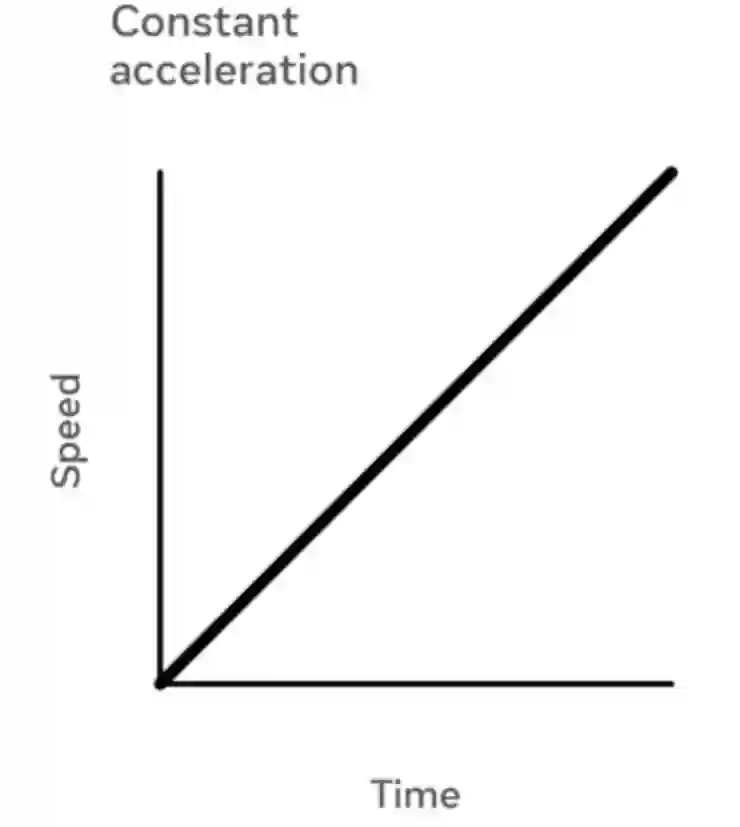

|

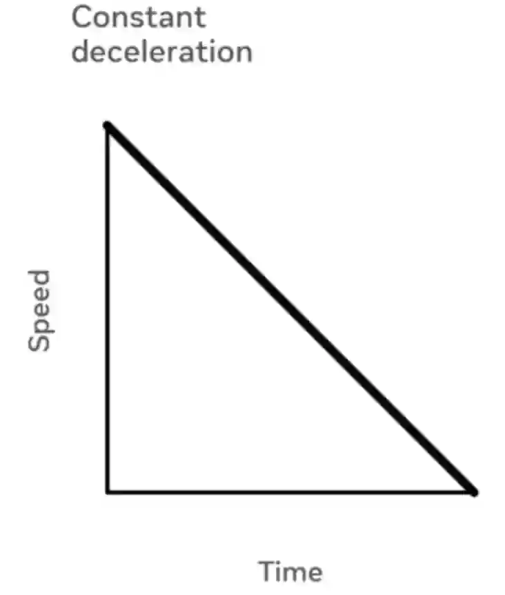

|

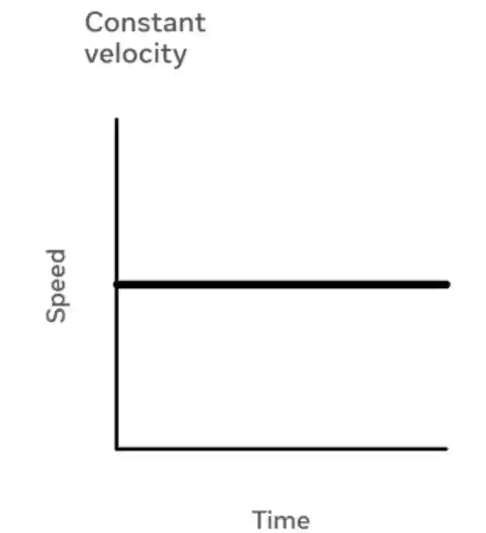

|

*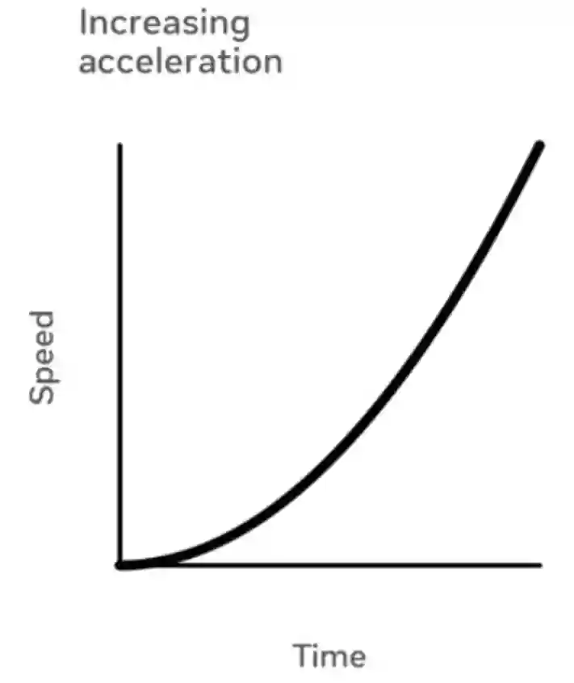*

|

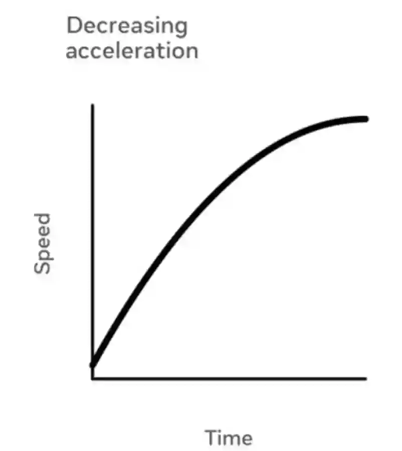

|

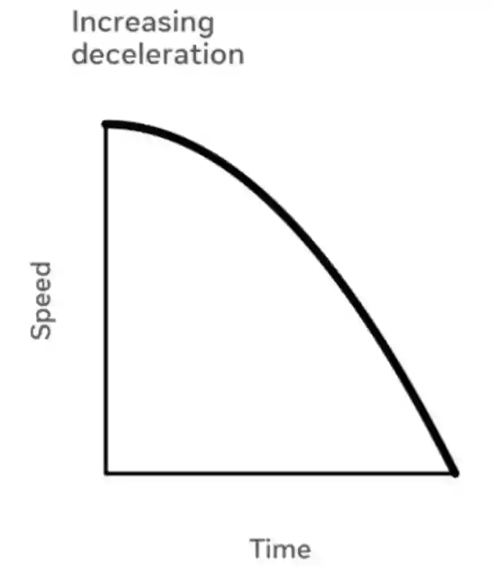

|

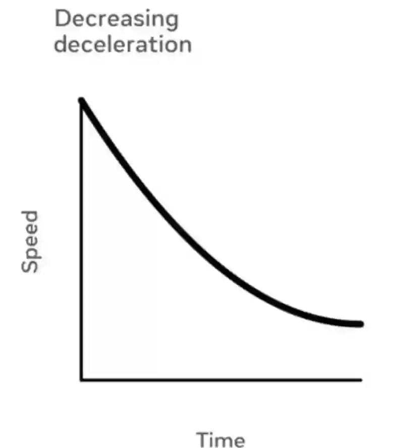

|

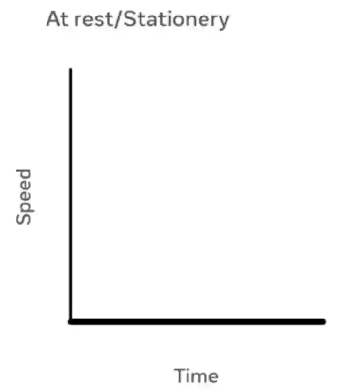

||
||

**Constant acceleration**

|

**Constant deceleration**

|

**Constant velocity**

|

**Increasing acceleration**

|

**Decreasing acceleration**

|

**Increasing deceleration**

|

**Decreasing deceleration**

|

**At rest/Stationery**

||
||

V= increases

A= constant

|

V=decreases

(-A)=constant

|

V=constant

A=0

|

A= Increases

V=increases

|

A= decreases

V= increases

|

A= negative

D=increases

V= decreases (at a faster rate)

|

A= negative

D=decreases

V=decreases (at a slower rate)

|

V=0

A=0

Object is not moving

||
|#

* The area under the graph of speed-time graph determines the distance travelled.
* The slope/gradient of a distance-time graph gives us velocity
* The slope/gradient of a speed-time graph gives us acceleration
* To find the gradient, use: $\frac{y_2-y_1}{x_2-x_1}$
* The value of the gradient of a speed time graph would be the value of acceleration
* Example:

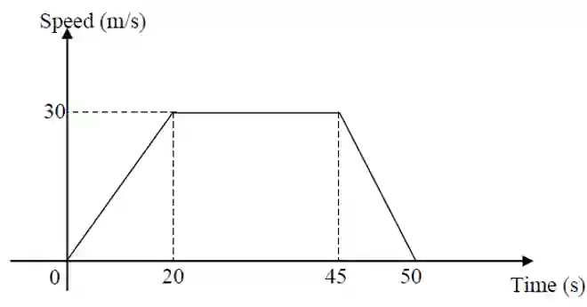

1. Calculate the acceleration in last 5 seconds

$a=\frac{{\Delta}v}{{\Delta}t}$ = $\frac{y_2-y_1}{x_2-x_1}$

$\frac{0-30}{50-45}$ = -6m/$s^2$ \<-- Acceleration

If this question asked for deceleration, then the final answer would have no negative (6m/$s^2$) as it is understood by deceleration that it is negative acceleration.

2. Calculate the total distance covered

Area of Triangle 1=

½ x 20 x 30 = $300m^2$

Area of rectangle=

(45-20) x(30-0) = $750m^2$

Area of triangle 2=

½ x (50-45) x (30-0) = $75m^2$

Total area = Total distance travelled

300\+750\+75 =1225$m^2$=++1125m++