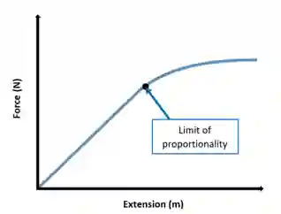

## Forces

* Forces may produce changes in the size and shape of an object

* The unit of force is N (Newtons)

* Spring constant is force per unit extension

* $k=\frac{F}{x}$    Unit: N/m or N/cm

* The greater the spring constant, the stiffer a spring is

* Limit of proportionality is the point beyond which extension is no longer directly proportional to the applied force (load). Beyond this point, the Hooke’s law (F=kx) no longer applies

* Eg of resultant forces acting along the same straight line:

  

* Object remains at rest or continues in a straight line at a constant speed unless acted by a resultant force

* Resultant force can sometimes change the velocity of an object by changing its direction of motion or its speed

* $F=ma$ (where the force and acceleration are in the same direction)

**Object in a circular path**

* speed increases if force increases, with mass and radius constant

* radius decreases if force increases, with mass and speed constant

* an increased mass requires an increased force to keep speed and radius constant

* Resultant force is perpendicular to the direction of motion/Towards the centre.

* solid friction as the force between two surfaces that may impede motion and produce heating

* friction (drag) acts on an object moving through a liquid or a gas (e.g. air resistance)

* Since the direction of velocity keeps changing, the ball is accelerating even though the magnitude of velocity is constant.

**Moment**

* Moment is the turning effect of force~.~ moment = force × perpendicular distance from the pivot    Unit: Nm or Ncm

* Examples: door and seesaw

* Object is at equilibrium when there is no resultant force and no resultant moment.

* Clockwise moment = Anticlockwise moment

* This is example shows an equilibrium:
  

Clockwise moment=Anticlockwise moment

Clockwise moment= 3x2 = 6Ncm

Anticlockwise moment= 2x3= 6Ncm

6-6

Resultant moment= 0

* Centre of gravity: A point where all the weight of an object seems to act

* Experiment to determine the position of the centre of gravity of an irregularly shaped plane lamina

1. Hang up lamina from a pivot (screw) so it swings freely

2. Suspend a plumb line (a weight attached to a thread) from the same pivot

3. Once stationery, draw a straight line along the thread (Centre of gravity is along the thread)

4. Repeat the experiment with lamina suspended from different positions

5. The centre of gravity is where all the drawn lines intersect

* To increase the stability of simple objects:

1. Lower the centre of gravity relative to the base

2. Increase the area of the base