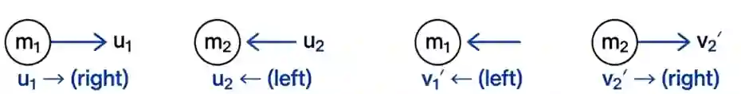

## Momentum

* Momentum is mass x velocity
* $p=mv$   Unit: kgm/s
* Impulse is force x time for which the force acts
* $Impulse=F{\Delta}t={\Delta}(mv)$   Unit: kgm/s or Ns
* Principle of momentum:
* Total momentum before collision = Total momentum after collision (in a closed system where no external forces are acting)
* $m_1u_1+m_2u_2=m_1v_1+m_2v_2$
* If the directions of 2 balls are opposite, then their velocities can be assigned signs.
* For example, in the image below, the objects have opposite direction of motion. The positive sign on the velocity can be given to the ball that is moving to the right and the negative sign on the velocity can be given to the ball that is moving to the left

* If after a collision, 2 masses stick together and travel at the same velocity together, then their masses can be added up.

* The equation becomes $m_1u_1+m_2u_2=v(m_1+m_2)$
  

* Resultant force is the change in momentum per unit time

* $F=\frac{{\Delta}p}{{\Delta}t}$