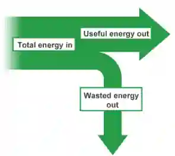

## Energy, work and power

* Energy may be stored as kinetic, gravitational potential, chemical, elastic (strain), nuclear, electrostatic and internal (thermal)

* Forces (Mechanical Work): A force acts on an object causing it to move = pushing a box transfers energy mechanically into kinetic or thermal stores

* ​Electrical Currents (Electrical Work): A moving electric charge transfers energy = a battery powering a light bulb converts chemical energy into light and thermal.

* ​Heating: Energy moves from a hotter object to a cooler object due to a temperature difference = a boiling kettle heating water via thermal transfer

* ​Waves (Electromagnetic and Sound): Energy is transferred via radiation or vibrations = light from the Sun traveling through space via electromagnetic waves or sound energy vibrating through the air

* The unit of Energy is J (Joules)

* Kinetic energy =  $E_k=\frac{1}{2} mv^2$

* Change in gravitational potential energy = $E_p=mg{\Delta}h$

* Principle of conservation of energy: “Energy is neither created nor destroyed, it is just converted from one form to another”

* Sankey diagram:

* The greater the width of the arrow, the more the energy.

* Mechanical or electrical work done is equal to the energy transferred

* $W=Fd={\Delta}E$

**Types of Energy and the process of of obtaining**

a)      Chemical energy stored in fossil fuels/biofuels can be obtained by burning fossil fuels/biofuels to boil the water in the pipes above (boiler). The water turns into steam and so this high pressure steam spins turbine. The turbine is connected to a generator which produces electricity

Chemical -\> Thermal -\> K.E -\> Electricity

b)     Waves = high speed waves pass through chamber walls compressing air column. Air particles reach turbine which spins the turbine. The turbine is connected to a generator which produces electricity

Kinetic energy in water -\> Kinetic energy of turbine -\> Electricity

c)      Tides = the tides rise and fall and so when water reaches its highest level, it reaches a turbine at high speed, forcing it to spin. The water is then blocked and once the water drops to a low tide, the trapped water is released and it spin the same turbine again

gravitational potential energy in tides -\> Kinetic energy in water -\> Kinetic energy of turbine -\> Electricity

d)     Water behind hydroelectric dams = water is dropped from a height and it reaches a turbine and spins it. The turbine is connected to a generator which produces electricity

GPE -\> K.E -\> Electricity

e)     Geothermal source= water is pumped under the earth. Water gets heated by rocks and turns into steam which spins a turbine that is connected to a generator that generates electricity. Heat energy -\> K.E -\> Electricity

f)       Nuclear fuel = Nuclear fission occurs and a lot of thermal energy is produced to heat the water and turn it to steam which spins a turbine that is connected to a generator.

Nuclear Energy -\> Thermal energy -\> K.E -\> Electricity

g)      Solar Energy = light from Sun is used to generate electrical energy. Light energy -\> Electricity

h)     Wind energy = High speed winds make propellers of a turbine spin which is connected to a generate and produces electricity. K.E -\> Electricity

**Advantages of some methods:**

Ø  Renewable

Ø  Reliable

Ø  Large amounts of energy produced

Ø  No greenhouse gases or pollutants released that cause global warming

Ø  Low cost

**Disadvantages of some methods:**

Ø  Costly

Ø  Not safe

Ø  Pollutants or greenhouse gases produced

Ø  Noisy

Ø  Large area needed

Ø  Non-renewable/reliable

Ø  Causes harm to species

* radiation from the Sun is the main source of energy for all our energy resources except geothermal, nuclear and tidal

* energy is released by nuclear fusion in the Sun

* research is being carried out to investigate how energy released by nuclear fusion can be used to produce electrical energy on a large scale

* %$\text{Efficiency} = \frac{\text{useful energy output}}{\text{total energy input}}$x100%  **OR**

* %$\text{Efficiency} = \frac{\text{useful power output}}{\text{total power input}}$x100%

* Power as work done per unit time and also as energy transferred per unit time

* Unit is W (Watts)

* $P=\frac{W}{t}$

* $P=\frac{{\Delta}E}{t}$