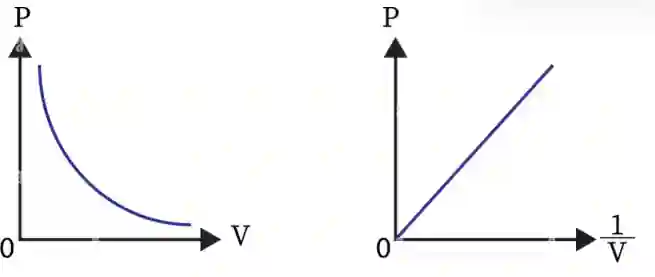

# **Thermal physics**

## Kinetic particle model of matter

### States of matter

#|
||

|

|

|

|

|

||
||

**Solid**

|

Definite shape

|

Definite volume

|

Strong forces of attractions

|

Incompressible

|

Low energy

||
||

**Liquid**

|

No definite shape

|

Definite volume

|

Forces of attractions exist

|

Incompressible

|

Medium energy

||
||

**Gas**

|

No definite shape

|

No definite volume

|

Negligible forces of attraction

|

Compressible

|

High energy

||
|#

* Solid --\> Liquid = Melting

* Liquid --\> Solid = Freezing

* Liquid --\> Gas = Evaporation/Boiling

* Gas --\> Liquid = Condensation

* Solid --\> Gas = Sublimation

* Gas --\> Solid = Deposition/Desublimation

### Particle model

#|
||

State

|

Arrangement

|

Motion

|

Separation

|

Image

||
||

**Solid**

|

Regular

|

Vibrate about their fixed positions

|

Closely/tightly packed

|

||
||

**Liquid**

|

Random

|

Slide over each other

|

Close to each other

|

||
||

**Gas**

|

Random

|

Collide randomly at high speeds

|

Far apart/Widely spaced

|

||
|#

* Intermolecular forces of attractions, distance between the particles and motion of particles affect the properties of solid, liquid and gas.

* The stronger the forces are, the closer the particles are, the more energy the particles have, and the lesser the speed is.

**Temperature and motion of particles:**

* The motion of the particles and temperature are directly proportional

* When temperature increases, particles gain kinetic energy, which increases their speed and that increases the motion and rate of frequency of collisions (E.g. vibrating vigorously, moving rapidly)

* Absolute Zero is the lowest possible temperature = -273$°C$ or 0 $K$ (Kelvin)

* At absolute zero, particles have the least kinetic energy

**Pressure and motion of gas particles:**

* Pressure is force per unit area

* Pressure of gas is produced by the random collision of gas molecules on the surface of an object.

* When the molecules collide with a surface, they bounce off, causing changes in momentum of the gas molecules due to changes in their velocity directions or momentum

* These collisions cause force over the area to be exerted on the surface of the object, as force is the rate of change in momentum

* Hence, there is pressure due to the gas

**Brownian motion:**

* The evidence for kinetic particle model of matter is the random motion of microscopic particles in a suspension

* Brownian motion: random, jerky movement of visible particles suspended in a fluid caused by the uneven, random collisions with the smaller, fast-moving, **microscopic** particles of the gas or liquid

E.g.

1. In Gas = air molecules colliding with smoke particles

2. In Liquid = water molecules colliding with pollen grains

* In conclusion, the light, fast-moving molecules collide with the heavier microscopic particles making them move in a random zigzag motion.

  

### Gases and the absolute scale of temperature

Effect on the pressure of a fixed mass of gas with an:

#|
||

Increase of temperature (at constant Volume)

|

Increase of Volume (at constant Temperature)

||
||

Particles gain K.E

|

Particles move further apart

||
||

Move faster

|

Spaces between particles increase

||
||

Rate of frequency of collisions increases

|

Rate of frequency of collisions decreases

||
||

Collisions will be harder with greater force

|

Less force exerted by colliding particles with surfaces

||
||

Total force per unit area increases

|

Smaller change in momentum

||
||

Pressure increases

|

Because pressure is inversely proportional, it decreases

||
|#

* Pressure is inversely proportional to Volume

* pV= constant

* Product of initial pressure and volume = product of final volume and pressure \<-- Use this when solving problems

* $\boxed{P_1V_1=P_2V_2}$ (for a fixed mass of a gas at constant temperature)

* Kelvin is the SI unit for temperature

* To calculate its value, use the equation:

* $\boxed{Temperature (in K) = {\theta} (in °C) + 273}$