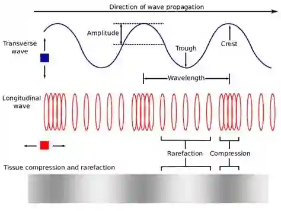
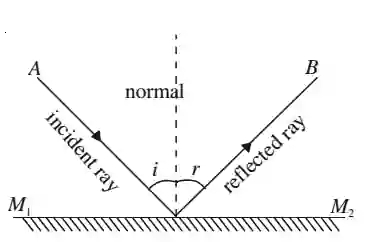
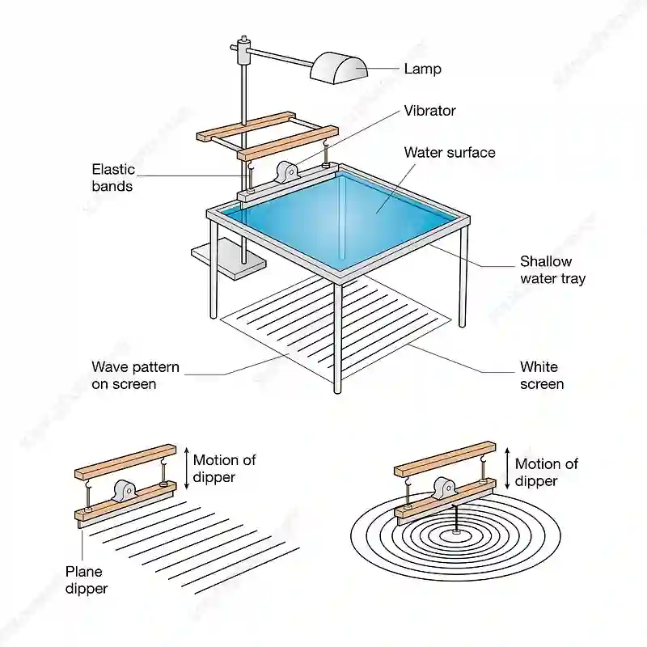

# **Waves**

## General properties of waves

* Waves are described as oscillations or vibrations about a fixed point

* Waves transfer energy without transferring matter

#|
||

|

|

||
||

**Types of waves**

|

**Transverse wave**

|

**Longitudinal wave**

||
||

**Description**

|

The direction of vibration is at right angles (perpendicular) to the direction of propagation (movement)

|

The direction of vibration is parallel to the direction of propagation (movement)

||
||

**Vacuum**

|

Electromagnetic waves can travel in a vacuum

|

Cannot travel in a vacuum because they require a material medium (particles) to transmit vibrations

||
||

**Examples**

|

Electromagnetic radiation, water waves and seismic S-waves (secondary)

|

Sound waves, and seismic P-waves (primary)

||
|#

* Period (T): time taken for one complete oscillation

* Frequency: Number of waves passing a point in a second

* $\boxed{f= \frac{1}{T}}$

* $\boxed{f= \frac{Total..number..of..waves}{Time}}$

* Wavefronts: (Picturing waves from above) A line joining points on a wave that are all in the same phase of vibration (E.g. all crests or all troughs)

* Amplitude: the maximum displacement of a wave from its rest (undisturbed) position.

* Wavelength: Distances from one point of a wave to the next point of the wave.

  1. Transverse: Distance between 2 successive crests/trough

  2. Longitudinal: Distance between 2 successive compression/rarefaction.

* Crest: Highest point of wave above its undisturbed position

* Trough: Lowest point of wave below its undisturbed position

* Wave speed: Distance travelled by a wave each second

* Compression: Area where particles are closest together. (where pressure and density are at maximum)

* Rarefaction: Area where particles are furthest apart. (where pressure and density are at minimum)

**Note:** A wavelength for a transverse wave can also be the length of one complete wave cycle (1 crest and 1 trough); similarly for a longitudinal wave, it is the length of 1 compression and 1 rarefaction

* Equation for wave speed: $\boxed{v=f{\lambda}}$

Example: A transverse wave has a wavelength of 4.0 cm and a time period of 0.020 s. Calculate the speed of wave in m/s

Answer

$\lambda = 4.0cm = 0.04m$

$f= \frac{1}{T} = f = \frac{1}{0.020} = 50Hz$

$speed = v=f\lambda = 50 . 0.04 = 2.0m/s$

### Reflection at a plane surface

* Reflection: Change in direction of a wave when it hits a plane surface

* Angle of incidence (i) = angle of reflection (r)

* Both these angles are measured form the normal

### Refraction due to change in speed

* Refraction: Change in speed of wave when the medium/depth changes

#|
||

Movement of a wave

|

Speed

|

Wavelength

|

Ray bends

|

Frequency

||
||

Less dense to a more dense medium

|

Decreases

|

Decreases

|

Towards the normal

|

Remains constant

||
||

More dense to a less dense medium

|

Increases

|

Increases

|

Away from the normal

|

Remains constant

||
|#

### Diffraction through a narrow gap

* Diffraction: Spreading of a wave as it passes through a narrow gap or past an edge

* If the gap/edge size is larger than the wavelength, then less diffraction occurs

* If gap/edge size is less than or equal to the wavelength, then more diffraction occurs

#|
||

|

||
|#

### Ripple tank

#|
||

Reflection at a plane surface

|

Refraction due to change in speed caused by a change in depth

|

Diffraction due to a gap

|

Diffraction due to an edge

||
||

Place a barrier at an angle  in the ripple tank

|

Place a glass block to make the water above it shallow

|

Place 2 barriers with some gap and make it parallel to the wavefronts

|

Place a barrier that makes an edge at the very end. It must also by parallel to the wavefront

||
||

|

|

|

||
|#

