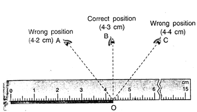
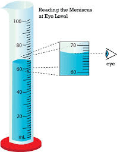
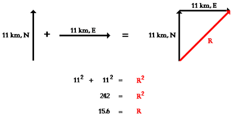
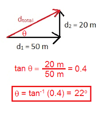

# Motion, Forces and Energy

## **Physical Quantities and Measurement Techniques**

**Units and Basic Quantities**

* A standard or unit must be chosen before a measurement can be made.

* The size of the quantity to be measured is determined using an instrument with a scale marked in the chosen unit.

* Three basic quantities measured in physics are **length**, **mass**, and **time**.

* Units for other physical quantities are derived from these basic quantities.

* The **SI (Système International d’Unités)** system is an internationally agreed set of units.

**Length**

* **SI Unit:** Metre ($\text{m}$)

* **Submultiples (smaller lengths):**

  * $1\text{ decimetre (dm)} = 10^{-1}\text{ m}$

  * $1\text{ centimetre (cm)} = 10^{-2}\text{ m}$

  * $1\text{ millimetre (mm)} = 10^{-3}\text{ m}$

  * $1\text{ micrometre } (\mu\text{m}) = 10^{-6}\text{ m}$

  * $1\text{ nanometre (nm)} = 10^{-9}\text{ m}$

* **Multiples (larger lengths):**

  * $1\text{ kilometre (km)} = 10^3\text{ m}$

  * $1\text{ gigametre (Gm)} = 10^9\text{ m}$

* Many everyday length measurements are made with a ruler or metre rule.

* A metre rule is typically used for lengths up to one metre.

* *Note:* Take positive and negative ($\pm$) uncertainty readings to improve accuracy.

**Area**

* The area of a square with sides $1\text{ cm}$ long is $1\text{ square centimetre } (1\text{ cm}^2)$.

* **Area Formula:** $\text{Area} = \text{length} \times \text{breadth}$

* **SI Unit:** Square metre ($\text{m}^2$), defined as the area of a square with $1\text{ m}$ sides.

**Volume**

* Volume represents the total amount of space occupied by an object.

* **SI Unit:** Cubic metre ($\text{m}^3$).

* **Common Unit:** Cubic centimetre ($\text{cm}^3$).

* **Volume of a Cylinder:** $V = \pi r^2 h$

* **Liquid Volume:** A measuring cylinder is used to measure liquid volume. Keep the cylinder on a flat surface and ensure your eye line is level with the bottom of the meniscus to avoid parallax error.

**Time**

* **SI Unit:** Second ($\text{s}$).

* Devices used to measure time rely on regular oscillations.

* Choose a timer with appropriate precision for the experiment (e.g., a standard stopwatch for a pendulum period, or a millisecond timer for measuring the speed of sound).

**Scalars and Vectors**

* **Scalar Quantity:** A physical quantity fully defined by **magnitude (size) only**.

  * *Examples:* Distance, speed, time, mass, pressure, energy, temperature.

* **Vector Quantity:** A physical quantity defined by both **magnitude and direction**.

  * *Examples:* Force, gravitational field strength, electric field strength, weight, velocity, acceleration, momentum.

* **Representing Vectors:** Represented visually by a straight arrow where the length indicates the magnitude and the arrowhead shows the direction.

* **Adding Scalars:** Added using standard arithmetic.

* **Adding Vectors:** Added geometrically, accounting for both magnitude and direction.

**Adding Two Perpendicular Vectors ($F_X$ and $F_Y$):**

For two force vectors acting at right angles ($90^\circ$):

* **Resultant Force Magnitude ($F$):**

  $$F = \sqrt{F_X^2 + F_Y^2}$$

* **Angle ($\theta$) between $F_X$ and the Resultant $F$:**

  $$\tan\theta = \frac{F_Y}{F_X}$$

