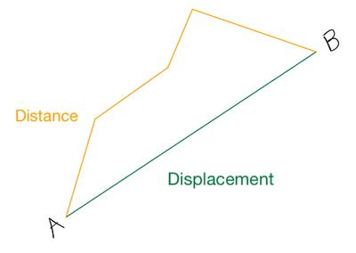
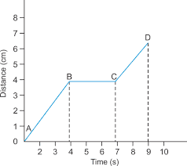
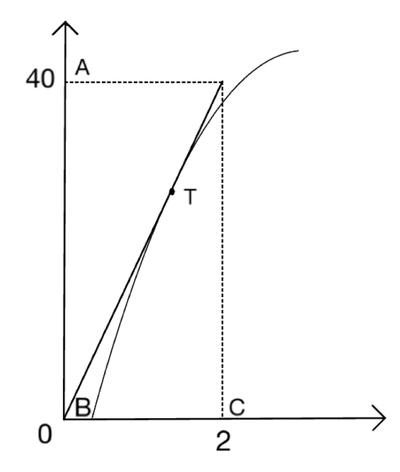
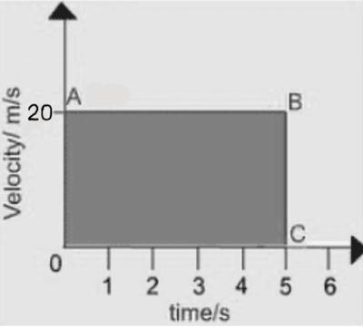
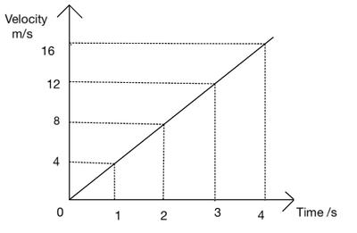
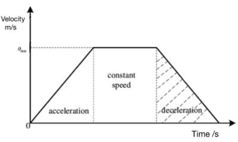
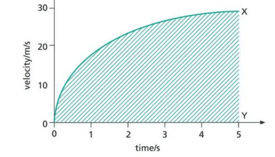
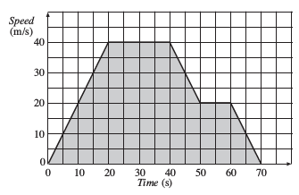
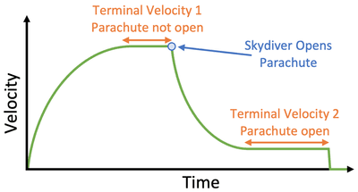

## Motion

### Distance and displacement

- Distance is a length a body travels between two points. It is a scalar quantity.
- Displacement is similar to distance but as it is a vector quantity, direction is also considered.

### Distance-Time Graph Examples

- At rest ( BC).
- Constant speed (AB and CD)
- Speed is higher when the gradient is steeper. For example, the speed of the train at CD is 2m/s, but that at AB is 1m/s. It is higher in CD, which can be seen as CD being steeper.

### Non-Constant Speed

- When speed changes, the gradient of the distance-time graph varies.
- Upward curve of increasing gradient: accelerating.
- The upward curve of decreasing gradient: decelerating.
- Example:

Gradient of the tangent at T:

$$\frac{AB}{BC} = \frac{40  \text{m}}{2 \text{s}} = 20  \text{m/s}$$

### Speed

Speed is the distance travelled by a body in unit time.

- When the distance travelled is (s) over a short time period (t), the speed (v) is given by:

$$v = \frac{s}{t}$$

- Key definition: Speed is the distance travelled per unit time.
- General formula:

$$\text{Average speed} = \frac{\text{Total distance travelled}}{\text{Total time taken}}$$

- Example: If a car travels 300 km in five hours, its average speed is: $\text{Average speed} = \frac{300 \text{ km}}{5 \text{ h}} = 60 \text{ km/h}$

### Velocity

- Velocity is the distance travelled in unit time in a given direction. Ie. Velocity = Speed given in a specific direction.
- Speed is the distance travelled in unit time.
- Example: If two trains travel due north at 20 m/s, they have the same speed and velocity due north. If one travels north and the other south, their speeds are the same, but not their velocities.
- ### Key definition: Velocity is the change in displacement per unit of time.
- Velocity formula:
  - ${\text{Velocity }=\frac{\text{Distance moved in a given direction}}{\text{Time taken} }}= \frac{Displacement} {Time}$
- Velocity is the speed in a given direction.
- A body's velocity is uniform or constant if it moves at a steady speed in a straight line.
- Velocity is not uniform if the body moves in a curved path.
- Speed and velocity units are the same: \<b\>km/h, m/s.\</b\>

Note: Speed is a scalar quantity and velocity a vector quantity. Displacement is a vector, unlike distance which is a scalar

### Acceleration

- When the velocity of an object changes, the object accelerates.
- ### Acceleration is defined as the change of velocity in unit time:

$$\text{Acceleration} = \frac{\Delta v}{\Delta t}$$

#|
||

Time (s)

|

Speed (m/s)

||
||

0

|

0

||
||

1

|

5

||
||

2

|

10

||
||

3

|

15

||
||

4

|

20

||
||

5

|

25

||
||

6

|

30

||
|#

- - Example: If a car starts from rest and reaches a velocity of 2 m/s after 1 second, its acceleration is $2 \text{m/s}^2 , \text{due north}$

- Key definition: Acceleration is the change in velocity per unit time.

- Example: For a steady increase of velocity from 20 m/s to 50 m/s in 5 seconds: $\text{Acceleration} = \frac{(50 - 20) , \text{m/s}}{5  \text{s}} = 6  \text{m/s}^2$

- Acceleration is a vector, and its magnitude and direction should be stated.

- For motion in a straight line, the magnitude of the velocity equals the speed, and the magnitude of the acceleration equals the speed change in unit time.

- Example: A car accelerating on a straight road with the following speeds:

- The speed increases by 5 m/s every second, and the acceleration is constant at 5 m/s².

- Acceleration is positive if the velocity \<b\>increases.\</b\>

- Acceleration is negative if the velocity \<b\>decreases\</b\> (also called deceleration or retardation).

### Speed-Time Graphs

- Speed-time graphs plot the speed of an object against time.
- Used to solve motion problems.

### Constant Speed

- Example: AB is a speed-time graph for an object moving with a constant speed of 25 m/s.

A straight horizontal line on a speed-time graph indicates constant speed.

### Constant Acceleration

- The linear shape (AB) of the graph indicates constant acceleration.
- The speed increases by 4 m/s every second, indicating constant acceleration.

### Variable Acceleration

### Example 1: The figure shows acceleration from rest, constant speed, and deceleration.

### Example 2: The figure shows changing acceleration with a curved shape.

- Speed increases over time, but by a smaller amount each second, indicating decreasing acceleration.

### Using Gradient to Calculate Acceleration

- The gradient of a speed-time graph represents the acceleration.
- For constant speed, the gradient is zero, indicating zero acceleration.
- For constant acceleration, the gradient is given by:

$$\text{Gradient} = \frac{\Delta y}{\Delta x} = \frac{Y_2- Y_1}{X_2- X_1}$$

- For changing acceleration, the gradient changes, indicating changing acceleration.
- An object accelerates if the speed increases and decelerates if the speed decreases with time.

### Area Under a Speed-Time Graph

- Measures the distance travelled.
- The rule applies even if acceleration is not constant.
- The distance equals the shaded area under the graph.

### Equations for constant acceleration

- ### First Equation

  - If an object is moving with constant acceleration ( a ) in a straight line and its speed increases from ( u ) to ( v ) in time ( t ):
  - Acceleration is given by:

$$a = \frac{v - u}{t}$$

- - Rearranging gives:

$$v = u + at \quad \text{(Equation 1)}$$

- ### Second Equation

  - For an object moving with constant acceleration, its average speed equals half the sum of its initial and final speeds:

$$\text{Average speed} = \frac{u + v}{2}$$

- - If (s) is the distance moved in time (t), then:

$$\text{Average speed} = \frac{s}{t}$$

- - Combining these, we get

$$\frac{s}{t} = \frac{u + v}{2}$$

- - Rearranging gives:

$$s = \frac{(u + v)}{2} \cdot t \quad \text{(Equation 2)}$$

### Air Resistance and Free Fall

- In the air, a coin falls faster than a small piece of paper due to air resistance.
- In a vacuum, both fall at the same rate.
- Air resistance has a greater effect on light bodies compared to heavy bodies.
- Air resistance is negligible for dense, heavy objects at low speeds.

### Acceleration of Free Fall

- All bodies falling freely under gravity accelerate uniformly if air resistance is negligible.
- This uniform acceleration is called the acceleration of free fall, denoted by ( g ).
- The value of (g) varies slightly but is about 9.8 m/s² on average.
- The velocity of a free-falling body increases by about 9.8m/s every second.

### A ball shot upwards with a velocity of 30 m/s decelerates by about 9.8 m/s every second, reaching its highest point after 3 seconds.

As an object falls, air resistance increases, reducing its acceleration.

- When air resistance equals the object's weight, it falls at a terminal velocity.
- Terminal velocity depends on the object's size, shape, and weight.
- A small, dense object has a high terminal velocity and accelerates for a longer distance.
- A light object or one with a large surface area, like a raindrop or parachute, has a low terminal velocity and accelerates over a shorter distance.
- Following is the velocity-time graph for a falling parachutist:

### Explanation:

- **Initial Phase:** When the parachutist jumps out of the plane, they experience free fall. During this phase, their velocity increases steadily due to the acceleration of gravity (approximately $9.8 \text{m/s}^2$ acting downwards. The graph slopes upwards steeply.
- **Slowing down of Parachute:** Air resistance increases significantly when the parachutist deploys their parachute. This causes a decrease in acceleration, leading to a less steep slope on the graph. The parachutist’s velocity continues to increase but at a slower rate compared to free fall.
- **Terminal Velocity:** As the parachutist continues to fall, their velocity eventually reaches a maximum constant value known as terminal velocity. At terminal velocity, the forces of gravity and air resistance (drag) balance out, resulting in zero net acceleration. On the velocity-time graph, this appears as a horizontal line where the velocity remains constant.