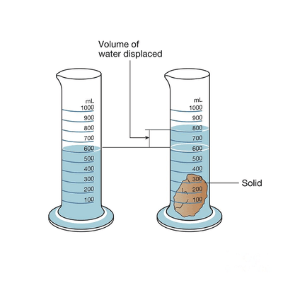
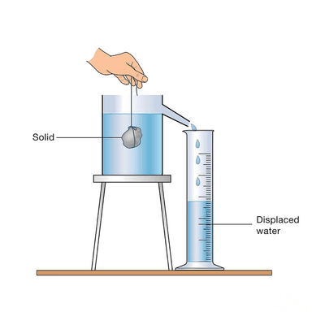

## Density

**Definition**

* Density $ (\rho $)  is the measure of mass per unit volume

$\rho = \frac{m}{V}$

* Standard units for density include kilograms per cubic meter (kg/m³) or grams per cubic centimeter (g/cm³).

**Calculation Methods**

* **Regular Shape**: Measure mass $(m)$ using a balance, and measure volume ($V $) by direct measurement of dimensions.
* **Irregular Shape**: Measure mass $(m)$ using a balance. Measure volume $(V)$ using displacement methods:

**Method 1:** Immerse the object in a measuring cylinder filled with water, record the initial and final water levels to find volume.

 

**Method 2:** __Displacement Can. Fill the can until the spout. Immerse the object in the water and find the volume of water displaced. That volume of water is the volume of the object.__

 

* **Liquid**: To determine the mass of an empty container, add liquid, measure total mass, and subtract to find the mass of the liquid. Divide by the known volume to find density.
* **Air**: Measure the mass of a flask filled with air, then remove the air with a vacuum pump. Calculate air density by dividing the mass difference by volume measured using water displacement.

**Example Calculations**

* **Example 1**: Calculate the density of copper given a mass of 63 g and a volume of 7 cm³ $\rho = \frac{m}{V} = \frac{63 \text{ g}}{7 \text{ cm}³} = 9 \text{ g/cm}³$
* **Example 2**: Determine the mass of an aluminium sheet with a volume of 73 cm³ and a density of 2.7 g/cm³

  $m = \rho \times V = 2.7 \text{ g/cm}³ \times 73 \text{ cm}³ = 197.1 \text{ g}$

**Floating and Sinking**:

* Objects float or sink in liquids based on their density relative to the liquid's density. A higher-density object sinks in a lower-density liquid and vice versa.

