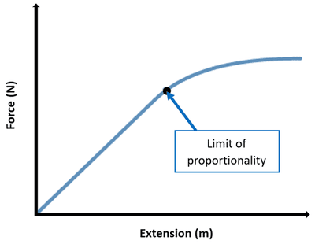
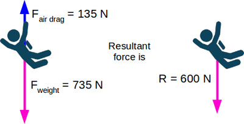
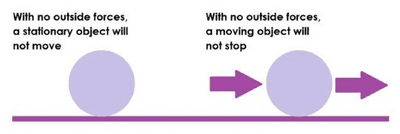
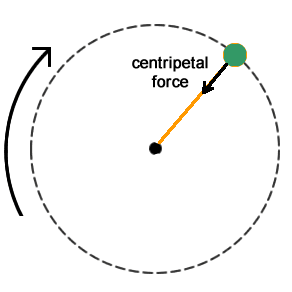
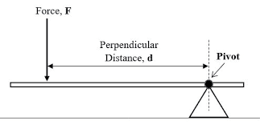
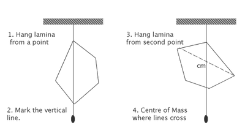
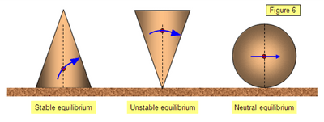

## Forces

**Force**

* A force is a push or a pull that can change the motion, speed, or shape of an object.
* It can cause objects at rest to move or alter the direction of moving objects.

**Extension in Springs**

* Springs follow Hooke's Law, where extension is proportional to the stretching force up to the limit of proportionality.
* Symbolically, $\text{extension} \propto \text{stretching force}$

**Spring Constant**

* The spring constant $(k)$ measures the force needed to cause a unit extension in a spring.

  $k = \frac{F}{x}$,  where $(F)$ is the force applied and $(x)$ is the resulting extension.

**Load-Extension Graphs**

* Used to graphically represent the relationship between applied force (load) and resulting extension in materials like springs.
* Non-linear graphs beyond the limit of proportionality indicate permanent deformation.

**Forces and Resultants**

* Forces have magnitude and direction, represented by arrows in diagrams.
* Multiple forces acting on an object can be balanced (e.g. weight and support force) or have a resultant force.
* The resultant force is the single force that has the same effect as all forces acting together.
* A resultant force can change the velocity of an object by altering its speed or direction of motion.

**Newton’s First Law**

* An object remains at rest or continues to move at a constant speed in a straight line unless acted upon by a resultant force.
* This means that no force is required to maintain constant velocity if no external forces act on the object.

**Friction and Air Resistance**

* Forces like friction and air resistance cause objects to slow down and eventually come to rest.
* In their absence, objects would continue moving indefinitely with constant speed.

**Newton’s Second Law**

* States that the acceleration of an object is directly proportional to the force acting on it and inversely proportional to its mass.

* Mathematically expressed as:

  $F = ma $

  where ($F $) is the resultant force in newtons ($N$),  ($m $) is the mass in kilograms ($kg$), and ($a$) is the acceleration in meters per second squared $(m/s^2)$.

**Proportional Relationships**

* Acceleration ($a$) is directly proportional to the force ($F$) when mass ($m$) is constant

  $a \propto F$

* Acceleration ($a$) is inversely proportional to mass  $(m$) when force ($F$ ) is constant

  $a \propto \frac{1}{m}$

**Units and Constant** $(k$**)**

* The unit of force, the newton ($N$), is defined as the force that gives a 1 kg mass an acceleration of $1m/s^2$
* $k$ in $F = kma$ equals 1 when $m = 1 kg$ and a = 1 $m/s^2$

**Resultant Force and Motion**

* Resultant force ($F$ ) causes an object to accelerate in the direction of the force.
* When forces are balanced, there is no acceleration, but changes in shape may occur due to internal forces within the object.

**Friction**

* Friction is the force that opposes the motion of one surface over another.
* It is essential for walking and gripping surfaces but can prevent proper movement on surfaces like ice.

**Types of Friction**

* Static Friction: The frictional force that opposes the starting of motion between surfaces in contact.
* Kinetic Friction: The frictional force that opposes the motion of surfaces sliding past each other.
* Fluid Friction (Drag): Resistance encountered by an object moving through a fluid (air or liquid), increasing with speed and reducing acceleration.

**Effect of Force and Mass on Friction**

* Increasing the force pressing surfaces together increases friction initially.
* Friction converts kinetic energy into thermal energy, causing a rise in temperature when contacting surfaces.

**Centripetal Force**

* In a circular motion, an object moves in a curved path due to a force directed towards the centre of the circle.

**Acceleration in Circular Motion**

* Despite constant speed, circular motion involves acceleration because velocity direction changes continuously.
* Acceleration towards the centre of the circle is necessary to maintain circular motion.

**Factors Affecting Centripetal Force**

Centripetal force magnitude depends on the following:

* **Speed** $(v)$**:** Increasing speed increases centripetal force.
* **Radius** $(r)$**:** Decreasing radius increases centripetal force.
* **Mass** $(m)$**:** Increasing mass increases centripetal force.

**Role of Centripetal Force**

* It ensures the object maintains a constant distance from the centre of the circle.

**Moment of a Force**

* The turning effect of a force around a pivot point is called the moment of the force.

* It depends on both the magnitude of the force and the perpendicular distance from the pivot to the line of action of the force.

* Mathematically, the moment is given by:

  $M = F \times d$

  where $d$ is the perpendicular distance from the pivot to the line of action of the force.

* The unit of moment is the Newton metre $(Nm)$.

**Balancing a Beam and the Law of Equilibrium**

* To balance a beam around a pivot point, the principle of moments (or law of moments) is used.
* The law states that for a beam in equilibrium, the sum of clockwise moments about any point equals the sum of anticlockwise moments about the same point.
* This principle is essential for designing and understanding the equilibrium of lever systems and other balanced structures.

**Conditions for Equilibrium**

An object is in equilibrium if:

* The sum of all forces acting on it equals zero (static equilibrium).
* The sum of all moments (clockwise and anticlockwise) around any point is zero (rotational equilibrium).

**Centre of Gravity**

* The centre of gravity (or centre of mass) of an object is the point through which the entire weight of the object acts.
* It behaves as if all the mass were concentrated at this single point.
* For a uniform object, such as a ruler, the centre of gravity is at its geometric centre.

**Determining the Centre of Gravity**

* Finding the centre of gravity of an irregularly shaped lamina involves suspending the object from different points and using a plumb line to mark the vertical line through which it hangs. The centre of gravity is where these lines intersect.

**Stability and Toppling**

* The stability of an object depends on the position of its centre of gravity relative to its base.
* An object is stable if its centre of gravity remains over its base of support.
* Toppling occurs when the vertical line through the centre of gravity falls outside the base of support.
* Increasing the base area and lowering the centre of gravity improves stability.

**Types of Equilibrium**

* **Stable Equilibrium:** An object returns to its original position when displaced slightly (e.g., a ball in a bowl).
* **Unstable Equilibrium:** An object moves further away from its original position when displaced slightly (e.g., a ruler balanced on its edge).
* **Neutral Equilibrium:** An object remains in its new position when displaced (e.g., a ball sitting on a flat surface).

**Momentum**

* Momentum ($p%=$) is the product of an object's mass ($m$) and its velocity ($v$).
* Mathematically, $p = mv$
* It is a vector quantity, meaning it has both magnitude and direction.
* The SI unit of momentum is kilogram metre per second $(kgm/s)$ or newton second $(Ns)$.

**Conservation of Momentum**

* The total momentum of a closed system of objects remains constant if no external forces act on it (such as friction or air resistance).

* This principle is known as the conservation of momentum.

* Momentum is conserved in collisions (both elastic and inelastic) and explosions. For example, in a collision, the total momentum before and after the collision remains the same.

  $$
  p_{\text{initial}}=p_{\text{final}}
  $$

  **Example:**

  A trolley of mass $m_1 = 3$ kg moving with velocity $u_1 = 5$ m/s collides and couples with a stationary trolley of mass $m_2 = 2$ kg. They move off together with the same velocity $(v).$ We need to find $(v)$.

  1. **Calculate initial momentum** $( p_{\text{initial}})$**:**

     $p_{\text{initial}} = m_1 \cdot u_1 = 3 \text{ kg} \cdot 5 \text{ m/s} = 15 \text{ kgm/s}$

  2. **Calculate final momentum (**$p_{\text{final}})$**:**

     Since they move off together with velocity $(v)$:

     $p_{\text{final}} = (m_1 + m_2) \cdot v = (3 \text{ kg} + 2 \text{ kg}) \cdot v = 5 \text{ kg} \cdot v$

  3. **Apply conservation of momentum** $(p_{\text{initial}} = p_{\text{final}})$**:**

     $15 \text{ kgm/s} = 5 \text{ kg} \cdot v$

  4. **Solve for** $(v)$**:**

     $v = \frac{15 \text{ kgm/s}}{5 \text{ kg}} = 3 \text{ m/s}$

  So, the velocity $(v $) of the two trolleys moving together after the collision is $\boxed{3 \text{ m/s}}$

**Impulse**

* Impulse ($ J$) is the change in momentum $( \Delta p) $ of an object when a force acts on it over a period of time $( \Delta t )$.
* Mathematically, $ J = F \Delta t = \Delta p $
* Impulse is also a vector quantity and has the same direction as the force causing it.

**Force and Momentum:**

* Relation of force to the rate of change of momentum:
  * $( F = \frac{\Delta p}{\Delta t} )$, which is an alternative form of Newton's second law.