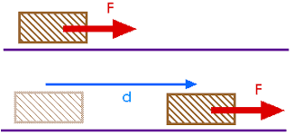
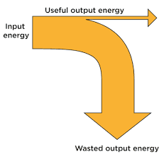

## Energy, work and power

**Types of energy stores**

* **Chemical Energy:** Energy stored in chemical bonds of substances like food, fuels (oil, gas, coal, wood).
* **Gravitational Potential Energy:** Energy an object possesses due to its position relative to a reference point (usually the Earth's surface).
* **Elastic Strain Energy:** Energy stored in an object when it is compressed, stretched, or deformed.
* **Kinetic Energy:** Energy possessed by a moving object.
* **Electrostatic Energy:** Energy stored in charged objects due to their separation in an electric field.
* **Nuclear Energy:** Energy stored in the nucleus of an atom..
* **Internal (Thermal) Energy:** Total energy stored in the microscopic motions and interactions of particles within a substance.

**Energy Transfers**

* **Mechanical Working:** Transfer of energy by the action of a force, like lifting a weight.
* **Electrical Working:** Transfer of energy by an electric current, such as in batteries or electric motors.
* **Waves (Electromagnetic and Sound):** Transfer of energy through waves, like light or sound waves.
* **Heating:** Transfer of energy through thermal processes, like heating water in a boiler.

**Principle of Conservation of Energy**

* Energy cannot be created or destroyed, only transformed from one form to another. Thus the total amount of energy is constant.

**Energy Forms**

* **Kinetic Energy** $(E_k)$:  Energy possessed by an object due to its motion.
  * $E_k = \frac{1}{2} mv^2$, where $(m)$ is mass and $( v )$ is velocity.
* **Example Calculation:** For a football of mass 0.4 kg moving at 20 m/s:
  * $E_k = \frac{1}{2} \times 0.4 \times (20)^2 = 80 \text{ J}$
* **Potential Energy** $(E_p)$:Energy an object has due to its position or condition or configuration.
  * $E_p = mgh$ , where $ (m)$ is mass, ($g $) is acceleration due to gravity, and ($h$) is height.
* **Example Calculation:** For a 0.1 kg mass raised vertically by 1 m:
  * $E_p = 0.1 \times 9.8 \times 1 = 0.98 \text{ J}$

**Work**

* Work ($W$) is done when a force ($F$) displaces a body through a distance ($d$) in the direction of the force.
* **Formula:** $W = F \cdot d$
* **Unit:** The unit of work is the joule (J), where $1 \text{ J} = 1 \text{ N} \cdot \text{m}$

**Example Calculation**

* If a force of 50 N is used to move a crate 3 m horizontally:

  $W = 50 \text{ N} \times 3 \text{ m} = 150 \text{ J}$

* If lifting a mass of 3 kg vertically by 2 m (where  g $\approx 10 \text{ m/s}^2$):

  $W = 30 \text{ N} \times 2 \text{ m} = 60 \text{ J}$

**Energy resources**

#|
||

Energy Type

|

Renewable or Non-renewable

|

Advantages

|

Disadvantages

||
||

Fossil Fuels

|

Non-renewable

|

High energy density, readily available during peak demand.

|

Limited supply, environmental pollution (CO2, SO2), finite resource.

||
||

Nuclear Fuels

|

Non-renewable

|

High energy output, low CO2 emissions.

|

Radioactive waste disposal issues, potential for accidents (e.g., Chernobyl, Fukushima).

||
||

Solar Energy

|

Renewable

|

Abundant, no emissions during operation, diverse applications.

|

Intermittent availability, high initial costs for large-scale installations.

||
||

Wind Energy

|

Renewable

|

Clean energy source, abundant in suitable locations.

|

Visual and noise impacts, intermittent nature of wind.

||
||

Wave Energy

|

Renewable

|

Renewable, predictable in coastal areas with consistent waves.

|

Technologically challenging, potential environmental impacts.

||
||

Tidal Energy

|

Renewable

|

Predictable and consistent, minimal greenhouse gas emissions.

|

High infrastructure costs, environmental impacts on marine ecosystems.

||
||

Hydroelectric Energy

|

Renewable

|

Reliable, long operational life, minimal greenhouse gas emissions.

|

Disruption of aquatic ecosystems, potential displacement of communities, limited suitable sites.

||
||

Geothermal Energy

|

Renewable

|

Reliable, low emissions, constant energy source.

|

Limited to geologically active areas, high upfront costs for exploration and drilling.

||
||

Biofuels

|

Renewable

|

Renewable, lower emissions compared to fossil fuels.

|

Competition with food production, land use issues, varying energy content.

||
|#

**How Fossil Fuels are used in Power Stations**

* **Coal:** In coal-fired power stations, coal is burned in a boiler to produce heat.
* **Natural Gas:** In gas-fired power stations, natural gas is burned directly in a gas turbine.
* The heat generated from burning these fuels is used to boil water, creating high-pressure steam.
* The steam drives turbines connected to electrical generators.
* Turbines are designed with sets of blades (rotor) mounted on a shaft, which rotates when steam is directed onto them.
* As steam expands through the turbine, its energy is transferred to the rotor, causing it to spin.
* The spinning rotor generates electricity through electromagnetic induction in the generator.

**How hydroelectric power stations work**

* They run using the kinetic energy generated from the flow of water moving downstream.
* The kinetic energy of moving water spins turbines which are connected to generators.
* These generators then produce electricity that can be used by households.

**How Nuclear Fuels (uranium) are used in Power Stations**

* Nuclear power stations use controlled nuclear fission reactions with uranium  to generate heat.
* This heat is used to produce steam indirectly through a heat exchanger.
* The steam, similar to fossil fuel stations, drives turbines connected to generators to produce electricity.
* The operation involves the steam passing through a turbine's fixed blades (stator) onto the rotating blades (rotor), where the expansion of steam energy is converted into rotational motion.
* The rotational motion of the rotor then drives the electrical generator, producing electricity for consumption.

**How geothermal power stations work**

* Geothermal power stations are built in areas where high volcanic or tectonic activity causes the rocks deep underground to reach extremely high temperatures due to nearby magma.

* A shaft is drilled at these sites to reach the hot rocks underground.

* Cold water is pumped down the injection pipe, where high temperatures turn the water into steam.

* The steam rises to the surface through the steam pipe and is used to turn a turbine.

* The turbine rotates a generator, which produces electricity.

* The steam is passed through a cooling tower to condense it back into water to be reused.

* Energy change in this process: $\text{Thermal energy}$ $\rightarrow$ $\text{Kinetic energy}$ $\rightarrow$ $\text{Electrical energy}$

**Power**

* The power of a device is the work it does per second, or the rate at which it does work.

* Power also represents the rate at which energy is transferred from one store to another.

* Formula:

  * $\text{power} = \frac{\text{work done}}{\text{time taken}}$
  * $P =$ $\frac{W}{t}$ where $W$ is the work done in time $t$
  * $P =$ $\frac{\Delta E}{t}$ where $\Delta E$ is the energy transferred in time $t$

* **Key definition:** Power is the work done per unit time and the energy transferred per unit time.

* Unit of power: watt $(W)$, where 1 $W$ = 1 $J/s$

* Larger units:

  * 1 $kW$ = 1000 $W$ = $10^3$ $W$
  * 1 $MW$ = 1,000,000 $W$ = $10^6$ $W$

* Example: If a machine does 500 $J$ of work in 10 $s$, its power is:

  $\frac{500 \text{J}}{10 \text{s}} = 50  {W}$

**Efficiency**

* % Efficiency formula for energy

$\text{Efficiency}$ (%) = $\left\( \frac{\text{Useful Energy Output}}{\text{Total Energy Input}} \right\)$ $\times 100%$

* % Efficiency formula for power

$\text{Efficiency}$ (%) = $\left\( \frac{\text{Useful Power Output}}{\text{Total Power Input}} \right\)$ $\times 100%$

**Example a: Electric Motor**

* **Given:**

Energy input = 400 J

Work done on load = 300 J

**Calculate Efficiency:**

$\text{Efficiency} = \left\( \frac{300 \text{ J}}{400 \text{ J}} \right\) \times 100$ = 75%

**Example b: Electric Drill**

* **Given:**

Power input to drill = 300 J/s

Useful power output (excluding thermal losses) = 200 J/s

* **Calculate Efficiency:**

$\text{Efficiency} = \left\( \frac{200 \text{ J/s}}{300 \text{ J/s}} \right\) \times 100% = \frac{2}{3} \times 100$ = 66.67%

**Sankey Diagrams**

* Sankey diagrams are used to represent energy transfers and efficiencies visually.
* They show how input energy is divided into useful output energy and wasted energy.
* The width of the arrows in a Sankey diagram is proportional to the amount of energy they represent.
* A wide arrow represents a large amount of energy, while a narrow arrow represents a small amount.

