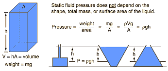

## Pressure

* Pressure is the force per unit area.
* Formula:

  $\text{pressure} = \frac{\text{force}}{\text{area}}$
* **Key definition:** Pressure is the force per unit area.
* Unit of pressure: pascal $(Pa)$, where 1 $Pa$ = 1 $N/m²$
* Greater area over which a force acts results in less pressure.

**Liquid Pressure**

* Pressure in a liquid increases with depth because the further down you go, the greater the weight of liquid above.
* Pressure at one depth acts equally in all directions.
* Pressure depends on the density of the liquid; the denser the liquid, the greater the pressure at any given depth.
* The change in pressure $\Delta p$ at a depth $\Delta h$  below the surface of a liquid with density $\rho$ is determined by considering a horizontal area $A$.
* Force acting vertically downwards on area  $A$ equals the weight of the liquid column of height $\Delta h$ and cross-sectional area $A$ above it.
* Volume of the liquid column: $\Delta h A$
* Mass of the liquid column: $m$ $=$ $\rho \Delta h A$  $(mass = density × volume)$
* Weight of the liquid column: $mg = \rho \Delta h A g$
* Force on area  $A$: $\rho \Delta h A g$
* Pressure due to the liquid column:

  $\text{pressure}$ = $\frac{\text{force}}{\text{area}}$

  $\frac{\rho \Delta h A g}{A} = \rho g \Delta h$
* Formula: $\Delta p = \rho g \Delta h$
* $\Delta p$ is the change in pressure beneath the surface of the liquid at depth $\Delta h$ due to the weight of a liquid of density $\rho$
  * $g$ is the gravitational field strength
  * This pressure acts equally in all directions at depth $\Delta h$ and depends only on $\Delta h$ and $\rho$.
* Value will be in pascals ($Pa$) if $\Delta h$ = is in meters $(m)$ and $( \rho )$ is in kilograms per cubic meter $(kg/m³).$

   