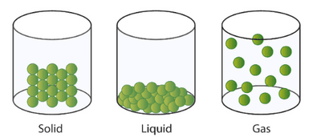
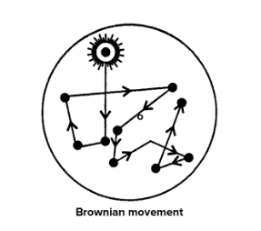
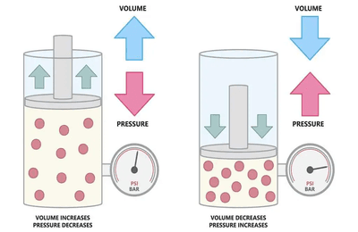

# Thermal Physics

## Kinetic Particle Model of Matter

<b>States of Matter</b>

- Matter consists of tiny particles like molecules and atoms.
- Matter exists as solids, liquids, or gases, each with different characteristics.
- Solids have a definite shape and volume, and particles are close together in fixed positions.
- Liquids have a definite volume and take the shape of their container. The particles are further apart and can slide over each other.
- Gases have no definite shape or volume, and particles move much further apart and freely.

<b>Brownian Motion</b>

- Describes random motion of particles in fluids (liquids and gases) and is caused by collisions with smaller, faster-moving particles.

<b>Temperature and kinetic energy</b>

- Particles in solids vibrate in fixed positions at room temperature.
- Heating solids increases particle vibrations, raising their average kinetic energy.
- Cooling a solid reduces particle vibrations until absolute zero (-273°C or 0 K) stops all motion.
- Absolute zero is the lowest possible temperature achievable.

<b>Pressure and Kinetic Energy</b>

- Gases have particles moving randomly at high speeds.
- Each gas particle collision with a container wall changes its momentum, creating a force.
- The average force per unit area on container walls remains constant at a constant temperature.
- Increasing temperature raises collision frequency, increasing average force and gas pressure.

<b>Effect on Pressure of a Change in Temperature (Constant Volume)</b>

- Heating a gas increases the kinetic energy of its particles.
- Higher kinetic energy leads to more frequent and energetic collisions with the container walls.
- Increased collisions result in higher pressure according to a gas law:

( PV = nRT )

<b>Effect on Pressure of a Change in Volume (Constant Temperature)</b>

- Reducing the volume of a gas increases the concentration of particles.
- More particles per unit volume lead to more collisions with the container walls.
- The pressure increases proportionally to the decrease in volume:

<b>Variations in Gas Pressure with Volume</b>

- Boyle's Law states that at constant temperature, the product of pressure and volume is constant:

$$( p_1 V_1 = p_2 V_2 )$$

- Graphing pressure ( p ) against the reciprocal of volume $( \frac{1}{V} )$ gives a straight line.

<b>Absolute Zero and Kelvin Temperature Scale:</b>

- Absolute zero, at −273°C or 0 K, is the lowest possible temperature.
- Kelvin scale temperatures are derived by adding 273 to Celsius temperatures: $( T (\text{K}) = \theta (\text{°C}) + 273 )$
- In the Kelvin scale, all temperatures are always positive and directly proportional to the average kinetic energy of particles.