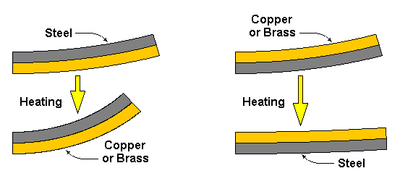
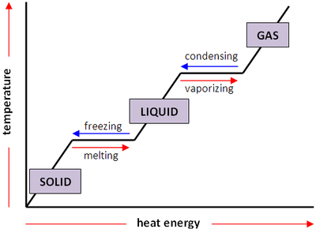

## Thermal properties and temperature

**Thermal expansion of solids, liquids and gases**

* Solids and Liquids: When heated, particles vibrate more, causing them to push apart slightly, resulting in expansion.
* Gases: Heating increases particle speed and collisions with container walls, which causes container expansion to maintain pressure.

**Applications**

* Bimetallic Strips: Made from metals with different expansion rates (e.g., copper and iron). Used in:
  * Fire Alarms: Bends to complete an electrical circuit when exposed to heat, triggering alarms.
  * Thermostats: Maintains temperature by bending to break or complete electrical circuits

 

* Shrink-fitting: Cooling components contracts them, fitting tightly into other parts upon warming. Used in manufacturing for tight connections without fasteners.
* Lid Removal: Expanding metal lids with hot water loosens them from glass jars, leading to easier opening.

**Precautions**

* Expansion joints are spaces left between rail tracks used in railways, and pipes to allow for thermal expansion without damage

**Internal Energy and Heating**

* Internal energy increases when an object is heated.
* Different materials require varying amounts of heat to raise their temperatures due to differences in specific heat capacity.
* Specific heat capacity $( c )$ measures the amount of heat required to raise the temperature of a substance by 1 degree Celsius per unit mass.

**Temperature and Thermal Energy**

* Temperature is related to the average kinetic energy of particles.
* Thermal energy is the total energy of particles in a substance, and more particles can hold more total thermal energy even if they have lower individual particle energies.

**Heat Transfer and Equilibrium**

* Heat transfers from higher to lower temperature bodies until thermal equilibrium is reached.
* This transfer is caused by collisions between particles, making their average kinetic energies equal.

**Specific Heat Capacity**

* Specific heat capacity ($c$) is defined as the energy required per unit mass per unit temperature increase, measured in joules per kilogram per degree Celsius $(\text{J/(kg°C})$
* The formula relating heat energy ($\Delta E$), mass $(m)$, specific heat capacity $(c)$, and temperature change $(\Delta \theta) $ is: \n $\Delta E = mc\Delta \theta$
* Specific heat capacity quantifies how much heat energy is needed to raise the temperature of a substance. Materials with higher specific heat capacities require more heat energy per unit mass to achieve the same temperature change.

**Worked Example Calculation**

**Given:**

* Heat energy supplied, $(\Delta E = 20000 , \text{J} )$
* Mass of the substance, $( m = 5 , \text{kg} )$
* Temperature change, $( \Delta \theta = 10°C )$
* Calculate the specific heat capacity $(c )$ of the substance.

**Formula:**

* The specific heat capacity (( c )) is given by:

  $ c = \frac{\Delta E}{m \Delta \theta}$

**Substituting the given values:**

$c = \frac{20000}{5    \times 10}$

**Calculation:**

* $c = \frac{20000 }{50  }$
* $c = 400  \text{J/(kg°C)}$

**Change of State**

* Heating can change a solid to a liquid (melting) and a liquid to a solid (freezing).
* Pure substances melt and freeze at specific temperatures, such as water at 0°C.
* Melting involves particles of a solid overcoming intermolecular forces to become a liquid.
* Solidification (freezing) involves the transfer of potential energy from particles to surroundings as a liquid becomes solid.
* Vaporisation requires substantial energy to overcome intermolecular forces in a liquid to become gas (vapour).
* Condensation involves gas particles losing potential energy to their surroundings as they return to a liquid state.

 

**Evaporation**

* Higher temperatures, larger surface areas, and wind or draughts increase the rate of evaporation.
* Energy is transferred to the surroundings from the liquid during evaporation, cooling the liquid.
* Evaporation cools the body through sweat, helping to maintain a constant temperature.

**Differences between boiling and evaporation**

| **Feature** | **Boiling** | **Evaporation** |
|----|----|----|
| **Temperature** | Occurs at a specific boiling temperature. | Occurs at any temperature below the boiling point. |
| **Process** | Bubbles of vapour form within the liquid. | Occurs at the surface of the liquid. |
| **Energy Requirement** | Requires sufficient heat to reach boiling point. | Requires less heat and occurs due to energetic particles escaping. |
| **Speed** | Rapid compared to evaporation. | Slower compared to boiling. |
| **Throughout Liquid?** | Happens throughout the entire volume of the liquid. | Happens only at the liquid's surface. |

