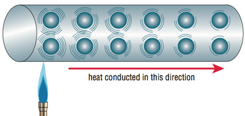
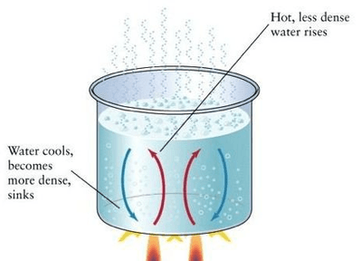
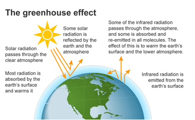

## Transfer of thermal energy

<b>Conduction</b>

- Conduction is heat transfer through matter from hot to cold without moving matter.
- Metals conduct heat well (e.g., copper, aluminum); insulators (wood, plastic) are poor conductors.
- Metals feel colder due to rapid heat transfer from the hand compared to insulators at the same temperature.
- Liquids and gases conduct heat slowly because the particles are further apart and need time to transfer energy to each other.
- Metals transfer heat via fast-moving delocalized (free) electrons, raising temperatures in cooler areas and lattice vibrations.
- Non-metals transfer heat through slower atomic or molecular vibrations, lacking delocalized (free) electrons.

<b>Convection</b>

- Heat transfer method in fluids like liquids and gases.
- Transfer of thermal energy by movement of the matter itself.

<b>Convection Currents</b>

- Warm fluids rise because they expand and become less dense.
- Cooler, denser fluids sink and replace the rising warm fluid.

This movement of fluids due to temperature differences is known as a convection current.

<b>Radiation</b>

- A method of thermal energy transfer which occurs without matter, even in vacuum.
- Emits as electromagnetic waves, travels at speed of light.

<b>Absorption and Reflection</b>

- Surfaces vary in radiation absorption.
- Black surfaces absorb more than shiny white ones.

<b>Emission</b>

|Surface Type|Absorption of Radiation|Emission of Radiation|Reflectivity|
|:---|:---|:---|:---|
|Shiny White|Poor absorber|Poor emitter|High|
|Dull Black|Good absorber|Good emitter|Low|

- Surfaces emit radiation differently when hot.
- Dull black surfaces emit more than shiny surfaces.
- All bodies emit radiation above absolute zero.

<b>Greenhouse effect</b>

- Greenhouse gases trap heat similar to glass in a greenhouse.
- Balance between incoming solar radiation and emitted Earth radiation crucial for climate stability.
- Increased carbon dioxide and methane upset this balance and absorb more infrared which cannot escape.

